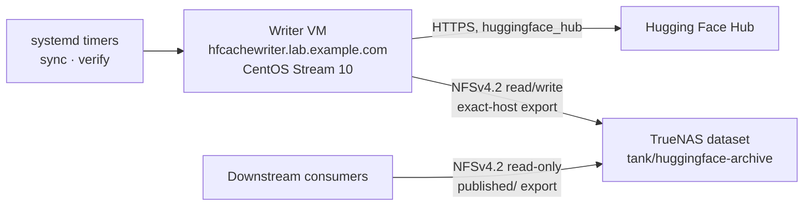

# hfcache Architecture

| Field | Value |
| --- | --- |
| Status | Normative contract for implementation |
| Derived from | `docs/plan.md` §1–§6, §13–§19, §25 |
| Work packages | `ARC-001`, `ARC-002`, `ARC-006`, `ARC-008` |
| Schema baseline | All durable formats begin at `schema_version = 1` |

This document is the architectural contract the implementation is written
against. Where it uses **must**, **must not**, **never**, and **only**, the
statement is a testable requirement; each such requirement carries a stable
identifier (`AD-nn`, `NG-nn`, `FS-nn`, `TX-nn`, `FW-nn`) that source comments,
tests, and review notes cite directly.

Companion contracts: `docs/configuration.md` (configuration schema),
`docs/schemas.md` (durable JSON schemas), `docs/cli.md` (command surface, JSON
output, exit codes), `docs/security.md` (threat model and controls).

The current cross-contract invariant register is `docs/invariants.md`;
individual decision records and their history are indexed by
`docs/adr/README.md`. New or changed invariants and architectural choices are
recorded there in the same work package as the change or plan implementation
(`docs/agents/workflow.md`). This document remains the detailed architectural
contract.

## 1. Mission

`hfcache` archives **complete revisions of Hugging Face model and dataset
repositories** at resolved immutable commit SHAs onto long-term TrueNAS storage,
and publishes them as immutable ordinary-file trees that downstream systems copy
over a server-enforced read-only NFS export. Public repositories work anonymously;
private and gated repositories require the explicit authenticated scope in
`AD-21`.

The unit of value is a **repository-complete revision**: every file present in
the upstream repository at one resolved commit SHA, locally SHA-256 verified,
described by a durable manifest, and reachable through an atomically replaced
reference. A revision is either completely published and verifiable, or it is not
visible to consumers at all. There is no partial state in between.

## 2. System context



Exactly one host mutates the archive. The writer resolves a configured reference
to an immutable commit SHA, downloads the complete snapshot into a private Hub
cache that lives on the archive dataset, hashes newly introduced content,
publishes an immutable tree by hardlinking cache blobs into a staging directory
and atomically renaming it into place, and then atomically replaces the reference
consumers read.

Consumers mount only the `published/` subtree, read one small JSON reference,
copy the exact immutable tree it names, and verify the copy against the manifest
it names. Consumers never point `HF_HOME` or `HF_HUB_CACHE` at the archive and
never depend on the Hugging Face cache symlink layout.

### 2.1 Trust and authority boundaries

| Boundary | Authority | Enforcement |
| --- | --- | --- |
| Hub → writer | Untrusted content, trusted transport | TLS verification always on; repository content is never executed, imported, or unpickled |
| Writer → archive | Sole mutating authority | TrueNAS export restricted to the writer's exact `/32`, Mapall to `hfcache-sync:hfcache-archive` |
| Archive → consumers | Read-only | Server-side read-only export of `published/`, Mapall to `hfcache-read:hfcache-archive` |
| Operator → writer | Configuration and lifecycle | Root-owned configuration and unit files; unprivileged service identity |

A downstream consumer is not trusted to be well-behaved, but is also not able to
damage the archive: read-only enforcement is server-side, not advisory.
Every principal allowed onto that consumer export is nevertheless inside the
repository-content authorization boundary: the archive has one publication tree,
not per-repository ACLs, so a consumer allowed to read it must be authorized to
receive every configured public, private, and gated repository.

### 2.2 Transport-neutral services (API-002/API-003)

`services/context.py` carries immutable execution/result records, independent
of transport frameworks. `services/queries.py` owns local metadata orchestration
for version, configuration-validation payloads, initialization inspection,
status, inventory, verification estimates, and identity-based existing evidence
reads. `services/commands.py` owns typed command orchestration: credential
resolution for Hub commands, selection, guards, reconciliation, invocation of
existing domain algorithms, classified results and exact durable run identity.
The CLI keeps argument parsing, bootstrap configuration loading and rendering.
The narrow metadata interface exposes no commands, Hub client, credential
resolver, or writable helper. Future transports must reuse
these services rather than invoke CLI callbacks (decision 108, INV-012).

Status includes configured repositories in configuration order, followed by
unmanaged published repositories in canonical identity order. Explicit selectors
restrict that union; a repository absent from both is HFARG004. Inventory comes
from references/manifests, independently of the derived repository catalog.
Verification confidence is keyed by exact publication instance (decision 62).
Metadata queries take no archive lock and do not rebuild state. Consumers must
handle a publication disappearing between separate reads, as required by FS-12.

Public command services acquire the common archive lock once; adapters and
future operation runners must not wrap them in a second acquisition. Domain
helpers invoked inside that ownership do not acquire service locks. Sync keeps
its download producer joined before the service releases the lock (AD-19).
All non-estimate verification modes hold lock-before-storage-preflight through
target resolution, hashing, report persistence and catalog read/merge/write.
Atomic JSON replacement protects readers, not competing merges (decision 110).
Probe-enabled doctor and confirmed initialization also hold the common lock;
they run their own diagnostic/initialization checks because requiring an existing
valid sentinel before inspecting or creating one would contradict their purpose.
Read-only doctor, initialization inspection/no-confirm, plans and previews take
no archive lock. Verification does not reconcile or contact the Hub.

## 3. Architecture decisions

Each decision is locked for schema version 1. Changing one is a deliberate
versioned change, not an implementation detail.

### AD-01 — The archive unit is a complete snapshot at one resolved commit SHA

**Decision.** Every archived artifact is the full file set of one repository at
one full 40-character commit SHA, resolved before download and used explicitly in
every Hub call.

**Rationale.** A commit SHA is the only identifier the Hub guarantees to be
immutable. Branch and tag names move; downloading by name races against upstream
force-pushes and yields a tree that cannot be described by a stable manifest.

**Consequences.** Reproducible content without Git history. A manifest can state
exactly what a revision contains. Two syncs that resolve the same SHA are
idempotent by construction.

**Rejected.** Mirroring Git history (`NG-01`), which multiplies storage and
complexity for a use case that only ever reads one tree at a time.

### AD-02 — The first sync preserves the latest observed revision; there is no backfill

**Decision.** The first successful sync of a repository publishes the head of the
configured reference at that moment. Commits that occurred before the first
observation are never retrieved.

**Rationale.** The product contract is a rolling archive of what the system
observed, not a historical reconstruction. Backfill would require Git history
(`AD-01`, `NG-01`).

**Consequences.** The archive's oldest revision is the first one observed.
Intermediate commits between scheduled runs are legitimately skipped (`AD-03`).

### AD-03 — Subsequent revisions are whatever each scheduled run observes

**Decision.** Each run resolves the configured reference again. If the SHA is new,
it is published as an additional revision. Commits that appeared and were
superseded between two runs are not recovered.

**Rationale.** The value is having *a* recent complete revision plus recent
history depth, not every commit. Catching every commit would require either
polling far more aggressively or reading Git history.

**Consequences.** Retention depth is measured in observations, not commits.
Operators tune depth by tuning the timer, and the plan documents this explicitly.

### AD-04 — Retention defaults to three unique published revisions per repository

**Decision.** Each repository retains at most `storage.maximum_revisions` unique
commit SHAs: three by default, with five supported explicitly. A successfully
published revision beyond that limit prunes the oldest eligible revision. The
current revision is never pruned.

**Rationale.** Bounded, predictable storage with enough depth to roll back a bad
upstream change. Three is the operator-requested default; explicit five-revision
policies remain valid so upgrading does not invalidate existing configuration.

**RET-010 amendment (2026-09-14, decision 102).** The original decision fixed
five in schema version 1. Accepting three and five and defaulting to three is a
deliberate compatibility widening of configuration; no archive JSON format
changes. Rollback to an older binary requires an explicit five-revision policy
(`docs/configuration.md` §4).

**Consequences.** Ordering must be immutable and independent of clocks
(`AD-05`). Pruning is a transaction that can fail without destroying data
(`TX-06`).

### AD-05 — Retention order comes from an immutable publication generation, never from time

**Decision.** Each unique SHA receives a monotonic per-repository integer
`publication_generation` when it is *first* published. Retention ordering uses
only that integer. Wall-clock time, file mtimes, directory mtimes, and upstream
commit timestamps are never used to order revisions.

**Rationale.** Clocks are wrong across restores, replicas, and snapshot rollbacks;
NFS mtimes are not a durable identity signal. An integer assigned once under the
global lock is stable across every recovery path.

**Consequences.** Repairing a SHA preserves its generation and therefore its
retention position (`AD-13`). Crash-induced gaps in the sequence are valid; two
distinct SHAs may never share a generation. Generation allocation reads the union
of retained manifests and pruned-revision records so a prune-then-crash cannot
reissue a value.

**DOC-009 conformance finding (2026-10-17).** These are the declared
`AD-05` / `FS-20` requirements. The current allocator reads retained
references only, and a regression test assigns a fresh generation when a
pruned SHA returns. Pending `RET-011` in `docs/progress.md` records this
existing contract/implementation gap; `docs/adr/ad-05.md` preserves the
decision and evidence. This finding does not weaken the requirement or
change runtime behaviour.

### AD-06 — Upstream disappearance never deletes local content

**Decision.** A `403`, `404`, deleted repository, gated repository, network
failure, or removal of the repository from configuration marks state and reports
it, and deletes nothing.

**Rationale.** The archive exists precisely for the case where upstream is gone.
An availability error is the moment the archive matters most; it must never be
the trigger that empties it.

**Consequences.** Automatic retention follows *successful publication* of a
new revision, never an error path or a configuration edit alone. An explicit
reviewed `prune` may enforce a lowered retention limit (§7.4); permanent removal
of an unmanaged repository requires the separate `purge` workflow (`AD-20`).

**DOC-009 clarification (2026-10-17, decision 106).** This consequence now
names the existing explicit deletion paths from `PUR-001` and `RET-010`
(decisions 96 and 102); preservation on upstream failure is unchanged.

### AD-07 — Dependencies are detected statically and warned about, never resolved

**Decision.** Base models, adapters, and similar transitive dependencies are
detected by reading known static metadata only, reported as non-fatal warnings,
and recorded in the manifest. They are never downloaded implicitly.

**Rationale.** Implicit recursive downloads make storage unbounded and turn one
configured repository into an unpredictable dependency graph. Detecting a
dependency by *executing* repository code would violate `AD-15`.

**Consequences.** An undeclared dependency yields warning `HFDEP001`, marks the
repository `completed_with_warnings`, and leaves the exit code at `0` when
nothing else failed. Archiving a dependency is an explicit configuration act.

### AD-08 — Hub access is the official Python client only

**Decision.** All Hub interaction goes through `huggingface_hub` Python APIs
behind a narrow injectable adapter. The application never invokes `hf`, `git`,
`git-lfs`, or `git-xet` as subprocesses.

**Rationale.** Subprocess orchestration converts typed results into scraped text,
hides failures, and couples the archive to CLI output formats. An injectable
adapter also makes the whole ingestion path testable without network access.

**Consequences.** Cache inspection and cache deletion use the supported public
cache APIs; blob paths are never derived by parsing cache directory names
(`FS-10`). Tests use deterministic fakes rather than mocking library internals.

### AD-09 — The native Hub cache on the archive dataset is the canonical download store

**Decision.** `snapshot_download()` writes into `<archive>/.store/hub`, on the
same ZFS dataset as the publication tree. It is private to the writer and is
never exposed to consumers.

**Rationale.** The native cache gives resumable transfers and revision-level
deduplication for free. Putting it on the same dataset is what makes hardlink
publication possible (`AD-11`).

**Consequences.** The cache is operational state, not the archive product. It may
be pruned through supported APIs at any time; the published hardlink trees are
what preserve the bytes.

### AD-10 — Consumers receive an immutable ordinary-file publication tree

**Decision.** Published revisions are ordinary files and directories laid out
with the repository's own relative paths, under a per-publication immutable
directory. Consumers resolve one JSON reference and copy that tree.

**Rationale.** The Hugging Face cache layout is an internal implementation detail
built on symlinks into a blob store. Copying it over NFS is fragile and couples
every consumer to a private format.

**Consequences.** A publication instance directory is immutable once renamed into
place (`FS-05`). Consumers need no Hugging Face software to consume the archive.

### AD-11 — Publication hardlinks within the dataset; copy mode is explicit and never a silent fallback

**Decision.** `publication_mode = "hardlink"` is the default and links cache blobs
into the publication tree. `publication_mode = "copy"` duplicates bytes and must
be selected deliberately after a capacity review. If hardlinks are unavailable
and copy mode was not configured, sync **fails before downloading**.

**Rationale.** Hardlinks give consumers an ordinary-file tree at zero additional
storage. A silent fallback to copying would multiply storage without warning and
could fill the dataset mid-run.

**Consequences.** `doctor` proves hardlink, atomic-rename, and atomic-ref
capability against the real dataset before the capability is relied upon. The
application never `chmod`s a hardlinked file, because that would mutate the
shared cache inode; read access is granted by directory mode and the export.

### AD-12 — Durable state is JSON on the filesystem; there is no database

**Decision.** Manifests, references, catalog, run reports, verification reports,
and transaction journals are versioned JSON files written atomically. There is no
SQLite or other mutable database on NFS.

**Rationale.** A single-writer archive whose authority is the filesystem can be
recovered by reading the filesystem. Databases on NFS add locking failure modes
and a second source of truth that can disagree with the tree.

**Consequences.** The catalog is *derived*, never authoritative: it can always be
rebuilt from immutable manifests and references. Recovery reads durable evidence
rather than replaying a log of intentions.

### AD-13 — Repair replaces a damaged instance without changing what the revision *is*

**Decision.** `repair` re-downloads the same immutable SHA into an isolated,
transaction-scoped cache, verifies every file against the **original** manifest,
and publishes a new instance under a new publication ID while preserving the
SHA's original `publication_generation`. Expected digests are never rewritten to
match newly observed bytes.

**Rationale.** Corruption must not be able to launder itself into the expected
value. The manifest is the evidence; a repair either reproduces it exactly or
fails loudly.

**Consequences.** A superseded instance stays readable at its original locator for
a seven-day grace period so an in-flight consumer copy can finish. Repair is
verification-gated at both ends: against the original manifest before publication
and against the new tree before any reference moves.

### AD-14 — Every mutation is bounded by an atomic filesystem operation and a durable checkpoint

**Decision.** Sync, publication, prune (including purge), repair, and recovery
advance only through atomic `rename(2)` operations on the same filesystem, each
recorded as an append-only checkpoint in a transaction journal after the
operation is durable.

**Rationale.** Crash safety cannot rest on the process finishing. It must rest on
each intermediate on-disk state being unambiguous and forward-recoverable.

**Consequences.** Every state a crash can leave behind is enumerated (`TX-01`
onward) and has exactly one correct resolution. When state is ambiguous, the
application stops and reports rather than guessing (`AD-16`).

### AD-15 — Repository content is data, never code

**Decision.** The application never executes, imports, unpickles, or instantiates
repository content, never sets `trust_remote_code`, and never follows a path that
resolves outside its approved roots.

**Rationale.** The archive ingests arbitrary third-party content from a public
Hub. Treating any of it as executable would make the writer's storage authority
reachable by whoever last pushed to an upstream repository.

**Consequences.** Dependency detection is limited to parsing known static
metadata (`AD-07`). Repository paths are validated for containment, spelling, and
regular-file type before any link or copy.

### AD-16 — Ambiguity stops the machine; it never triggers a guess

**Decision.** Unknown files, unknown journal schema versions, impossible
checkpoint combinations, inconsistent manifests, and ambiguous reference state
are reported and preserved. They are never deleted, rewritten, or resolved by
heuristic.

**Rationale.** Every automatic guess in a storage system is a potential silent
data loss. An operator reading a precise report loses minutes; an incorrect
automatic repair can lose a revision permanently.

**Consequences.** Recovery is roll-forward oriented and idempotent. When two
resolutions are both defensible, the application prefers over-retention to
deletion.

### AD-17 — One writer; locking is local

**Decision.** Exactly one host has read/write access, enforced by the export's
exact-host restriction. Mutual exclusion between `sync`, `verify`, `prune`,
`purge`, `repair`, `recover`, quarantine apply, probing `doctor`, and confirmed
initialization is a local exclusive lock under `/run/hfcache`. All non-estimate
verification modes hold it from target resolution through report/catalog
persistence; the storage preflight runs after acquisition (decision 110).

**Rationale.** With a single writer, local locking is sufficient and correct.
Distributed locking over NFS is a well-known source of subtle failure and buys
nothing here.

**Consequences.** No leader election, no distributed coordination, no lock files
on NFS. A second writer host is a design change, not a configuration change.

### AD-18 — Ingestion verification hashes bytes; it does not trust identifiers

**Decision.** Every newly introduced unique physical object is read and SHA-256
hashed locally before publication. A previously computed digest is reused only
when the object is proven to be the same physical inode as an already-verified
retained publication with the same size.

Within the same ingestion operation, the digest just computed may be carried
through hardlink staging without reading the bytes a second time only when the
source still has the exact `(device, inode, size)` identity observed by that
hash and the staged destination is proven to be that same object. This is not
cross-run digest reuse: the manifest still records `hashed = true`, because the
operation read the bytes itself.

**Rationale.** A cache path, an mtime, a prior-run inode number, an upstream Git
SHA-1, or an opaque Xet identifier describes *provenance*, not the bytes
currently on disk. Only reading the bytes proves the bytes.

**Consequences.** Upstream-supplied digests are recorded as additional comparison
values, never as substitutes. A hash or completeness failure prevents
publication; it never becomes the new expected value. Hardlink publication
proves object identity rather than re-hashing an inode whose bytes this same
operation already read; copy publication still hashes the distinct landed
object and compares it with the first-pass digest.

### AD-19 — Download ahead with one bounded producer

**Decision.** When repository-error continuation is enabled, resolve and
estimate the selected queue before transferring bytes, admit its aggregate
capacity requirement, and use one background repository-download producer while
the main thread hashes and publishes completed snapshots in configuration order.
The producer passes the existing `sync.max_workers` budget into its one active
Hub transfer. It is drained before the whole-run archive lock is released.
Strict stop-on-error runs remain fully serial.

**Rationale.** Local SHA-256 reads can occupy the NFS path for many hours while
leaving WAN bandwidth idle. One producer overlaps those independent resources
without multiplying Xet's internal concurrency or creating a second archive
writer. Planning and aggregate admission before the first transfer prevent a
queue from knowingly exceeding the configured reserve.

**Consequences.** Multiple ordinary publication transactions may wait at
`download_completed`; existing per-transaction recovery handles them
independently and the canonical Hub cache remains resumable. Publication,
retention generations, results, and final errors stay deterministic in
configuration order. No worker may outlive the archive lock. Running several
repository transfers concurrently is a separate resource-model change and is
not implied by `max_workers`. Hub-cache mutation and retention's whole-cache
scan are process-serialized, and queue-ahead retention is deferred until every
downloaded snapshot has been consumed. Copy-mode publication also rechecks
capacity and holds the allocation guard while writing, so its distinct-inode
copy cannot race a download for space; hardlink staging needs no such pause.
On an unexpected foreground exception, work that has not started is cancelled
and the sole active transfer is joined before the exception releases the lock;
the command never drains the untouched remainder merely because it is stopping.

### AD-20 — Repository removal is explicit, unmanaged, and transactional

**Decision.** Configuration removal and upstream disappearance still preserve
every local byte (`AD-06`). Permanent removal is a separate operator command,
`purge`, which accepts only repositories already absent from configuration and
requires exactly one of `--dry-run` or `--apply`. A broad invocation must say
`--all-unmanaged`; an empty argument list never means all.

**Rationale.** Long-lived archives need an intentional way to release content
whose retention is no longer wanted, but making configuration edits destructive
would turn a typo, partial deployment, or upstream failure into data loss. The
separate command makes deletion visible, reviewable, and journalled.

**Consequences.** Purge validates the complete shallow repository layout against
retained references and immutable manifests before mutation. Any unexpected
entry refuses the whole repository (`HFRET001`, `FS-19`). Cache revisions are
removed only through `huggingface_hub`; references and revision trees are
tombstoned before manifests; the existing prune commit point and recovery rule
apply. Original manifests and one reason record per removed revision remain in
`audit/pruned/`. Audit metadata is not archive content and is never purged.

### AD-21 — Restricted Hub scope is explicit and shares one consumer boundary

**Decision.** `hub.token_mode = "required"` is the sole opt-in for private and
gated repositories. It must resolve an explicit `--token-file` or systemd
credential before any Hub request; that credential is passed to every Hub call.
`disabled` and `optional` remain public-only even when `optional` finds a token,
so installing a credential cannot silently widen repository scope. Restricted
content is published through the same immutable ordinary-file tree as public
content, and every consumer of that tree must be inside the same authorization
boundary as the credential owner.

**Rationale.** The deployment is a private network with one internal consumer
boundary. Within that boundary, refusing bytes the configured service account is
authorized to retrieve prevents the archive from serving its actual mission.
The mode must still be explicit: a token installed for identity checks or rate
limits is not consent to retain and redistribute every repository it can see.

**Consequences.** A missing required credential is `HFARG008` at exit `10`.
`HFHUB006` remains the public-scope refusal for `disabled` and `optional`; under
`required`, a gate the credential has not accepted is an access failure
(`HFHUB005`). Hub revocation or repository removal stops future resolution but
never deletes an already published revision (`AD-06`); an operator who must
remove retained restricted content removes the repository from configuration and
uses the explicit `purge --dry-run` / `purge --apply` workflow (`AD-20`). No
durable JSON shape changes: access scope is configuration intent already covered
by the configuration fingerprint.

**Rejected.** Allowing restricted content whenever `optional` happens to find a
token, because deployment state would change archive scope. Per-repository
credentials or publication ACLs, because this deployment has one internal
consumer boundary and those mechanisms would claim isolation the export does not
provide. Automatic deletion on access revocation, because upstream state is not
authority to destroy local archive data (`AD-06`, `FS-19`).

## 4. Non-goals

These are deliberately out of scope for version 1. Each is a bounded decision
with a stated reason, not an oversight.

| ID | Non-goal | Reason |
| --- | --- | --- |
| `NG-01` | Git history, all branches, all tags, PRs, discussions, issues | The archive unit is one resolved tree (`AD-01`) |
| `NG-02` | Backfilling commits between observations | Follows from `AD-02`/`AD-03`; would require `NG-01` |
| `NG-03` | Materializing dataset payloads hosted outside the Hub repository | Not part of repository completeness; unbounded and unverifiable |
| `NG-04` | Guaranteeing a runnable software environment, dependency set, or image | Different product; the archive stores repository content |
| `NG-05` | Automatic download of base models, adapters, tokenizers, or other transitive dependencies | `AD-07` |
| `NG-06` | Gated or private repositories (retired) | Superseded by `AD-21`; retained here as the historical scope identifier |
| `NG-07` | Spaces, Storage Buckets, arbitrary Git repositories | Different resolution, layout, and completeness semantics |
| `NG-08` | Serving models to inference engines | The archive is storage, not a runtime |
| `NG-09` | Running models, importing modules, unpickling, `trust_remote_code` | `AD-15` |
| `NG-10` | Multiple concurrent writers or distributed leader election | `AD-17` |
| `NG-11` | Running on the TrueNAS host operating system | Storage appliances are not application hosts; the writer is a dedicated VM |
| `NG-12` | A workflow engine, state-machine framework, or Pydantic AI in version 1 | `FW-01` |

Non-goals are not permanent bans. `NG-06` was retired by `HUB-010`
(2026-08-23, decision 98) without a durable-schema redesign: the existing
`token_mode`, `credential_name`, and `expected_account` configuration supports
the explicit restricted scope in `AD-21`. `disabled` and `optional` remain
public-only. This paragraph was reconciled with that amendment at `DOC-009`
(2026-10-17, decision 106).

*Amended 2026-08-23 at `HUB-010` (`AD-21`).* That expected extension is now
implemented: `required` enables authenticated private/gated scope, while the
other modes retain the original public-only behavior. `NG-06` is retired.

## 5. Filesystem layout

One dedicated ZFS dataset holds cache blobs, staging directories, hardlinked
publications, manifests, and atomic renames, so every atomic operation stays
within a single filesystem.

### 5.1 Archive tree

```text
/srv/hfcache/                                    0750  root of the archive dataset
├── .hfcache-root                                0640  sentinel: archive identity
├── .store/                                      0700  private to the writer
│   ├── hub/                                           canonical huggingface_hub cache
│   │   ├── models--<org>--<repo>/
│   │   └── datasets--<org>--<repo>/
│   ├── health/                                        preflight probe area
│   │   └── probe-<probe-id>/
│   ├── quarantine/                                    preserved evidence, operator-released
│   │   └── <transaction-id>/
│   ├── repair/                                        transaction-scoped isolated caches
│   │   └── <transaction-id>/hub/
│   ├── staging/                                       publication trees under construction
│   │   └── <transaction-id>/
│   │       ├── tree/
│   │       └── manifest.json
│   ├── transactions/                                  durable journals
│   │   └── <transaction-id>.json
│   └── trash/                                         prune tombstones, pre-cleanup
│       └── <transaction-id>/
│           ├── tree/
│           └── manifest.json
├── published/                                   2750  the only consumer-visible subtree
│   ├── repos/
│   │   ├── models/<org>/<repo>/
│   │   │   ├── refs/
│   │   │   │   ├── current.json                       which revision consumers should take
│   │   │   │   └── revisions/<sha>.json               active instance for each retained SHA
│   │   │   └── revisions/<sha>/<publication-id>/      immutable repository tree
│   │   └── datasets/<org>/<repo>/                     identical shape
│   ├── manifests/
│   │   ├── models/<org>/<repo>/<sha>/<publication-id>.json
│   │   └── datasets/<org>/<repo>/<sha>/<publication-id>.json
│   └── catalog/
│       ├── repositories.json                          derived index of retained state
│       └── verification.json                          derived archive health summary
├── audit/                                       0700  provenance that outlives the data
│   ├── pruned/<type>/<org>/<repo>/<sha>/
│   │   ├── <publication-id>.manifest.json             byte-for-byte original manifest
│   │   └── <publication-id>.prune.json                why, when, and under which transaction
│   └── repairs/<type>/<org>/<repo>/<sha>/
│       ├── <publication-id>.manifest.json             retired instance's original manifest
│       └── <publication-id>.retirement.json           repair provenance and grace expiry
└── runs/                                        0700
    └── <YYYYMMDD>T<HHMMSS>Z-<run-id>.json             one report per invocation
```

Writer-local paths, none of which hold archive content:

```text
/opt/hfcache/                  root-owned releases and locked virtual environments
/etc/hfcache/config.toml       root-owned, service-readable configuration
/srv/hfcache/                  the NFS mount point (root-owned when unmounted)
/var/cache/hfcache/xet/        disposable hf_xet transfer cache
/var/lib/hfcache/              local operational state, including HF_HOME
/run/hfcache/                  process locks and transient run state
```

### 5.2 Ownership and modes

Modes below are what the writer creates with `UMask=0027` against a dataset whose
root and `published/` are pre-owned by the NAS-side identity.

| Path | Owner:group | Mode | Reason |
| --- | --- | --- | --- |
| Archive root | `hfcache-sync:hfcache-archive` | `0750` | Writer-only; the read identity enters through `published/` |
| `.hfcache-root` | mapped writer identity | `0640` | Readable to the group, writable only by the writer |
| `.store`, `audit`, `runs` | mapped writer identity | `0700` | Cache, journals, staging, provenance, and reports are not consumer data |
| `published` | `hfcache-sync:hfcache-archive` | `2750` setgid | Group-traversable for the read identity; setgid keeps the group on everything created beneath |
| Directories under `published` | mapped writer identity | `2750` | Inherited setgid plus `UMask=0027` |
| Files under `published` | mapped writer identity | `0640` | `UMask=0027`; read access for the export identity, no write |

Published **files** are never `chmod`ed by the application. In hardlink mode a
published file and its cache blob are the same inode, so changing the mode of one
changes both (`AD-11`). Read-only for consumers is enforced by the server-side
export, not by file mode.

A published tree's **root directory** is the exception, and it has to be. "Inherited
setgid" above is true of the directories *under* a published tree and false of the
tree itself: that root is created in `.store/staging/<txn>/`, which is `0700` and
has no setgid to inherit, and it reaches `published/` by a rename — which does not
change a mode. So the only moment its mode can be set is at creation, and
`publication.create_staging` sets it with `mkdir` **followed by an explicit
`chmod`**. The `chmod` is not redundant with `mkdir`'s mode argument: POSIX does
not guarantee `mkdir` honours setgid there, and this NFSv4 server does not — `mkdir`
alone yields `0750`, `mkdir`+`chmod` yields `2750` (`docs/progress.md` decision 66).
Removing it would drop the group the read identity depends on, silently, and the
failure would appear on a consumer host rather than this one.

Because the writer export maps every client identity to
`hfcache-sync:hfcache-archive`, files on the mount appear owned by NAS-side ids
with no local account on the writer. Writability is therefore proven by a real
create/fsync/rename/delete probe under `.store/health/`, never by comparing the
local service uid against `st_uid`.

### 5.3 Path grammar

| Element | Grammar | Notes |
| --- | --- | --- |
| `<type>` | `models` \| `datasets` | Plural on disk; the configuration and API use the singular `model` \| `dataset` |
| `<org>` | Hub namespace segment | Preserved exactly, including case |
| `<repo>` | Hub repository-name segment | Preserved exactly, including case |
| `<sha>` | `[0-9a-f]{40}` | The full resolved commit SHA, lowercase; abbreviations are never written to disk |
| `<publication-id>` | `[0-9a-f]{32}` | Random UUID4 hex; opaque and carries no ordering |
| `<transaction-id>` | `[0-9a-f]{32}` | Random UUID4 hex |
| `<run-id>` | `[0-9a-f]{32}` | Random UUID4 hex |
| `<probe-id>` | `[0-9a-f]{16}` | Random hex, unique per preflight |

A repository identifier is exactly two segments, `<org>/<repo>`. Single-segment
canonical identifiers are rejected with a configuration error; every canonical
Hub repository now has a namespaced form (`gpt2` → `openai-community/gpt2`) and
requiring it keeps the on-disk layout unambiguous.

Both segments must match `[A-Za-z0-9][A-Za-z0-9._-]*`, must not be `.` or `..`,
and must not exceed 96 characters. This is validated at configuration load, before
any network or filesystem access.

Ordering within any generated JSON array of repositories, files, or revisions is
deterministic: byte-wise ascending on the relative POSIX path or on
`(type, id, generation)` as applicable. Two runs over identical state produce
byte-identical output. Byte-wise on `(type, id)` is not the same as ordering by
`(type, namespace, name)` — `-` sorts before `/`, so `a-b/x` precedes `a/b-x` —
and the whole identifier is what orders.

#### Repository-relative file paths

The paths *inside* a repository come from upstream and are hostile input
(`docs/security.md` T-02). Each is validated before anything is linked, copied,
or written at it:

| Rule | Reason |
| --- | --- |
| Non-empty, no leading `/` | An absolute path is not a location in this tree |
| No `.`, `..`, or empty component | Traversal, and `a//b` naming the same file as `a/b` |
| No trailing `/` | A file entry that names a directory |
| No C0 control character, DEL, or NUL | Unrepresentable, and a log-injection vector |
| No backslash | A path separator on a consumer platform, where `a\..\..\b` traverses |
| Component at most 255 bytes | `NAME_MAX` |
| Whole path at most 1024 bytes | Keeps every derived absolute path far inside `PATH_MAX` |

The line is drawn at what can **escape**, not at what is merely awkward
elsewhere: a trailing space or a name like `CON` is left alone, because this
application does not get to decide what a repository may call its files.

Two entries that fold to the same key — NFC normalization plus full case folding
— are rejected rather than published. The archive dataset is case-sensitive and
does not normalize, so both spellings would survive here; a consumer copying to
APFS or NTFS would silently merge them and hold a tree that no longer matches the
manifest it verified against. The fold is deliberately a little stricter than any
single filesystem's rule, because refusing a pair of names is visible and
recoverable while silently merging two files is neither (`AD-16`).

## 6. Filesystem invariants

These hold at every instant an external observer could look, including
immediately after a crash. Each is directly testable.

### Identity and location

- **`FS-01`** — `.hfcache-root` contains the archive's identity as versioned JSON,
  including a UUID that must equal the configured `storage.archive_id`.
- **`FS-02`** — Before any mutating command proceeds, the archive root must be
  proven to be a mount point distinct from its parent, of an NFS/NFSv4 filesystem
  type, mounted read/write.
- **`FS-03`** — A mismatch between the sentinel UUID and the configured
  `archive_id` is fatal. It is never repaired, regenerated, or ignored.
- **`FS-04`** — `.store/staging` and every destination it is renamed into are on
  the same filesystem as the archive root, so publication is always a `rename(2)`
  and never a cross-device copy.

### Immutability

- **`FS-05`** — A publication instance directory
  `published/repos/<type>/<org>/<repo>/revisions/<sha>/<publication-id>/` is
  immutable once it has been renamed into place. The application never adds,
  removes, modifies, or re-modes a file inside it. It is only ever renamed away
  wholesale, to trash or quarantine.
- **`FS-06`** — A published manifest is immutable. Expected sizes and digests are
  never rewritten to match a later observation (`AD-13`, `AD-18`).
- **`FS-07`** — A repaired instance receives a new `<publication-id>` and a new
  manifest that copies the original expected path/size/digest set exactly and
  records `repair_of`. The original manifest is preserved byte-for-byte.

### References

- **`FS-08`** — `refs/current.json` and `refs/revisions/<sha>.json` are small
  versioned objects naming a full commit SHA, publication generation, publication
  ID, and the exact archive-relative tree and manifest paths. They are replaced by
  atomic rename, never edited in place, never appended to.
- **`FS-09`** — Every path inside a durable artifact is relative and is validated
  to remain under its root after normalization. A path field containing an
  absolute path, a `..` segment, or a symlink component is invalid. The root is
  the archive root for every artifact except a reference, whose `tree` and
  `manifest` are relative to `published/` — the directory a consumer actually
  mounts, and therefore the only base that resolves on the reader's side
  (`docs/schemas.md` §4.1).
- **`FS-10`** — Every reference that exists names a publication instance
  directory and a manifest that both exist and are complete. A reference is
  written only after both of its targets are durable.
- **`FS-11`** — `refs/revisions/<sha>.json` exists for exactly the set of SHAs the
  repository currently retains. `refs/current.json` names one of them.
- **`FS-12`** — A consumer that reads `refs/current.json` once and copies the tree
  it names either succeeds, or observes a failure it can retry by rereading the
  reference. It never silently copies a mixture of two revisions.

### Cache and blobs

- **`FS-13`** — Cache blob paths are obtained only through supported
  `huggingface_hub` cache-inspection APIs. The application never parses cache
  directory names to infer a blob location.
- **`FS-14`** — Cache content is deleted only through supported `huggingface_hub`
  cache-management APIs. No cache blob under `.store/hub` is ever removed by a
  direct filesystem call. A transaction-scoped repair cache under
  `.store/repair/<transaction-id>/hub` is application-owned scratch and is removed
  wholesale after its bytes are durable in a publication; this is the single
  documented exception and it never touches `.store/hub`.
- **`FS-15`** — Every source resolved for publication is verified to be contained
  by the operation's approved cache root — `.store/hub` for normal ingestion, one
  `.store/repair/<transaction-id>/hub` for repair — and to be a regular file.
  Devices, sockets, FIFOs, dangling links, and paths escaping the root are
  rejected. Hardlink staging additionally proves after link creation that the
  destination has the exact `(device, inode, size)` identity observed by this
  operation's hash. A mismatch removes the unproven staging entry and stops
  before publication; this transient identity is never written to a manifest or
  journal.

### Derived state

- **`FS-16`** — `published/catalog/*.json` is derived. It can always be rebuilt
  from immutable manifests plus references, and disagreement between the catalog
  and that authority is resolved in favour of manifests and references.

### Transactions and unknown data

- **`FS-17`** — Every sync, publication, prune, purge, repair, and recovery mutation has
  a durable transaction journal under `.store/transactions/` whose checkpoints are
  appended only after the operation they describe is durable.
- **`FS-18`** — Staging, trash, quarantine, and repair directories are named by
  transaction ID. A directory in these areas is only ever acted upon when it
  matches that naming contract, has a journal, and exceeds the configured age.
  Explicit operator cancellation of proven empty staging may substitute
  confirmed writer termination for the age heuristic (§7.8.2).
- **`FS-19`** — Files and directories the application does not recognise are
  reported and preserved. Nothing outside the application's own naming contracts
  is deleted, moved, or rewritten (`AD-16`).
- **`FS-20`** — Each unique SHA has exactly one `publication_generation` for the
  life of the repository. Generations are allocated from the union of retained
  manifests and `audit/pruned/` records, are never reused, and may contain gaps
  left by crashes.

### Initialization

- **`FS-21`** — `hfcache archive init` is the only way to create the sentinel and
  the top-level directories. It is an explicit operator action, never reached from
  a timer, a sync, or an automatic recovery path.
- **`FS-22`** — Initialization refuses a target that is not the expected
  read/write NFS mount, already has a sentinel, or holds unknown content or
  symlinks. The single exception is one pre-existing **empty** `published/`
  directory whose ownership and mode already match §5.2, which is adopted because
  TrueNAS requires it to exist before the consumer export can be defined. A
  non-empty, wrongly owned, or wrongly moded `published/` is still refused.
  "Correctly owned" means the same owner and group as the archive root, not a
  particular local uid: under the Mapall writer export both carry NAS-side ids
  with no local account, so that is the only form of §5.2's ownership rule the
  writer can evaluate. The retryable partial states are an incomplete subset of
  the required directories and a leftover `.hfcache-root.tmp-<16 hex>` sibling
  from an interrupted sentinel write; the retry removes the latter, which is the
  one deletion initialization performs and is on a file it owns.
- **`FS-23`** — Initialization writes `.hfcache-root` last, after the directory
  structure is durable, so a sentinel's existence proves the layout beneath it.

## 7. Transaction and crash-recovery boundaries

A crash is not an exceptional case to be handled once the happy path works. It is
the normal case that defines the design: the writer can lose power, lose its NFS
mount, or be killed at any instruction, and every resulting on-disk state must
have exactly one correct resolution.

### 7.1 Rules that hold for every transaction

- **`TX-01`** — Every mutating operation opens a journal at
  `.store/transactions/<transaction-id>.json` before its first mutation, and the
  journal is durable before that mutation begins. **QUA-001 amendment
  (2026-09-14, decision 103):** explicit removal of already resolved, proven
  redundant staging quarantine uses the existing terminal publication and
  committed recovery journals as its durable authority (§7.8.1). It opens no
  new journal and changes no publication state; any interrupted removal is
  resumed by revalidating the remaining subset.
- **`TX-02`** — A checkpoint is recorded **after** the operation it names is
  durable, never before. The journal is a record of what has happened, not of what
  is intended (`AD-14`). This is why recovery can trust it without replaying.
- **`TX-03`** — Checkpoints are append-only with a strictly increasing
  `sequence`, and each carries **re-observable evidence**: archive-relative paths,
  file counts, digests. Recovery confirms a checkpoint by looking at the
  filesystem, not by trusting the record.
- **`TX-04`** — Every checkpoint is idempotent. Re-performing the operation it
  names, when its evidence already holds, is a no-op. This is what makes
  `recover --apply` safe to run repeatedly.
- **`TX-05`** — Every state-changing step is a single atomic filesystem
  operation. Multi-step "atomicity" by convention does not exist here.
- **`TX-06`** — Where a transaction can fail leaving either more data or less
  data, it leaves more. Over-retention is a reportable condition; deletion is not
  reversible (`AD-16`).
- **`TX-07`** — Every mutating command reconciles unfinished journals **before**
  contacting the Hub or changing archive state, under the same exclusive lock it
  will hold for its own work. Quarantine cleanup checks that no unfinished
  journal remains and refuses otherwise; it does not recover unrelated work.

### 7.2 The atomic operations this design relies on

| Operation | Used for | Proven by |
| --- | --- | --- |
| `rename(2)` of a directory within the dataset | Publishing a revision tree, tombstoning, quarantining | `doctor` |
| `rename(2)` of a file over an existing file | Replacing a reference, publishing a manifest or catalog | `doctor` |
| `unlink(2)` of a single file | Removing a per-SHA reference | POSIX |
| `link(2)` within the dataset | Hardlink publication | `doctor` |
| `fsync(2)` on a file and on its parent directory | Making a rename's effect durable | POSIX |

Nothing else is assumed. In particular no lock file on NFS, no `O_EXCL` protocol
across hosts, and no ordering guarantee between two separate renames.

### 7.3 Publication transaction

`operation = "publication"`, one per repository per newly observed SHA.

A continuation-enabled sync may have several such transactions open at
checkpoint 2: one repository is being hashed or published while the single
download producer fills a later repository's canonical cache. They remain
independent transactions and the recovery matrix below applies to each one;
there is no queue-wide durable state or commit point.

| # | Checkpoint | Atomic act | Evidence |
| --- | --- | --- | --- |
| 1 | `staging_created` | — | Staging directory path under `.store/staging/<txn>/` |
| 2 | `download_completed` | — | Cache revision present; local-only completeness passed |
| 3 | `content_hashed` | — | Digest count, hashed bytes, reused-digest count |
| 4 | `staging_built` | — | Staging tree path, file count, pending manifest digest |
| 5 | `revision_tree_renamed` | rename dir | Published tree path, file count |
| 6 | `manifest_published` | rename file | Manifest path, manifest SHA-256 |
| 7 | `revision_ref_published` | rename file | `refs/revisions/<sha>.json`, publication ID |
| 8 | `current_ref_replaced` | rename file | New and previous `(commit_sha, publication_id)` |
| 9 | `catalog_rebuilt` | rename file | Catalog path, catalog SHA-256 |
| 10 | `publication_committed` | `rmtree` of `.store/staging/<txn>/` | `state = "committed"`, staging area absent |

The pending manifest is written into staging at step 4, **before** the tree is
renamed. That ordering is what makes a crash between 5 and 6 recoverable: the
published tree can still be validated against a manifest that already exists.

The last checkpoint discards the staging area, because by then it holds only a
redundant copy of a manifest step 6 published. A directory under
`.store/staging` is how §7.8 recognises *unfinished* work, so one left behind by
a committed transaction reports a finished revision as outstanding and warns
`HFWRN004` about it once it ages past `sync.stale_staging_age_hours`. This is why
steps 4 and 5 record the staged paths **without** a path suffix: a later step in
the same operation moves or removes both, so the evidence is re-observable by a
person and is not asserted to still exist (decision 53's rule).

**Crash matrix.** Every row is a state an external observer can find, and has one
resolution.

| Crash point | On-disk state | Resolution |
| --- | --- | --- |
| Before 5 | Staging tree and cache partials only; no published change | Roll back. Quarantine the staging directory if it matches the naming contract and exceeds the stale age; the cache keeps its partials for the next resumable download |
| After 5, before 6 | Published tree exists, unreferenced, no published manifest | Roll forward if the staged manifest survives: validate the tree against it, then continue from 6. If the staged manifest is gone, the tree cannot be validated — quarantine it and report; never publish an unvalidated tree |
| After 6, before 7 | Tree and manifest published; no per-SHA reference | Roll forward: validate tree against manifest, publish the reference, continue |
| After 7, before 8 | Revision retained and discoverable, not current | Roll forward: replace `current.json` if this generation is the newest for the repository, then continue |
| After 8, before 9 | Revision is current; catalog stale | Roll forward: rebuild the catalog, which is derived and always reconstructible (`FS-16`) |
| After 9, before 10 | Everything published; journal open | Close the journal. No filesystem change |

At no point does the previous current revision become unusable: `current.json` is
replaced by a single atomic rename at step 8, and both the old and the new tree
exist on either side of it.

### 7.4 Prune transaction

`operation = "prune"`, triggered by the successful publication of a unique
revision beyond `storage.maximum_revisions`, or an explicit `prune --apply`
to finish deferred retention or apply a lower configured limit. One invocation
removes at most one eligible revision per repository; repeat a reviewed prune
after lowering the limit until no eligible excess remains.

| # | Checkpoint | Atomic act | Evidence |
| --- | --- | --- | --- |
| 1 | `plan_persisted` | rename file | The validated `PrunePlan` inside the journal |
| 2 | `cache_revision_deleted` | — | Cache scan shows the revision absent |
| 3 | `revision_ref_removed` | unlink | `refs/revisions/<sha>.json` absent |
| 4 | `tree_tombstoned` | rename dir | `.store/trash/<txn>/tree` present, file count |
| 5 | `manifest_tombstoned` | rename file | `.store/trash/<txn>/manifest.json`, digest |
| 6 | `catalog_published` | rename file | Catalog path and digest |
| 7 | `prune_logically_committed` | — | **The commit point** |
| 8 | `audit_record_written` | rename file | `audit/pruned/.../<pid>.manifest.json` and `.prune.json` |
| 9 | `trash_removed` | — | `.store/trash/<txn>/` absent |
| 10 | `containers_removed` | `rmdir` | The emptied `revisions/<sha>/` and `manifests/<sha>/`: those removed, and those kept because something remained |
| 11 | `prune_completed` | — | `state = "committed"` |

**The per-SHA reference is removed before the tree is tombstoned** (step 3 before
step 4). The reverse order would leave a window in which a reference names a tree
that has already been renamed away, violating `FS-10`. Recovery does not need the
reference to find the tree — the persisted plan already names it.

Cache deletion at step 2 happens while all retained revisions are still
published, and uses supported `huggingface_hub` cache APIs only (`FS-14`). The published
hardlinks keep the bytes alive regardless of what the cache does.

**The commit point is checkpoint 7.** It divides the transaction into two
different failure regimes:

| Failure | Behaviour |
| --- | --- |
| Before checkpoint 7 | **Roll back.** Restore the manifest, the tree, the per-SHA reference, and the catalog, so all previously retained revisions are published again. Cache deletion may already have happened; that is harmless, because the publication hardlinks hold the bytes. Report `HFRET001`–`HFRET004` and warn `HFWRN001` for temporary over-retention |
| At or after checkpoint 7 | **Never republish.** One fewer revision is consumer-visible and the complete manifest is still recoverable from trash. A failure in steps 8–10 leaves the journal open at the last recorded checkpoint; `recover` reports the prune as `complete_prune` and finishes only the cleanup, and `HFWRN002` comes from observing the outstanding tombstone during reconciliation |
| Rollback itself fails | `HFRET005`, `state = "needs_operator"`. The transaction stops and preserves everything it holds |

**Checkpoint 10 removes the containers steps 4 and 5 emptied.** Tombstoning moves
the publication *instance* and its manifest out, and both live one level below a
`<sha>` directory — so `revisions/<sha>/` and `manifests/<sha>/` are left holding
nothing, inside the consumer-visible subtree. Nothing derived is wrong when they
linger: `list`, `status`, the catalog, `next_generation`, and `verify` all resolve
through references. But they accumulate one pair per pruned SHA, and a consumer
listing `revisions/` sees SHAs the archive does not retain.

It sits **after** the commit point, in the cleanup regime, for the same reason
steps 8 and 9 do. Before checkpoint 7 the transaction can still roll back, and
these containers are exactly where the rollback puts the tree and manifest back;
removing them earlier would mean recreating them on the one path that must not
acquire new failure modes. A crash between 7 and 10 therefore leaves the
containers behind, `recover` reports the prune as `complete_prune`, and finishing
it removes them.

The atomic act is `rmdir`, and that is the entire safety argument. It refuses a
directory that still holds anything, so the two states in which a container must
survive need no detection of their own:

- A **repair** in its grace period leaves the retired instance beside its
  replacement (§7.5), so `revisions/<sha>/` holds two instances.
- A SHA that was pruned and later **re-observed** is republished into the same
  container under a new publication id.

`rmtree` would remove both. It is not used here: `FS-19` permits removing a
directory proven empty, not one decided to be unwanted.

The archive never manually deletes a cache blob to force the retained count
(`FS-14`), and no upstream error or configuration edit ever reaches this
transaction (`AD-06`).

#### Purge variant — complete unmanaged repository

`purge --apply` reuses `operation = "prune"`, the checkpoint sequence above,
and checkpoint 7 as its commit point. Its persisted `PurgePlan` names every
active revision. Before opening the journal, planning proves the repository has
exactly one current reference, one per-SHA reference/tree/manifest for every
selected revision, and no unrecognized shallow entry. A repair instance still
in its grace period or any unexplained entry refuses purge (`HFRET001`).

The atomic acts at checkpoints 3–5 widen from one revision to the whole
repository: rename `refs/` to `.store/trash/<txn>/refs`, rename `revisions/` to
`.store/trash/<txn>/revisions`, then rename the repository's manifest directory
to `.store/trash/<txn>/manifests`. Moving all references first preserves
`FS-10`. A purge-only `repository_container_removed` checkpoint follows step 5:
`rmdir` proves the now-empty repository container absent before catalog rebuild.
It is a permitted conditional checkpoint, not part of ordinary prune's sequence.

Before checkpoint 7, recovery restores revision trees and manifests before it
restores `refs/`, rebuilds the catalog, and marks the transaction failed. At or
after checkpoint 7, recovery never republishes: it writes every original
manifest byte-for-byte plus a `PrunedRevisionRecord` whose reason is
`operator_requested_repository_purge`, removes the transaction-owned tombstone,
and removes only empty namespace containers with `rmdir`. A command purging
several repositories is one transaction per repository; earlier committed
repositories stay removed if a later repository fails, and retry plans only what
remains. This is deletion with bounded failure, not cross-repository atomicity.

### 7.5 Repair transaction

`operation = "repair"`. The distinguishing property is that repair must not be
able to launder corrupt bytes into the expected value (`AD-13`).

| # | Checkpoint | Atomic act | Evidence |
| --- | --- | --- | --- |
| 1 | `evidence_preserved` | — | Verification findings and the corrupt instance retained |
| 2 | `isolated_cache_created` | — | `.store/repair/<txn>/hub` exists and is empty |
| 3 | `isolated_download_completed` | — | Complete snapshot present in the isolated cache only |
| 4 | `verified_against_original_manifest` | — | Every path, size, and digest matches the original manifest |
| 5 | `staging_built` | — | Staging tree path and file count |
| 6 | `replacement_tree_renamed` | rename dir | New instance path under a new publication ID |
| 7 | `replacement_manifest_published` | rename file | New manifest path and digest |
| 8 | `replacement_reverified` | — | The published replacement re-read and confirmed |
| 9 | `revision_ref_switched` | rename file | `refs/revisions/<sha>.json` names the new instance |
| 10 | `current_ref_switched` | rename file | Only when the repaired SHA is current |
| 11 | `catalog_rebuilt` | rename file | Catalog path and digest |
| 12 | `retirement_record_written` | rename file | `audit/repairs/.../<pid>.retirement.json`, grace expiry |
| 13 | `implicated_cache_revision_deleted` | — | Canonical cache revision absent |
| 14 | `isolated_cache_removed` | — | `.store/repair/<txn>/` absent |
| 15 | `repair_committed` | `rmtree` of `.store/staging/<txn>/` | `state = "committed"`, staging area absent |

Checkpoint 4 is the gate: if any expected digest differs from the original
manifest, the transaction stops with `HFRET006` and the published revision is
unchanged. Newly observed bytes never become the new expectation.

Checkpoint 8 is the second gate: the replacement is re-read from its published
location before any reference moves, so a reference only ever switches to an
instance that has been verified where it now lives.

**Crash between 9 and 10** is the interesting case: `refs/revisions/<sha>.json`
names the new instance while `refs/current.json` still names the old one. Both
trees exist — the old one is inside its grace period — so `FS-10` holds and no
consumer sees a dangling reference. Recovery completes the second switch.

The retired instance stays at its original locator until
`grace_expires_at`, so an in-flight consumer copy can finish. After expiry a
separately checkpointed cleanup runs:

| # | Checkpoint | Atomic act |
| --- | --- | --- |
| 16 | `retired_tree_quarantined` | rename dir into `.store/quarantine/<txn>/` |
| 17 | `retired_manifest_archived` | rename file into `audit/repairs/` |
| 18 | `repair_cleanup_completed` | — |

Quarantined evidence is retained until an operator confirms storage health and
explicitly approves its removal. The application never deletes it on a schedule.

### 7.6 Sync run transaction

`operation = "sync"`, one per invocation, wrapping the per-repository publication
transactions and linked to them by `run_id`.

| # | Checkpoint | Evidence |
| --- | --- | --- |
| 1 | `run_started` | Run ID, configuration fingerprint, archive ID |
| 2 | `preflight_passed` | The `FS-02`/`FS-03`/§19 check results |
| 3 | `journals_reconciled` | Transaction IDs reconciled, or none found |
| 4 | `repositories_processed` | Per-repository status set |
| 5 | `catalog_rebuilt` | Catalog path and digest |
| 6 | `run_report_written` | Run report path |
| 7 | `run_completed` | Aggregate exit classification |

A crash anywhere leaves the per-repository journals as the authority; the run
journal exists to correlate them and to prove that reconciliation happened before
Hub contact.

Two consequences follow from that. The run journal is opened before the run may
touch anything (`TX-01`), so it is itself unfinished for as long as the run
executes and the run **excludes itself** from what it reconciles at checkpoint 3 —
a transaction cannot recover itself. And a run journal a crash left open has one
resolution whatever checkpoint it reached: close it. It owns no filesystem state,
and the one whole-run step that changes the archive — plan §13.1 step 10's catalog
rebuild — reads configuration to decide which repositories are managed (`AD-06`),
which recovery does not take. The next run performs it; the catalog is derived
(`FS-16`).

A run whose exit classification is not `0` still records checkpoint 7 and commits.
The run transaction completed; which repositories failed is what the durable run
report and that checkpoint's evidence carry.

### 7.7 Recovery transaction

`operation = "recovery"`. `recover --dry-run` performs the analysis and writes
nothing. `recover --apply` opens this journal and records one checkpoint per
remediation, each naming the transaction it resolved and the evidence it
observed, followed by `recovery_report_written` and `recovery_completed`.

Recovery is permitted to: quarantine abandoned staging that matches the naming
contract; finish a publication from checkpoint 5 onward; rebuild the catalog;
repair a reference when checkpoints and valid manifests identify exactly one
correct target; roll an interrupted prune back or forward across its commit point;
finish a repair's second reference switch; and close a §7.6 run journal, which
holds no state of its own.

Recovery is **not** permitted to: replace an expected digest; choose a current
revision by modification time; delete unknown data; resolve a state that two valid
executions could both have produced; or act on a journal whose schema version it
does not know.

### 7.8 Stale artifacts and unknown data

`.store/staging`, `.store/trash`, `.store/quarantine`, and `.store/repair` are
addressed by transaction ID (`FS-18`). An entry in one of these areas is acted on
only when all three hold: its name matches the transaction-ID grammar, a journal
for that transaction exists, and its age exceeds `sync.stale_staging_age_hours`.
The explicitly supervised empty-staging cancellation in §7.8.2 is the narrow
exception to that age requirement.

Anything failing those conditions is reported as `HFWRN003` and preserved. The
application has no code path that deletes a file it cannot explain (`FS-19`,
`AD-16`).

#### 7.8.1 Explicit cleanup of recovered staging quarantine

**QUA-001 amendment (2026-09-14, decision 103).** `quarantine --dry-run` and
`quarantine --apply` require explicit transaction IDs. Only abandoned publication
staging already moved into quarantine by a committed recovery operation is
eligible. Its source journal must be a completed, failed publication with the
recognized recovery rollback reason and checkpoints strictly before publication.
The matching committed recovery checkpoint must name that source transaction,
its quarantine path, and the original staging path. Repair evidence and trees
quarantined because their validation manifest was lost remain outside this
command's authority.

The plan validates every requested entry before any removal. The root may be
empty or contain only a real `tree/` directory and its descendants. Every
nonempty file must have a matching path, size, and digest in the same
repository's current retained publication manifest. Both the current file and
the quarantined file are read and hashed against that digest. Symlinks, special
files, unexpected root entries, inconsistent references, and unexplained journal
evidence refuse cleanup. Empty directories need no replacement content.

Apply holds the ordinary writer lock and the archive identity/preflight guards,
refuses unfinished transactions, and revalidates before deletion. It unlinks
only individually proven redundant files, then uses bottom-up `rmdir` for
directories; a directory with unexpected contents refuses removal. Every
completed removal is made durable. Original journals, recovery reports,
published references, manifests, and retained files remain unchanged.

This cleanup has no publication commit point to roll back: the source operation
was already resolved, and every discarded byte has a freshly verified retained
copy. A crash leaves a subset of the same redundant files and empty directories.
The same explicit command revalidates that subset and resumes; an already absent
target with valid journal provenance is a successful no-op. The CLI envelope
reports plans and applied results; no durable JSON shape or checkpoint vocabulary
is added. Quarantine is never removed automatically or through an implicit
all-entries selector.

Journal inventory still refuses unreadable records, unsupported fields, and
unfinished work. A completed journal unrelated to the selected staging does
not have to match the current checkpoint sequence: it supplies no deletion
authority. The selected publication journals and their matching committed
recovery proofs must pass the full checkpoint checks (QUA-003, decision 105).

#### 7.8.2 Explicit cancellation of an interrupted download

**QUA-002 amendment (2026-09-14, decision 104).** An operator may intentionally
stop an identified sync to perform maintenance and resume its cached download
afterward. For that exact run only, confirmed service termination and possession
of the exclusive writer lock may replace the age heuristic when the publication
journal records only `staging_created` and its staging root/tree contain no
files or unexplained entries. Run ID, transaction IDs, repository, commit, and
checkpoint evidence must match the reviewed interruption; any other unfinished
transaction refuses this supervised procedure.

Use the installed application's `plan_recovery` with an explicit zero-hour
threshold for this reviewed scope, then its ordinary journaled `apply_recovery`
under the standard preflight and lock. Review the exact plan before applying;
rebuild it under the lock, use the real current time, and preserve the configured
staleness threshold. This is an operator procedure, not an automatic recovery
policy or a general CLI age override. Recovery closes the interrupted run and
quarantines its empty staging using the existing durable records. Published
references and all Hub download-cache files remain untouched. The new empty
quarantine may then be explicitly cleaned under §7.8.1 before restarting sync.
A valid early download journal may have no publication ID; completed recovery
provenance still establishes ownership of that staging transaction.

### 7.9 What stops the machine

Automatic recovery halts, sets `state = "needs_operator"`, and changes nothing
when it encounters:

| Condition | Code |
| --- | --- |
| A journal `schema_version` it does not know | `HFTXN001` |
| A checkpoint combination no valid execution can produce | `HFTXN002` |
| Journal evidence that contradicts the filesystem | `HFTXN003` |
| Two equally valid resolutions | `HFTXN004` |

Each stops the *mutating* command with exit `20`, before Hub contact. `status`,
`list`, `verify`, and `recover --dry-run` still run, so an operator always has a
way to inspect an archive that has stopped accepting writes.

## 8. Framework boundary

The sequences in §7 look like workflows. They are not implemented as one.

- **`FW-01`** — Version 1 is ordinary deterministic Python functions plus typed,
  append-only checkpoint records. There is no workflow engine, state-machine
  library, task queue, DAG framework, actor system, or agent framework.
- **`FW-02`** — Transaction journals are **records of durable filesystem facts**,
  not an orchestration substrate (`TX-02`). Nothing reads a journal to decide what
  to do next during normal operation; journals are read by recovery, to learn what
  already happened.
- **`FW-03`** — The runtime dependency set is `huggingface-hub`, `pydantic`, and
  `typer`, plus whichever transfer backend the resolved `huggingface-hub` version
  requires. TOML parsing, JSON, hashing, filesystem operations, locking, and
  logging use the standard library.
- **`FW-04`** — A new runtime dependency is justified only by a material
  correctness benefit that the standard library cannot provide. Convenience,
  familiarity, and reduced line count are not sufficient. Each addition is
  recorded as a decision with its rationale.

**Why.** The sequence here is fixed, linear, and single-writer. Every branch is a
failure branch, and every failure branch is already fully specified by §7's crash
matrices. A workflow engine would add a second source of truth about state —
alongside the filesystem, which is the actual authority (`AD-12`) — and turn a
crash matrix that can be read in one document into an interaction between the
engine's persistence model and ours. The engine would also need its own durable
store, which is exactly what `AD-12` exists to avoid.

**When to revisit.** If later requirements introduce **branching workflow graphs**,
**human approval states**, or **durable distributed orchestration**, the answer is
Pydantic AI — not a different workflow framework, and not an incremental
home-grown engine accreted inside `hfcache`. Reaching for a general abstraction
before one of those three conditions holds is the failure mode this boundary
exists to prevent.

### 2026-10-17 API-001 amendment

Decisions [108](adr/decision-108.md) and [109](adr/decision-109.md) amend
FW-01/FW-03 for the activated [REST-first plan](plans/2026-10-17-plan-rest-api-and-mcp.md).
The typed services retain ordinary domain functions and existing archive authority.
The closed dependency list permits incremental `httpx` (base), FastAPI/Uvicorn
(`server`), and standalone `fastmcp` (`mcp`, only after REST acceptance). None is
installed by API-001. Protocol correctness, verified transports and maintained
lifespan/auth implementations justify these explicit FW-04 exceptions.

The sole task-queue exception is one bounded FIFO execution lane with
non-resuming service-private receipts. No DAG, broker, archive database, automatic
replay, checkpoint orchestration, or in-app scheduler is permitted. A receipt
never supersedes archive evidence. [API](api.md) and [server](server.md) state
the target contracts and their implementation status.

## 9. Phase 0 acceptance

Phase 0's stated acceptance criteria, and where each is satisfied:

| Criterion | Where |
| --- | --- |
| All durable formats have schema versions | `docs/schemas.md` §1.1 fixes the versioning rule, and every format in §2–§10 carries `schema_version`. A newer version is refused rather than read speculatively, which is what makes release rollback safe |
| Every mutation has an identified atomic boundary | §7.3–§7.7 name every checkpoint, the single atomic act behind it, and its evidence. §7.2 lists the five primitives relied on and states that nothing else is assumed |
| No requirement depends on full Git history or repository code execution | `NG-01`/`NG-02` remove the history dependency; `AD-01` makes the resolved commit SHA the only identifier needed. `AD-15`/`NG-09` and threat `T-01` remove code execution, including from dependency detection, which parses static metadata only |

Contracts produced by Phase 0: this document, `docs/configuration.md`,
`docs/schemas.md`, `docs/cli.md`, and `docs/security.md`. Implementation phases
are written against these; a change to behaviour that contradicts one of them is a
change to the contract first.
