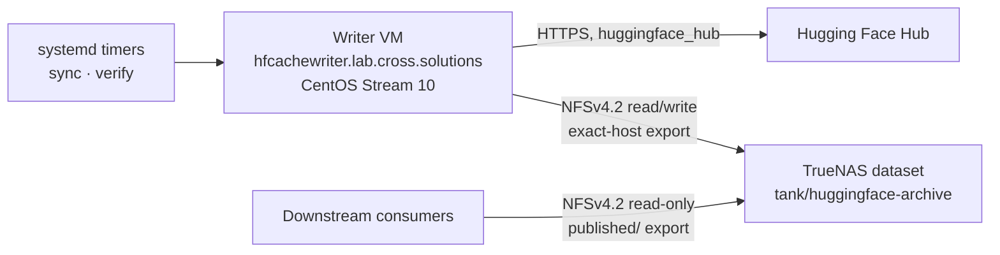

# hfcache Architecture

| Field | Value |
| --- | --- |
| Status | Normative contract for implementation |
| Derived from | `docs/plan.md` §1–§6, §13–§19, §25 |
| Work packages | `ARC-001`, `ARC-002`, `ARC-006`, `ARC-008` |
| Schema baseline | All durable formats begin at `schema_version = 1` |

This document is the architectural contract the implementation is written
against. Where it uses **must**, **must not**, **never**, and **only**, the
statement is a testable requirement; each such requirement carries a stable
identifier (`AD-nn`, `NG-nn`, `FS-nn`, `TX-nn`, `FW-nn`) that source comments,
tests, and review notes cite directly.

Companion contracts: `docs/configuration.md` (configuration schema),
`docs/schemas.md` (durable JSON schemas), `docs/cli.md` (command surface, JSON
output, exit codes), `docs/security.md` (threat model and controls).

## 1. Mission

`hfcache` archives **complete revisions of public Hugging Face model and dataset
repositories** at resolved immutable commit SHAs onto long-term TrueNAS storage,
and publishes them as immutable ordinary-file trees that downstream systems copy
over a server-enforced read-only NFS export.

The unit of value is a **repository-complete revision**: every file present in
the upstream repository at one resolved commit SHA, locally SHA-256 verified,
described by a durable manifest, and reachable through an atomically replaced
reference. A revision is either completely published and verifiable, or it is not
visible to consumers at all. There is no partial state in between.

## 2. System context



Exactly one host mutates the archive. The writer resolves a configured reference
to an immutable commit SHA, downloads the complete snapshot into a private Hub
cache that lives on the archive dataset, hashes newly introduced content,
publishes an immutable tree by hardlinking cache blobs into a staging directory
and atomically renaming it into place, and then atomically replaces the reference
consumers read.

Consumers mount only the `published/` subtree, read one small JSON reference,
copy the exact immutable tree it names, and verify the copy against the manifest
it names. Consumers never point `HF_HOME` or `HF_HUB_CACHE` at the archive and
never depend on the Hugging Face cache symlink layout.

### 2.1 Trust and authority boundaries

| Boundary | Authority | Enforcement |
| --- | --- | --- |
| Hub → writer | Untrusted content, trusted transport | TLS verification always on; repository content is never executed, imported, or unpickled |
| Writer → archive | Sole mutating authority | TrueNAS export restricted to the writer's exact `/32`, Mapall to `hfcache-sync:hfcache-archive` |
| Archive → consumers | Read-only | Server-side read-only export of `published/`, Mapall to `hfcache-read:hfcache-archive` |
| Operator → writer | Configuration and lifecycle | Root-owned configuration and unit files; unprivileged service identity |

A downstream consumer is not trusted to be well-behaved, but is also not able to
damage the archive: read-only enforcement is server-side, not advisory.

## 3. Architecture decisions

Each decision is locked for schema version 1. Changing one is a deliberate
versioned change, not an implementation detail.

### AD-01 — The archive unit is a complete snapshot at one resolved commit SHA

**Decision.** Every archived artifact is the full file set of one repository at
one full 40-character commit SHA, resolved before download and used explicitly in
every Hub call.

**Rationale.** A commit SHA is the only identifier the Hub guarantees to be
immutable. Branch and tag names move; downloading by name races against upstream
force-pushes and yields a tree that cannot be described by a stable manifest.

**Consequences.** Reproducible content without Git history. A manifest can state
exactly what a revision contains. Two syncs that resolve the same SHA are
idempotent by construction.

**Rejected.** Mirroring Git history (`NG-01`), which multiplies storage and
complexity for a use case that only ever reads one tree at a time.

### AD-02 — The first sync preserves the latest observed revision; there is no backfill

**Decision.** The first successful sync of a repository publishes the head of the
configured reference at that moment. Commits that occurred before the first
observation are never retrieved.

**Rationale.** The product contract is a rolling archive of what the system
observed, not a historical reconstruction. Backfill would require Git history
(`AD-01`, `NG-01`).

**Consequences.** The archive's oldest revision is the first one observed.
Intermediate commits between scheduled runs are legitimately skipped (`AD-03`).

### AD-03 — Subsequent revisions are whatever each scheduled run observes

**Decision.** Each run resolves the configured reference again. If the SHA is new,
it is published as an additional revision. Commits that appeared and were
superseded between two runs are not recovered.

**Rationale.** The value is having *a* recent complete revision plus recent
history depth, not every commit. Catching every commit would require either
polling far more aggressively or reading Git history.

**Consequences.** Retention depth is measured in observations, not commits.
Operators tune depth by tuning the timer, and the plan documents this explicitly.

### AD-04 — Retention keeps five unique published revisions per repository

**Decision.** Each repository retains at most five unique commit SHAs. A sixth
successfully published revision prunes the oldest eligible revision. The current
revision is never pruned.

**Rationale.** Bounded, predictable storage with enough depth to roll back a bad
upstream change. Five is fixed in schema version 1 so retention reasoning,
tests, and capacity planning have one shape.

**Consequences.** Ordering must be immutable and independent of clocks
(`AD-05`). Pruning is a transaction that can fail without destroying data
(`TX-06`).

### AD-05 — Retention order comes from an immutable publication generation, never from time

**Decision.** Each unique SHA receives a monotonic per-repository integer
`publication_generation` when it is *first* published. Retention ordering uses
only that integer. Wall-clock time, file mtimes, directory mtimes, and upstream
commit timestamps are never used to order revisions.

**Rationale.** Clocks are wrong across restores, replicas, and snapshot rollbacks;
NFS mtimes are not a durable identity signal. An integer assigned once under the
global lock is stable across every recovery path.

**Consequences.** Repairing a SHA preserves its generation and therefore its
retention position (`AD-13`). Crash-induced gaps in the sequence are valid; two
distinct SHAs may never share a generation. Generation allocation reads the union
of retained manifests and pruned-revision records so a prune-then-crash cannot
reissue a value.

### AD-06 — Upstream disappearance never deletes local content

**Decision.** A `403`, `404`, deleted repository, gated repository, network
failure, or removal of the repository from configuration marks state and reports
it, and deletes nothing.

**Rationale.** The archive exists precisely for the case where upstream is gone.
An availability error is the moment the archive matters most; it must never be
the trigger that empties it.

**Consequences.** Pruning is driven exclusively by *successful publication* of a
new revision, never by an error path or a configuration edit.

### AD-07 — Dependencies are detected statically and warned about, never resolved

**Decision.** Base models, adapters, and similar transitive dependencies are
detected by reading known static metadata only, reported as non-fatal warnings,
and recorded in the manifest. They are never downloaded implicitly.

**Rationale.** Implicit recursive downloads make storage unbounded and turn one
configured repository into an unpredictable dependency graph. Detecting a
dependency by *executing* repository code would violate `AD-15`.

**Consequences.** An undeclared dependency yields warning `HFDEP001`, marks the
repository `completed_with_warnings`, and leaves the exit code at `0` when
nothing else failed. Archiving a dependency is an explicit configuration act.

### AD-08 — Hub access is the official Python client only

**Decision.** All Hub interaction goes through `huggingface_hub` Python APIs
behind a narrow injectable adapter. The application never invokes `hf`, `git`,
`git-lfs`, or `git-xet` as subprocesses.

**Rationale.** Subprocess orchestration converts typed results into scraped text,
hides failures, and couples the archive to CLI output formats. An injectable
adapter also makes the whole ingestion path testable without network access.

**Consequences.** Cache inspection and cache deletion use the supported public
cache APIs; blob paths are never derived by parsing cache directory names
(`FS-10`). Tests use deterministic fakes rather than mocking library internals.

### AD-09 — The native Hub cache on the archive dataset is the canonical download store

**Decision.** `snapshot_download()` writes into `<archive>/.store/hub`, on the
same ZFS dataset as the publication tree. It is private to the writer and is
never exposed to consumers.

**Rationale.** The native cache gives resumable transfers and revision-level
deduplication for free. Putting it on the same dataset is what makes hardlink
publication possible (`AD-11`).

**Consequences.** The cache is operational state, not the archive product. It may
be pruned through supported APIs at any time; the published hardlink trees are
what preserve the bytes.

### AD-10 — Consumers receive an immutable ordinary-file publication tree

**Decision.** Published revisions are ordinary files and directories laid out
with the repository's own relative paths, under a per-publication immutable
directory. Consumers resolve one JSON reference and copy that tree.

**Rationale.** The Hugging Face cache layout is an internal implementation detail
built on symlinks into a blob store. Copying it over NFS is fragile and couples
every consumer to a private format.

**Consequences.** A publication instance directory is immutable once renamed into
place (`FS-05`). Consumers need no Hugging Face software to consume the archive.

### AD-11 — Publication hardlinks within the dataset; copy mode is explicit and never a silent fallback

**Decision.** `publication_mode = "hardlink"` is the default and links cache blobs
into the publication tree. `publication_mode = "copy"` duplicates bytes and must
be selected deliberately after a capacity review. If hardlinks are unavailable
and copy mode was not configured, sync **fails before downloading**.

**Rationale.** Hardlinks give consumers an ordinary-file tree at zero additional
storage. A silent fallback to copying would multiply storage without warning and
could fill the dataset mid-run.

**Consequences.** `doctor` proves hardlink, atomic-rename, and atomic-ref
capability against the real dataset before the capability is relied upon. The
application never `chmod`s a hardlinked file, because that would mutate the
shared cache inode; read access is granted by directory mode and the export.

### AD-12 — Durable state is JSON on the filesystem; there is no database

**Decision.** Manifests, references, catalog, run reports, verification reports,
and transaction journals are versioned JSON files written atomically. There is no
SQLite or other mutable database on NFS.

**Rationale.** A single-writer archive whose authority is the filesystem can be
recovered by reading the filesystem. Databases on NFS add locking failure modes
and a second source of truth that can disagree with the tree.

**Consequences.** The catalog is *derived*, never authoritative: it can always be
rebuilt from immutable manifests and references. Recovery reads durable evidence
rather than replaying a log of intentions.

### AD-13 — Repair replaces a damaged instance without changing what the revision *is*

**Decision.** `repair` re-downloads the same immutable SHA into an isolated,
transaction-scoped cache, verifies every file against the **original** manifest,
and publishes a new instance under a new publication ID while preserving the
SHA's original `publication_generation`. Expected digests are never rewritten to
match newly observed bytes.

**Rationale.** Corruption must not be able to launder itself into the expected
value. The manifest is the evidence; a repair either reproduces it exactly or
fails loudly.

**Consequences.** A superseded instance stays readable at its original locator for
a seven-day grace period so an in-flight consumer copy can finish. Repair is
verification-gated at both ends: against the original manifest before publication
and against the new tree before any reference moves.

### AD-14 — Every mutation is bounded by an atomic filesystem operation and a durable checkpoint

**Decision.** Sync, publication, prune, repair, and recovery advance only through
atomic `rename(2)` operations on the same filesystem, each recorded as an
append-only checkpoint in a transaction journal after the operation is durable.

**Rationale.** Crash safety cannot rest on the process finishing. It must rest on
each intermediate on-disk state being unambiguous and forward-recoverable.

**Consequences.** Every state a crash can leave behind is enumerated (`TX-01`
onward) and has exactly one correct resolution. When state is ambiguous, the
application stops and reports rather than guessing (`AD-16`).

### AD-15 — Repository content is data, never code

**Decision.** The application never executes, imports, unpickles, or instantiates
repository content, never sets `trust_remote_code`, and never follows a path that
resolves outside its approved roots.

**Rationale.** The archive ingests arbitrary third-party content from a public
Hub. Treating any of it as executable would make the writer's storage authority
reachable by whoever last pushed to an upstream repository.

**Consequences.** Dependency detection is limited to parsing known static
metadata (`AD-07`). Repository paths are validated for containment, spelling, and
regular-file type before any link or copy.

### AD-16 — Ambiguity stops the machine; it never triggers a guess

**Decision.** Unknown files, unknown journal schema versions, impossible
checkpoint combinations, inconsistent manifests, and ambiguous reference state
are reported and preserved. They are never deleted, rewritten, or resolved by
heuristic.

**Rationale.** Every automatic guess in a storage system is a potential silent
data loss. An operator reading a precise report loses minutes; an incorrect
automatic repair can lose a revision permanently.

**Consequences.** Recovery is roll-forward oriented and idempotent. When two
resolutions are both defensible, the application prefers over-retention to
deletion.

### AD-17 — One writer; locking is local

**Decision.** Exactly one host has read/write access, enforced by the export's
exact-host restriction. Mutual exclusion between `sync`, `verify`, `prune`,
`repair`, and `recover` is a local exclusive lock under `/run/hfcache`.

**Rationale.** With a single writer, local locking is sufficient and correct.
Distributed locking over NFS is a well-known source of subtle failure and buys
nothing here.

**Consequences.** No leader election, no distributed coordination, no lock files
on NFS. A second writer host is a design change, not a configuration change.

### AD-18 — Ingestion verification hashes bytes; it does not trust identifiers

**Decision.** Every newly introduced unique physical object is read and SHA-256
hashed locally before publication. A previously computed digest is reused only
when the object is proven to be the same physical inode as an already-verified
retained publication with the same size.

**Rationale.** A cache path, an mtime, a prior-run inode number, an upstream Git
SHA-1, or an opaque Xet identifier describes *provenance*, not the bytes
currently on disk. Only reading the bytes proves the bytes.

**Consequences.** Upstream-supplied digests are recorded as additional comparison
values, never as substitutes. A hash or completeness failure prevents
publication; it never becomes the new expected value.

## 4. Non-goals

These are deliberately out of scope for version 1. Each is a bounded decision
with a stated reason, not an oversight.

| ID | Non-goal | Reason |
| --- | --- | --- |
| `NG-01` | Git history, all branches, all tags, PRs, discussions, issues | The archive unit is one resolved tree (`AD-01`) |
| `NG-02` | Backfilling commits between observations | Follows from `AD-02`/`AD-03`; would require `NG-01` |
| `NG-03` | Materializing dataset payloads hosted outside the Hub repository | Not part of repository completeness; unbounded and unverifiable |
| `NG-04` | Guaranteeing a runnable software environment, dependency set, or image | Different product; the archive stores repository content |
| `NG-05` | Automatic download of base models, adapters, tokenizers, or other transitive dependencies | `AD-07` |
| `NG-06` | Gated or private repositories | Version 1 is public-only; the credential boundary stays future-compatible |
| `NG-07` | Spaces, Storage Buckets, arbitrary Git repositories | Different resolution, layout, and completeness semantics |
| `NG-08` | Serving models to inference engines | The archive is storage, not a runtime |
| `NG-09` | Running models, importing modules, unpickling, `trust_remote_code` | `AD-15` |
| `NG-10` | Multiple concurrent writers or distributed leader election | `AD-17` |
| `NG-11` | Running on the TrueNAS host operating system | Storage appliances are not application hosts; the writer is a dedicated VM |
| `NG-12` | A workflow engine, state-machine framework, or Pydantic AI in version 1 | `FW-01` |

Non-goals are not permanent bans. `NG-06` in particular is expected to become
reachable without a schema redesign: the configuration already carries
`token_mode`, `credential_name`, and `expected_account`, and the credential path
is implemented in version 1 even though version 1 refuses non-public repositories.

## 5. Filesystem layout

One dedicated ZFS dataset holds cache blobs, staging directories, hardlinked
publications, manifests, and atomic renames, so every atomic operation stays
within a single filesystem.

### 5.1 Archive tree

```text
/srv/hfcache/                                    0750  root of the archive dataset
├── .hfcache-root                                0640  sentinel: archive identity
├── .store/                                      0700  private to the writer
│   ├── hub/                                           canonical huggingface_hub cache
│   │   ├── models--<org>--<repo>/
│   │   └── datasets--<org>--<repo>/
│   ├── health/                                        preflight probe area
│   │   └── probe-<probe-id>/
│   ├── quarantine/                                    preserved evidence, operator-released
│   │   └── <transaction-id>/
│   ├── repair/                                        transaction-scoped isolated caches
│   │   └── <transaction-id>/hub/
│   ├── staging/                                       publication trees under construction
│   │   └── <transaction-id>/
│   │       ├── tree/
│   │       └── manifest.json
│   ├── transactions/                                  durable journals
│   │   └── <transaction-id>.json
│   └── trash/                                         prune tombstones, pre-cleanup
│       └── <transaction-id>/
│           ├── tree/
│           └── manifest.json
├── published/                                   2750  the only consumer-visible subtree
│   ├── repos/
│   │   ├── models/<org>/<repo>/
│   │   │   ├── refs/
│   │   │   │   ├── current.json                       which revision consumers should take
│   │   │   │   └── revisions/<sha>.json               active instance for each retained SHA
│   │   │   └── revisions/<sha>/<publication-id>/      immutable repository tree
│   │   └── datasets/<org>/<repo>/                     identical shape
│   ├── manifests/
│   │   ├── models/<org>/<repo>/<sha>/<publication-id>.json
│   │   └── datasets/<org>/<repo>/<sha>/<publication-id>.json
│   └── catalog/
│       ├── repositories.json                          derived index of retained state
│       └── verification.json                          derived archive health summary
├── audit/                                       0700  provenance that outlives the data
│   ├── pruned/<type>/<org>/<repo>/<sha>/
│   │   ├── <publication-id>.manifest.json             byte-for-byte original manifest
│   │   └── <publication-id>.prune.json                why, when, and under which transaction
│   └── repairs/<type>/<org>/<repo>/<sha>/
│       ├── <publication-id>.manifest.json             retired instance's original manifest
│       └── <publication-id>.retirement.json           repair provenance and grace expiry
└── runs/                                        0700
    └── <YYYYMMDD>T<HHMMSS>Z-<run-id>.json             one report per invocation
```

Writer-local paths, none of which hold archive content:

```text
/opt/hfcache/                  root-owned releases and locked virtual environments
/etc/hfcache/config.toml       root-owned, service-readable configuration
/srv/hfcache/                  the NFS mount point (root-owned when unmounted)
/var/cache/hfcache/xet/        disposable hf_xet transfer cache
/var/lib/hfcache/              local operational state, including HF_HOME
/run/hfcache/                  process locks and transient run state
```

### 5.2 Ownership and modes

Modes below are what the writer creates with `UMask=0027` against a dataset whose
root and `published/` are pre-owned by the NAS-side identity.

| Path | Owner:group | Mode | Reason |
| --- | --- | --- | --- |
| Archive root | `hfcache-sync:hfcache-archive` | `0750` | Writer-only; the read identity enters through `published/` |
| `.hfcache-root` | mapped writer identity | `0640` | Readable to the group, writable only by the writer |
| `.store`, `audit`, `runs` | mapped writer identity | `0700` | Cache, journals, staging, provenance, and reports are not consumer data |
| `published` | `hfcache-sync:hfcache-archive` | `2750` setgid | Group-traversable for the read identity; setgid keeps the group on everything created beneath |
| Directories under `published` | mapped writer identity | `2750` | Inherited setgid plus `UMask=0027` |
| Files under `published` | mapped writer identity | `0640` | `UMask=0027`; read access for the export identity, no write |

Published files are **never** `chmod`ed by the application. In hardlink mode a
published file and its cache blob are the same inode, so changing the mode of one
changes both (`AD-11`). Read-only for consumers is enforced by the server-side
export, not by file mode.

Because the writer export maps every client identity to
`hfcache-sync:hfcache-archive`, files on the mount appear owned by NAS-side ids
with no local account on the writer. Writability is therefore proven by a real
create/fsync/rename/delete probe under `.store/health/`, never by comparing the
local service uid against `st_uid`.

### 5.3 Path grammar

| Element | Grammar | Notes |
| --- | --- | --- |
| `<type>` | `models` \| `datasets` | Plural on disk; the configuration and API use the singular `model` \| `dataset` |
| `<org>` | Hub namespace segment | Preserved exactly, including case |
| `<repo>` | Hub repository-name segment | Preserved exactly, including case |
| `<sha>` | `[0-9a-f]{40}` | The full resolved commit SHA, lowercase; abbreviations are never written to disk |
| `<publication-id>` | `[0-9a-f]{32}` | Random UUID4 hex; opaque and carries no ordering |
| `<transaction-id>` | `[0-9a-f]{32}` | Random UUID4 hex |
| `<run-id>` | `[0-9a-f]{32}` | Random UUID4 hex |
| `<probe-id>` | `[0-9a-f]{16}` | Random hex, unique per preflight |

A repository identifier is exactly two segments, `<org>/<repo>`. Single-segment
canonical identifiers are rejected with a configuration error; every canonical
Hub repository now has a namespaced form (`gpt2` → `openai-community/gpt2`) and
requiring it keeps the on-disk layout unambiguous.

Both segments must match `[A-Za-z0-9][A-Za-z0-9._-]*`, must not be `.` or `..`,
and must not exceed 96 characters. This is validated at configuration load, before
any network or filesystem access.

Ordering within any generated JSON array of repositories, files, or revisions is
deterministic: byte-wise ascending on the relative POSIX path or on
`(type, id, generation)` as applicable. Two runs over identical state produce
byte-identical output.

## 6. Filesystem invariants

These hold at every instant an external observer could look, including
immediately after a crash. Each is directly testable.

### Identity and location

- **`FS-01`** — `.hfcache-root` contains the archive's identity as versioned JSON,
  including a UUID that must equal the configured `storage.archive_id`.
- **`FS-02`** — Before any mutating command proceeds, the archive root must be
  proven to be a mount point distinct from its parent, of an NFS/NFSv4 filesystem
  type, mounted read/write.
- **`FS-03`** — A mismatch between the sentinel UUID and the configured
  `archive_id` is fatal. It is never repaired, regenerated, or ignored.
- **`FS-04`** — `.store/staging` and every destination it is renamed into are on
  the same filesystem as the archive root, so publication is always a `rename(2)`
  and never a cross-device copy.

### Immutability

- **`FS-05`** — A publication instance directory
  `published/repos/<type>/<org>/<repo>/revisions/<sha>/<publication-id>/` is
  immutable once it has been renamed into place. The application never adds,
  removes, modifies, or re-modes a file inside it. It is only ever renamed away
  wholesale, to trash or quarantine.
- **`FS-06`** — A published manifest is immutable. Expected sizes and digests are
  never rewritten to match a later observation (`AD-13`, `AD-18`).
- **`FS-07`** — A repaired instance receives a new `<publication-id>` and a new
  manifest that copies the original expected path/size/digest set exactly and
  records `repair_of`. The original manifest is preserved byte-for-byte.

### References

- **`FS-08`** — `refs/current.json` and `refs/revisions/<sha>.json` are small
  versioned objects naming a full commit SHA, publication generation, publication
  ID, and the exact archive-relative tree and manifest paths. They are replaced by
  atomic rename, never edited in place, never appended to.
- **`FS-09`** — Every path inside a reference is archive-relative and validated to
  remain under the archive root after normalization. A reference containing an
  absolute path, a `..` segment, or a symlink component is invalid.
- **`FS-10`** — Every reference that exists names a publication instance
  directory and a manifest that both exist and are complete. A reference is
  written only after both of its targets are durable.
- **`FS-11`** — `refs/revisions/<sha>.json` exists for exactly the set of SHAs the
  repository currently retains. `refs/current.json` names one of them.
- **`FS-12`** — A consumer that reads `refs/current.json` once and copies the tree
  it names either succeeds, or observes a failure it can retry by rereading the
  reference. It never silently copies a mixture of two revisions.

### Cache and blobs

- **`FS-13`** — Cache blob paths are obtained only through supported
  `huggingface_hub` cache-inspection APIs. The application never parses cache
  directory names to infer a blob location.
- **`FS-14`** — Cache content is deleted only through supported `huggingface_hub`
  cache-management APIs. No cache blob under `.store/hub` is ever removed by a
  direct filesystem call. A transaction-scoped repair cache under
  `.store/repair/<transaction-id>/hub` is application-owned scratch and is removed
  wholesale after its bytes are durable in a publication; this is the single
  documented exception and it never touches `.store/hub`.
- **`FS-15`** — Every source resolved for publication is verified to be contained
  by the operation's approved cache root — `.store/hub` for normal ingestion, one
  `.store/repair/<transaction-id>/hub` for repair — and to be a regular file.
  Devices, sockets, FIFOs, dangling links, and paths escaping the root are
  rejected.

### Derived state

- **`FS-16`** — `published/catalog/*.json` is derived. It can always be rebuilt
  from immutable manifests plus references, and disagreement between the catalog
  and that authority is resolved in favour of manifests and references.

### Transactions and unknown data

- **`FS-17`** — Every sync, publication, prune, repair, and recovery mutation has
  a durable transaction journal under `.store/transactions/` whose checkpoints are
  appended only after the operation they describe is durable.
- **`FS-18`** — Staging, trash, quarantine, and repair directories are named by
  transaction ID. A directory in these areas is only ever acted upon when it
  matches that naming contract, has a journal, and exceeds the configured age.
- **`FS-19`** — Files and directories the application does not recognise are
  reported and preserved. Nothing outside the application's own naming contracts
  is deleted, moved, or rewritten (`AD-16`).
- **`FS-20`** — Each unique SHA has exactly one `publication_generation` for the
  life of the repository. Generations are allocated from the union of retained
  manifests and `audit/pruned/` records, are never reused, and may contain gaps
  left by crashes.

### Initialization

- **`FS-21`** — `hfcache archive init` is the only way to create the sentinel and
  the top-level directories. It is an explicit operator action, never reached from
  a timer, a sync, or an automatic recovery path.
- **`FS-22`** — Initialization refuses a target that is not the expected
  read/write NFS mount, already has a sentinel, or holds unknown content or
  symlinks. The single exception is one pre-existing **empty** `published/`
  directory whose ownership and mode already match §5.2, which is adopted because
  TrueNAS requires it to exist before the consumer export can be defined. A
  non-empty, wrongly owned, or wrongly moded `published/` is still refused.
- **`FS-23`** — Initialization writes `.hfcache-root` last, after the directory
  structure is durable, so a sentinel's existence proves the layout beneath it.
