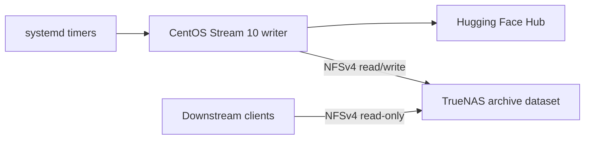

# Hugging Face Repository Cache

## Detailed Implementation Plan

| Field | Value |
| --- | --- |
| Status | Accepted — environment provisioned, implementation authorized |
| Date | 2026-07-24 |
| Environment state | Verified 2026-07-24 (§35) |
| Progress tracker | `docs/progress.md` |
| Working project name | `hfcache` |
| Primary CLI | `hfcache` |
| Sync writer | `hfcachewriter.lab.cross.solutions` |
| Writer operating system | CentOS Stream 10 |
| Storage platform | TrueNAS 25.10.5 |
| Repository scope | Public Hugging Face model and dataset repositories |
| Completeness level | Repository-complete at an immutable Hub revision |
| Retention | Five successfully published revisions per repository |

## Plan Map

- [Purpose, goals, and architecture decisions](#1-purpose)
- [Filesystem, project, configuration, and schemas](#6-filesystem-design)
- [CLI, Hub integration, synchronization, publication, and retention](#11-cli-contract)
- [Integrity, dependency warnings, recovery, and mount safety](#16-integrity-and-verification)
- [TrueNAS, CentOS Stream 10, systemd, SELinux, and security](#20-truenas-25105-implementation)
- [Testing, performance, and phased implementation](#26-testing-strategy)
- [Rollout, upgrades, recovery, risks, and definition of done](#29-rollout-sequence)
- [Deployment inputs and authoritative references](#34-deployment-values-to-supply)
- [Environment state and autonomous implementation protocol](#35-current-environment-state)

## 1. Purpose

Build a production-quality Python CLI that archives complete revisions of configured Hugging Face model and dataset repositories on long-term TrueNAS storage. The system will use the official `huggingface_hub` Python client, run from one dedicated CentOS Stream 10 writer VM, and publish immutable repository trees that downstream systems can mount over read-only NFS and copy to local storage.

The application will preserve the newest revision observed on its first run and then add newly observed revisions until each repository reaches a rolling maximum of five. A sixth successfully published revision causes the oldest eligible revision to be pruned. New content will be SHA-256 verified during ingestion, and the complete retained archive will receive a quarterly offline verification.

This plan covers application implementation, TrueNAS/NFS integration, CentOS Stream deployment, systemd scheduling, integrity controls, testing, documentation, rollout, and operational recovery.

The recommended design is more than mounting NFS as `HF_HUB_CACHE` and scheduling `hf download`. The native Hub cache remains valuable as the private, resumable ingestion store on NFS, but a small orchestration layer is required for commit resolution, repository-completeness checks, SHA-256 manifests, atomic consumer publication, five-revision retention, mount safety, recovery, warnings, and service reporting. Consumers receive a stable ordinary-file tree rather than depending on Hugging Face's internal cache layout.

## 2. Goals

1. Download every file in a configured model or dataset repository at a resolved immutable commit SHA.
2. Use `huggingface_hub.HfApi` and `snapshot_download()` directly rather than shelling out to `hf`, Git, Git LFS, or Xet commands.
3. Store all durable repository content, revision manifests, and run reports on a dedicated TrueNAS dataset.
4. Maintain no more than five published revisions per repository during healthy steady-state operation.
5. Never expose incomplete or unverified revisions to downstream readers.
6. Give exactly one host read/write access to the archive: `hfcachewriter.lab.cross.solutions`.
7. Give downstream consumers server-enforced read-only NFS access.
8. Refuse to download when the archive path is not the expected NFS mount.
9. Detect likely base-model dependencies without executing repository code; warn when a dependency is undeclared, but do not fail the sync or download it automatically.
10. Produce offline-verifiable, versioned manifests containing SHA-256 hashes and provenance.
11. Operate unattended through hardened systemd services and timers while retaining a complete interactive CLI.
12. Remain recoverable from durable filesystem state without depending on a mutable database on NFS.

## 3. Non-goals

The first release will not:

- Mirror full Git history, every branch, every tag, pull requests, discussions, or issues.
- Backfill commits that occurred between scheduled sync observations.
- Materialize external dataset payloads referenced outside the Hub repository.
- Guarantee a complete runtime software environment, Python dependency set, or container image.
- Automatically download base models, adapters, tokenizers from other repositories, or other transitive dependencies.
- Support gated or private repositories. The configuration and credential boundary will remain future-compatible with them.
- Support Hugging Face Spaces, Storage Buckets, or arbitrary Git repositories.
- Serve models directly to inference engines.
- Run models, import downloaded Python modules, unpickle artifacts, or enable `trust_remote_code`.
- Support multiple concurrent writer hosts or distributed leader election.
- Run directly on the TrueNAS host operating system.
- Introduce Pydantic AI in version 1. The sequence is deterministic and does not need an agent or general workflow engine.

## 4. Locked Architecture Decisions

| Decision | Selected approach | Consequence |
| --- | --- | --- |
| Archive unit | Complete snapshot at one resolved commit SHA | Reproducible repository content without Git history |
| Initial revision | Latest configured branch/tag head at first successful sync | No historical backfill |
| Subsequent revisions | Latest head observed by each scheduled run | Intermediate commits may be skipped |
| Retention | Five unique published revisions per repository | Sixth revision prunes oldest eligible revision |
| Upstream disappearance | Preserve all local content | A 403, 404, or deleted repository never triggers deletion |
| Dependency handling | Static detection and warning | No recursive or implicit downloads |
| Hub integration | Official Python client | No CLI subprocess or Git/Xet orchestration |
| Canonical download store | Native Hub cache on NFS | Resumable downloads and revision-level deduplication |
| Consumer interface | Immutable ordinary-file publication tree | Readers do not depend on cache symlink layout |
| Publication optimization | Hardlinks on the same ZFS dataset | No second physical copy when NFS supports hardlinks |
| Hardlink fallback | Explicit full-copy mode, never silent fallback | Unexpected storage multiplication is prevented |
| Durable state | JSON manifests, refs, and run reports | Recovery does not require SQLite on NFS |
| Writer topology | One CentOS Stream 10 VM | Local locking is sufficient |
| Authentication | Public access initially; optional systemd credential support | Future gated/private support needs no schema redesign |
| Ingestion verification | SHA-256 newly introduced unique content | New bytes are verified before publication |
| Archive verification | Quarterly full offline verification | Periodic detection of application-level corruption |
| Scheduling authority | systemd timers and drop-ins | TOML describes sync policy, not host scheduling |

## 5. System Context



The writer resolves and downloads Hub content, verifies it, and atomically publishes immutable repository revisions. Downstream clients read only the published area, resolve a revision once, and copy it to local storage. They do not point `HF_HOME` or `HF_HUB_CACHE` at the read-only archive.

## 6. Filesystem Design

Use one dedicated ZFS dataset so cache blobs, staging directories, hardlinked publications, manifests, and atomic renames remain on the same filesystem.

```text
/srv/hfcache/
├── .hfcache-root
├── .store/
│   ├── hub/
│   │   ├── models--organization--repository/
│   │   └── datasets--organization--repository/
│   ├── health/
│   ├── quarantine/
│   ├── repair/
│   ├── staging/
│   ├── transactions/
│   └── trash/
├── published/
│   ├── repos/
│   │   ├── models/
│   │   │   └── organization/
│   │   │       └── repository/
│   │   │           ├── refs/
│   │   │           │   ├── current.json
│   │   │           │   └── revisions/
│   │   │           │       └── <commit-sha>.json
│   │   │           └── revisions/
│   │   │               └── <commit-sha>/
│   │   │                   └── <publication-id>/
│   │   └── datasets/
│   │       └── organization/
│   │           └── repository/
│   │               ├── refs/
│   │               │   ├── current.json
│   │               │   └── revisions/
│   │               │       └── <commit-sha>.json
│   │               └── revisions/
│   │                   └── <commit-sha>/
│   │                       └── <publication-id>/
│   ├── manifests/
│   │   ├── models/
│   │   │   └── organization/repository/<commit-sha>/<publication-id>.json
│   │   └── datasets/
│   │       └── organization/repository/<commit-sha>/<publication-id>.json
│   └── catalog/
│       ├── repositories.json
│       └── verification.json
├── audit/
│   ├── pruned/
│   └── repairs/
└── runs/
    └── <UTC-timestamp>-<run-id>.json
```

Local writer-only paths:

```text
/var/cache/hfcache/xet/        # Disposable hf_xet transfer cache
/var/lib/hfcache/              # Local operational state, if required
/run/hfcache/                  # Process locks and transient run state
/etc/hfcache/config.toml       # Declarative configuration
```

### 6.1 Filesystem invariants

1. `.hfcache-root` contains a generated archive UUID recorded in configuration.
2. The application must prove `/srv/hfcache` is an NFS mount before any mutating command runs.
3. The configured archive UUID must match the sentinel.
4. `.store/staging` and the destination revision directory must be on the same filesystem.
5. A published revision instance directory is immutable from the application’s perspective.
6. `refs/current.json` is a small, versioned object containing the full commit SHA, publication generation, opaque publication ID, exact relative tree path, and manifest path.
7. `refs/current.json` is replaced atomically; it is not edited in place.
8. Downstream readers load `refs/current.json` once and copy the exact immutable tree it names; they do not follow a mutable symlink.
9. A revision manifest under `published/manifests` is durable before the revision becomes current.
10. No cache blob is manually deleted. Cache cleanup uses supported `huggingface_hub` cache APIs.
11. Sync, publication, pruning, repair, and recovery mutations have durable transaction journals.
12. Expected hashes in an immutable revision manifest are never rewritten to match a later verification result.
13. Each unique SHA receives one immutable per-repository `publication_generation`; repair instances of that SHA retain the same generation but receive a new publication ID.
14. `refs/revisions/<sha>.json` atomically identifies the active publication instance for every retained SHA; the catalog is derived from these refs and immutable manifests.

### 6.2 One-time archive initialization

`hfcache archive init` is the only supported way to create the sentinel and top-level application directories. It is an explicit operator action, never part of a timer or automatic recovery. The command:

1. Requires an explicit archive root and confirmation flag.
2. Proves the target is the expected read/write NFS mount.
3. Refuses a pre-existing sentinel, unknown content, symlinks, or an already initialized archive — with one narrow exception: a single pre-existing, *empty* `published/` directory is adopted rather than refused when its ownership and mode already match §20.1, because TrueNAS requires that directory to exist before the consumer NFS export can be defined (§35.2). A non-empty, wrongly owned, or wrongly moded `published/` is still refused.
4. Generates a random archive UUID unless the operator supplies a provisioned one.
5. Creates private and published directories with the documented ownership/modes.
6. Fsyncs the structure and atomically writes `.hfcache-root` last.
7. Prints the UUID that must be copied into root-owned configuration.

A failed initialization may be safely retried only after `archive init --inspect` confirms that all partial paths match the known empty-layout contract.

### 6.3 Consumer resolution

A consumer mounts only `published/`, reads one small ref, validates its relative paths remain under the mount, and then copies the named immutable tree:

```json
{
  "schema_version": 1,
  "repository_type": "model",
  "repository_id": "organization/model-name",
  "commit_sha": "0123456789abcdef...",
  "publication_generation": 1,
  "publication_id": "opaque-id",
  "tree": "repos/models/organization/model-name/revisions/0123456789abcdef.../opaque-id",
  "manifest": "manifests/models/organization/model-name/0123456789abcdef.../opaque-id.json"
}
```

The client reads `refs/current.json` once; it does not re-read the ref during its copy. Consumer documentation includes a small shell/Python example that copies the tree and verifies it against the referenced manifest.

Repair keeps the superseded instance at its original published locator for a seven-day grace period, so an in-flight copy can finish. The example still treats disappearance or final manifest failure as retryable: discard the partial local copy, reread `current.json`, and restart from the newly referenced instance.

## 7. Project Layout

```text
hfcache/
├── .editorconfig
├── .gitignore
├── .python-version
├── LICENSE
├── README.md
├── pyproject.toml
├── uv.lock
├── examples/
│   └── config.toml
├── packaging/
│   └── systemd/
│       ├── srv-hfcache.mount
│       ├── srv-hfcache.automount
│       ├── hfcache.target
│       ├── hfcache-sync.service
│       ├── hfcache-sync.timer
│       ├── hfcache-verify.service
│       └── hfcache-verify.timer
├── docs/
│   ├── architecture.md
│   ├── cli.md
│   ├── configuration.md
│   ├── consumers.md
│   ├── deployment-centos-stream-10.md
│   ├── operations.md
│   ├── recovery.md
│   ├── schemas.md
│   ├── security.md
│   └── truenas.md
├── scripts/
│   └── check.sh
├── src/
│   └── hfcache/
│       ├── __init__.py
│       ├── __main__.py
│       ├── cli.py
│       ├── config.py
│       ├── dependencies.py
│       ├── errors.py
│       ├── hashing.py
│       ├── hub.py
│       ├── logging.py
│       ├── manifests.py
│       ├── models.py
│       ├── paths.py
│       ├── publication.py
│       ├── recovery.py
│       ├── reporting.py
│       ├── retention.py
│       ├── storage.py
│       ├── sync.py
│       ├── transactions.py
│       └── verification.py
└── tests/
    ├── fixtures/
    ├── integration/
    ├── system/
    └── unit/
```

Module boundaries can be consolidated where implementation remains small, but Hub access, storage mutation, retention, and verification must remain independently testable.

## 8. Python and Dependency Management

### 8.1 Runtime baseline

- Pin Python 3.14 through `.python-version`. **Validated 2026-07-24 (`BOOT-002`):** the full locked dependency set resolves and installs on CPython 3.14.6, including the `hf-xet` native extension; the pin stands.
- Use a standard `src/` package layout.
- Define the CLI entry point as `hfcache = "hfcache.cli:app"`.
- Build both sdist and wheel artifacts with `uv build`.
- Run production from a pre-created locked virtual environment. Do not resolve or download Python dependencies during a scheduled sync.

### 8.2 Runtime dependencies

- `huggingface-hub`
- `pydantic`
- `typer`

**Confirmed at lock time (2026-07-24, `BOOT-002`):** `huggingface-hub` 1.24.0 declares `hf-xet` as a *required* dependency, not an extra, so no `huggingface_hub[hf_xet]` marker is needed. `hf-xet` 1.5.2 is pinned in `uv.lock` and ships `cp38-abi3` manylinux wheels that install on CPython 3.14, so production downloads use the same transfer path as tests with no source build.

Use `tomllib` to parse TOML and validate its decoded structure with strict Pydantic models. Prefer the standard library for JSON, hashing, filesystem operations, locking, and logging unless a dependency provides a material correctness benefit.

The first release uses ordinary deterministic functions plus append-only typed checkpoint records; it does not introduce a general workflow or state-machine engine. Journals record filesystem facts after atomic operations and are not an orchestration engine. If later requirements add branching workflow graphs, human approval states, or durable distributed orchestration, use Pydantic AI rather than adding a different workflow framework.

### 8.3 Development dependencies

- `pytest`
- `pytest-cov`
- `hypothesis`
- `ruff`
- `pyrefly`

Use Hypothesis for retention-ordering, path-containment, and transaction-state invariants. Add any other specialized test package only when a concrete test cannot be cleanly implemented with pytest fixtures and test doubles.

### 8.4 Required quality commands

```bash
uv lock --check
uv run ruff format --check .
uv run ruff check .
uv run pyrefly check
uv run pytest
uv build
```

All commands must pass from a clean checkout with the locked dependency set.

## 9. Configuration Contract

Configuration is TOML loaded into strict Pydantic models. Unknown fields are rejected. All filesystem paths must be absolute. Repository identifiers, types, and revisions are validated before network or storage mutation.

```toml
schema_version = 1

[hub]
endpoint = "https://huggingface.co"
expected_account = ""
token_mode = "optional"
credential_name = "hf-token"

[storage]
archive_root = "/srv/hfcache"
archive_id = "replace-with-provisioned-uuid"
publication_mode = "hardlink"
minimum_free_space_gib = 100
minimum_free_space_percent = 10
maximum_revisions = 5

[sync]
max_workers = 4
lock_wait_seconds = 3600
continue_on_repository_error = true
dependency_policy = "warn"
stale_staging_age_hours = 24

[verification]
algorithm = "sha256"
hash_new_content = true
lock_wait_seconds = 86400

[repair]
retired_instance_grace_hours = 168

[[repositories]]
id = "organization/model-name"
type = "model"
revision = "main"
enabled = true
declared_dependencies = []

[[repositories]]
id = "organization/dataset-name"
type = "dataset"
revision = "main"
enabled = true
declared_dependencies = []
```

### 9.1 Configuration rules

- `schema_version` is mandatory and initially equals `1`.
- Every Pydantic configuration model uses strict validation, `extra="forbid"`, and frozen instances after loading.
- `maximum_revisions` must equal `5` in the first release. Generalize only after a deliberate schema change.
- `type` is limited to `model` or `dataset`.
- `revision` may be a branch, tag, or full commit SHA.
- Duplicate `(type, id)` entries are rejected.
- `max_workers` must be within a conservative validated range, initially `1..32`; the production default is `4`.
- Scheduled sync waits up to one hour for the exclusive lock; quarterly verification waits up to 24 hours so a long sync can finish without creating a race.
- `stale_staging_age_hours` is the configurable age required by §13.3 before reconciliation may act on an abandoned staging, trash, quarantine, or repair directory; the default is 24 hours and it is one of three required conditions (`docs/architecture.md` §7.8).
- Superseded repair instances remain at their original immutable published paths for at least seven days; reducing this grace requires measured consumer-copy data and an explicit configuration review.
- File filtering options are intentionally absent because the product contract is repository-complete.
- `expected_account` may be empty for anonymous public access.
- `token_mode` is `disabled`, `optional`, or future `required`.
- Tokens are never accepted as literal TOML values.
- In schema version 1, any credential is used only for identity validation and public-Hub access. Repository metadata marked private or gated is rejected even if the credential could read it.
- `publication_mode` is `hardlink` by default. `copy` must be explicitly selected after capacity review.
- Effective free-space reserve is the greater of `minimum_free_space_gib` and `minimum_free_space_percent` of the configured dataset quota or capacity.
- Repository removal from configuration never deletes its archive.
- Configuration changes are validated without mutation by `hfcache config validate`.

## 10. Domain Models and Durable Schemas

Create versioned Pydantic models for:

- `ApplicationConfig`
- `HubConfig`
- `StorageConfig`
- `SyncConfig`
- `VerificationConfig`
- `RepairConfig`
- `RepositoryConfig`
- `RepositoryIdentity`
- `ResolvedRevision`
- `CurrentRevisionRef`
- `RevisionInstanceRef`
- `HubFileMetadata`
- `FileManifestEntry`
- `DependencyObservation`
- `RevisionManifest`
- `RepositoryCatalogEntry`
- `RunReport`
- `RepositoryRunResult`
- `VerificationReport`
- `PrunePlan`
- `TransactionJournal`
- `PrunedRevisionRecord`

### 10.1 Revision manifest fields

Each manifest includes:

- Schema version.
- Repository ID and type.
- Requested revision.
- Resolved full commit SHA.
- Opaque publication ID and exact archive-relative tree path.
- Monotonic per-repository publication generation, assigned only when the SHA is first published.
- Hub endpoint.
- First observed, download started, download completed, verified, and published UTC timestamps.
- Application, Python, and `huggingface_hub` versions.
- File count and total logical bytes.
- One entry per repository path containing:
  - Relative POSIX path.
  - Logical size.
  - SHA-256.
  - Upstream Git object ID, LFS SHA-256, or Xet identifier when available.
  - Upstream/cache provenance used to explain how the bytes were obtained; path or inode values alone are never durable proof of content identity.
- Dependency observations and declaration status.
- Verification outcome.
- Publication mode.
- Repair provenance when this materialization replaces a damaged instance of the same SHA.

Manifests are written as deterministic, UTF-8 JSON with sorted keys and a trailing newline. Writes use a temporary sibling and atomic replacement.

### 10.2 Run report fields

Each run report includes:

- Run ID and UTC timestamps.
- Hostname.
- Application version.
- Configuration fingerprint excluding secrets.
- Archive ID.
- Command and invocation mode.
- Per-repository status: `skipped`, `published`, `completed_with_warnings`, or `failed`.
- Downloaded, reused, hashed, and pruned byte counts.
- Warning and error codes.
- Aggregate exit classification.

### 10.3 Transaction journal fields

Each mutation journal includes:

- Journal schema version and unique transaction ID.
- Operation kind: sync, publication, prune, repair, or recovery.
- Repository identity and resolved SHA when applicable.
- The set of completed atomic checkpoints, each with its durable evidence.
- Only archive-relative, containment-validated paths.
- Configuration fingerprint and archive ID.
- Created, last-checkpoint, and completed UTC timestamps.
- The durable artifacts expected before and after each checkpoint.
- A compact error record when an operation failed.

Checkpoint records are append-only and idempotent. Unknown journal versions or impossible checkpoint combinations stop automatic recovery and require operator review; the application never guesses.

## 11. CLI Contract

| Command | Purpose |
| --- | --- |
| `hfcache config validate` | Parse and validate TOML without mutation |
| `hfcache archive init` | Deliberately initialize an empty, verified NFS archive and create its sentinel |
| `hfcache archive init --inspect` | Inspect a partial or existing initialization without mutation |
| `hfcache doctor` | Validate mount, sentinel, permissions, hardlinks, atomic rename, free space, DNS, Hub reachability, and optional identity |
| `hfcache plan` | Resolve configured revisions and report expected downloads without mutation |
| `hfcache sync` | Synchronize all or selected configured repositories |
| `hfcache status` | Show configured, retained, current, warning, and verification state |
| `hfcache list` | List archived repositories and revisions |
| `hfcache verify --new` | Verify newly introduced content associated with a run |
| `hfcache verify --full` | Verify all retained unique content offline |
| `hfcache verify --revision TYPE:ID@SHA` | Verify one retained revision |
| `hfcache verify --estimate` | Estimate unique bytes and duration for a full verification |
| `hfcache prune --dry-run` | Display the exact retention cleanup plan |
| `hfcache prune --apply` | Apply a validated retention cleanup plan |
| `hfcache recover --dry-run` | Reconcile unfinished transactions and describe proposed repairs |
| `hfcache recover --apply` | Apply a validated recovery plan |
| `hfcache repair TYPE:ID@SHA` | Reconstruct and republish a damaged known revision when upstream remains available |
| `hfcache version` | Display application and dependency versions |

Every command accepts a global `--config PATH` option placed before the subcommand, defaulting to `/etc/hfcache/config.toml`; this matches the systemd invocation in §22.2. `hfcache sync` additionally accepts repeated `TYPE:ID` selectors to restrict a run to specific configured repositories.

### 11.1 Output modes

- Human-readable output is the default.
- `--json` emits stable machine-readable output for automation.
- Progress output is disabled automatically when not attached to a terminal.
- Secrets, bearer headers, credential paths containing secret material, and signed URLs are never logged.

### 11.2 Exit classifications

Use explicit application exit codes that do not collide with Typer’s usage errors:

| Code | Meaning |
| --- | --- |
| `0` | Success, including non-fatal dependency warnings |
| `10` | Invalid configuration or invocation precondition |
| `20` | Mount, sentinel, permission, capacity, or lock safety failure |
| `30` | One or more repository sync failures |
| `40` | Integrity verification failure |
| `50` | Prune or repair failure |

When repository processing continues after an individual failure, the final exit code is still non-zero so systemd records the run as failed.

## 12. Hub Integration

Create a narrow `HubClient` abstraction around public `huggingface_hub` APIs. Keep it injectable so tests can use deterministic fakes without mocking library internals.

Responsibilities:

1. Validate optional authentication and retrieve `whoami`.
2. Retrieve repository metadata, reject private/gated content in version 1, and resolve the requested reference to its full commit SHA.
3. Retrieve repository tree metadata and logical size.
4. Perform `snapshot_download()` with:
   - Explicit repository ID.
   - Explicit repository type.
   - Resolved full commit SHA.
   - Explicit Hub cache path.
   - No allow or ignore filters.
   - Configured worker count.
5. Perform a local-only completeness check after download.
6. Return typed metadata without exposing internal client response objects to storage code.
7. Use public cache inspection and revision-deletion APIs through the adapter; never infer blob paths by parsing private cache directory names.

In anonymous mode, pass `token=False` explicitly to Hub calls so a developer or service account's ambient cached credentials cannot silently change behavior. In authenticated mode, read the selected systemd credential at runtime and pass that exact token explicitly. Do not pass `token=None` where it could activate implicit token discovery.

Do not:

- Execute repository code.
- Instantiate Transformers, Datasets builders, PEFT models, or tokenizers.
- Use `trust_remote_code`.
- Invoke `hf`, `git`, `git-lfs`, or `git-xet`.
- Treat the Xet transfer cache as durable archive content.

## 13. Sync Transaction

### 13.1 Whole-run sequence

1. Load and validate configuration.
2. Acquire the local exclusive sync lock in `/run/hfcache`.
3. Run mutating preflight checks.
4. Load and reconcile unfinished transaction journals before contacting the Hub.
5. Load current catalog and manifests.
6. Resolve optional Hub identity.
7. Create a durable run transaction journal.
8. Process enabled repositories in deterministic configuration order.
9. Continue after a repository failure only when configured.
10. Rebuild the catalog from authoritative manifests and refs.
11. Write the final run report and mark the transaction completed.
12. Release the lock.
13. Return the aggregate exit code.

### 13.2 Per-repository sequence

1. Resolve the requested revision to a full commit SHA.
2. If that SHA is already published:
   - Validate the revision manifest exists.
   - Resolve its active publication ID from `refs/revisions/<sha>.json` and validate the referenced manifest/tree.
   - If it differs from `refs/current.json`, atomically replace the current ref with that retained SHA and exact immutable tree locator.
   - Update `last_seen` in catalog state.
   - Leave publication order unchanged.
   - Report `skipped` or `ref_moved_to_retained_revision`.
3. Request a download dry run and calculate required new bytes.
4. Verify configured free-space headroom before downloading.
5. Download the complete snapshot into the private Hub cache.
6. Run a local-only completeness check.
7. Enumerate the exact repository path set from Hub tree metadata.
8. Validate that every resolved source remains within the private cache root.
9. Locally hash every newly introduced unique physical object; reuse a prior local digest only for a currently proven identical hardlinked inode with the same size.
10. Detect dependencies from static metadata.
11. Assign `publication_generation = max(valid generations for this repository) + 1` and allocate a unique publication ID; generation gaps after crashes are acceptable.
12. Write the revision manifest to a temporary sibling.
13. Build a clean publication directory under `.store/staging`.
14. Fsync files and directories where supported.
15. Atomically rename staging to `published/repos/.../revisions/<sha>/<publication-id>`.
16. Atomically publish the manifest at its publication-ID-specific path.
17. Atomically publish `refs/revisions/<sha>.json` with the active publication-instance locator.
18. Atomically replace `refs/current.json` with the SHA and exact tree/manifest locators.
19. Update the derived repository catalog.
20. Apply the retention policy.
21. Report `published` or `completed_with_warnings`.

### 13.3 Crash behavior

- A crash before revision rename leaves only staging and native cache partials; the previous current ref is unchanged.
- A crash after revision-instance rename but before ref replacement leaves a valid non-current instance discoverable during reconciliation.
- A crash after ref replacement but before pruning leaves more retained data, never less.
- Each completed atomic mutation is recorded as a durable checkpoint so startup recovery can reconcile or safely quarantine incomplete work.
- Stale staging directories are quarantined or removed only when they match the application’s naming contract and exceed a configurable age.
- Unknown files are reported and never silently deleted.

## 14. Publication

### 14.1 Hardlink publication

For every repository file:

1. Use public `huggingface_hub` cache inspection results to identify the snapshot entry and backing blob; do not derive private cache paths.
2. Confirm the source is contained by the operation's approved cache root: `.store/hub` for normal ingestion or one transaction-scoped `.store/repair/.../hub` root for repair.
3. Create the destination parent directories in staging.
4. Create a hardlink from source to destination.
5. Preserve repository path spelling and case.
6. Reject special files, devices, sockets, FIFOs, and path traversal.

The application does not chmod hardlinked files because that would also change the cache inode. Read-only access is enforced by directory permissions and the consumer NFS export.

### 14.2 Hardlink preflight

`hfcache doctor` must prove that:

- Cache and publication paths share the same device/filesystem.
- A regular file can be hardlinked between private and published test directories.
- The link count and contents are correct.
- A directory can be atomically renamed within the dataset.
- A small ref file can be atomically replaced.

If hardlinks are unsupported, sync fails before downloading unless `publication_mode = "copy"` was deliberately configured.

### 14.3 Copy publication

Copy mode:

- Copies from resolved regular files, never preserves cache symlinks.
- Uses temporary files and atomic rename per file.
- Verifies copied size and SHA-256 before publication.
- Reports projected and actual duplicated storage.
- Is documented as a capacity-impacting fallback.

## 15. Retention and Pruning

### 15.1 Retention semantics

- Retention is per repository.
- The set contains unique full commit SHAs.
- Initial sync publishes one latest observed revision.
- Each later newly observed SHA adds one revision.
- Publication ordering is based only on immutable, per-repository `publication_generation`, not wall-clock time or upstream commit time.
- The first SHA receives generation `1`; each newly published unique SHA receives the next value under the global lock. Gaps are valid; two distinct SHAs may not share a generation.
- Repairing an existing SHA changes its publication ID but preserves its original generation and retention position.
- Re-observing an existing SHA does not make a duplicate or reorder the retention sequence.
- The current revision is never pruned.
- No upstream error or configuration removal triggers pruning.

### 15.2 Sixth-revision algorithm

After a sixth unique revision is successfully published:

1. Load all valid manifests and the current ref.
2. Resolve each SHA's active instance ref and sort unique revisions by immutable `publication_generation`.
3. Select the oldest non-current revision.
4. Produce and validate a `PrunePlan`.
5. Persist a `prune_pending` transaction journal and fsync its parent directory.
6. While all six revisions remain published, ask `huggingface_hub` cache management APIs to delete the exact corresponding cache revision and any now-unreferenced blobs. Published hardlinks continue to preserve the bytes.
7. Prepare and fsync the updated catalog plus a prune-provenance record under `audit/pruned/`.
8. Atomically remove `refs/revisions/<sha>.json`, then atomically rename the active publication tree into `.store/trash/<transaction-id>/tree` and its complete active manifest into `.store/trash/<transaction-id>/manifest.json`. Removing the reference first keeps the invariant that no reference ever names a tree that has been renamed away (`docs/architecture.md` `FS-10`); the persisted plan, not the reference, is what recovery uses to locate the tombstoned tree.
9. Publish the updated catalog, and record a checkpoint after each atomic operation.
10. Mark the logical prune committed; at this point exactly five revisions are consumer-visible and the complete manifest remains recoverable from trash.
11. Move the complete manifest plus prune provenance into `audit/pruned/`, then delete the tombstoned hardlink tree. If either cleanup fails, leave a `cleanup_deferred` checkpoint and retry only post-commit cleanup later.
12. Reconcile cache state, manifests, refs, catalog, and the trash area, then complete the journal and report logical and physical-space effects.

If any prune step fails:

- Keep the newly published current revision.
- Before the logical-commit checkpoint, restore the complete manifest, publication tree, per-SHA instance ref, and catalog so all six revisions remain published; cache cleanup may already have occurred, but published hardlinks preserve the revision.
- Record a prune failure and permit the temporary sixth revision.
- After the logical-commit checkpoint, do not republish merely because trash deletion failed; report deferred physical cleanup while the five-revision logical policy remains satisfied.
- Preserve enough journal and tombstone evidence to make rollback or roll-forward unambiguous on the next run.
- Never manually remove cache blobs to force the count.

### 15.3 ZFS snapshot interaction

Document that deleting the oldest application revision may not immediately return physical pool space because ZFS snapshots continue referencing its blocks. Application retention and TrueNAS snapshot retention must be capacity-planned together.

## 16. Integrity and Verification

### 16.1 Ingestion verification

- Use SHA-256.
- Stream files in bounded chunks; never load model files into memory.
- Locally hash every newly introduced unique physical object before publication.
- Reuse a prior local SHA-256 only when the current file is proven to be the same physical inode as a retained verified publication with the same size. A cache path, prior-run inode number, mtime, Git SHA-1, or opaque Xet identifier is insufficient.
- Treat a documented upstream SHA-256 only as an additional comparison value; it never substitutes for locally reading and hashing a new physical object.
- Confirm the complete path set and file sizes against resolved Hub metadata.
- A hash or completeness failure prevents publication.
- A later verification mismatch never rewrites the expected digest, auto-prunes the revision, or silently re-downloads over the evidence.

### 16.2 Quarterly full verification

The quarterly job:

1. Acquires an exclusive verification lock that is mutually exclusive with sync and prune.
2. Loads every active retained manifest referenced by `refs/revisions/<sha>.json`.
3. Validates refs, manifests, and publication paths.
4. Builds a set of unique durable objects from current `(device, inode)` identity and `samefile` checks so confirmed hardlinks are read once; copy-mode files are each read even when expected digests match.
5. Recomputes SHA-256 offline.
6. Validates every manifest path, size, and digest.
7. Detects missing, extra, replaced, or non-regular files.
8. Writes an atomic `VerificationReport`.
9. Updates `published/catalog/verification.json`.
10. Exits `40` on any integrity failure.

Do not schedule full verification at the same time as TrueNAS scrubs, SMART long tests, replication peaks, or large sync windows.

### 16.3 Event-driven full verification

Run `verify --full` after:

- A ZFS checksum or scrub error.
- Restoration from snapshot or replica.
- Migration to new storage.
- Unexpected shutdown during publication.
- Manual archive modification.
- A repair action.
- A change to publication mode or manifest schema.

### 16.4 Verification estimation

`verify --estimate` reports:

- Unique bytes requiring reads.
- Previously measured sequential read throughput when available.
- Estimated duration.
- Repository and revision counts.
- Current TrueNAS scrub overlap warning when detectable.

Start with a quarterly cadence. Re-evaluate only after measuring archive size and sustained NFS read throughput.

### 16.5 Repair safety

`hfcache repair TYPE:ID@SHA` never downloads into or overwrites the cache inode implicated in a corruption report:

1. Acquire the global lock, validate archive/capacity headroom, and preserve the mismatch report and corrupt publication as evidence.
2. Create a new empty cache under `.store/repair/<transaction-id>/hub`.
3. Download the exact immutable SHA into that isolated cache without reusing canonical cache objects.
4. Perform a complete path, size, and SHA-256 verification against the original immutable manifest. If any expected digest differs, stop without changing the published revision.
5. Allocate a new publication ID while preserving the SHA's existing `publication_generation`; build and atomically publish the replacement under its new, non-conflicting revision-instance path.
6. Publish a new immutable manifest that copies the original expected path/size/digest set exactly and records `repair_of=<old-publication-id>`. Keep the original manifest byte-for-byte unchanged.
7. Reverify the new tree before changing any active reference.
8. Atomically replace `refs/revisions/<sha>.json` with the new instance locator. If the repaired SHA is current, then atomically replace `refs/current.json`; until that second switch, it still names the existing old path rather than a missing tree. Rebuild the derived catalog afterward.
9. Only after all applicable refs point to the verified instance, write a retirement record for the old publication ID but leave its tree and original manifest at the old immutable locators for the configured seven-day grace period.
10. Use supported Hub cache APIs to remove the implicated canonical cache revision, then remove the isolated repair cache only after its published hardlinks or copies are durable.
11. After the grace expires, a checkpointed cleanup moves the unreferenced old tree into `.store/quarantine/<transaction-id>/` and its byte-for-byte original manifest into `audit/repairs/`.
12. Retain quarantined evidence until the operator confirms storage health and explicitly approves cleanup.

Every step is checkpointed and recoverable. A crash before a ref switch leaves the old ref and tree valid; a crash between the per-SHA and current-ref switches also leaves `refs/current.json` pointing to an existing old tree, and recovery can finish the second switch. An in-flight consumer that resolved the old ref can finish during the grace period; if its final verification fails, it rereads the ref and restarts. Repair never treats newly observed corrupt bytes as the new expected value.

## 17. Dependency Detection

Inspect only known static metadata files and model-card metadata. Initial detectors include:

- Model-card `base_model` metadata.
- `adapter_config.json` and `base_model_name_or_path`.
- Recognized adapter, quantization, and derived-model configuration fields.

Each observation records:

- Detected repository or model identifier.
- Source file and metadata field.
- Confidence level.
- Whether it appears in `declared_dependencies`.
- Whether it is independently configured for archive management.

An undeclared dependency:

- Emits stable warning code `HFDEP001` and a visible CLI warning.
- Emits a structured journal warning.
- Marks the repository result `completed_with_warnings`.
- Is written to the revision manifest.
- Does not change the process exit code from zero when no other failure occurred.
- Does not trigger an implicit download.

Unparseable or ambiguous metadata is reported without executing code.

## 18. Startup Recovery

Every mutating command acquires the global lock and reconciles unfinished journals before contacting the Hub or changing archive state. `hfcache recover --dry-run` exposes the same analysis without mutation; `hfcache recover --apply` executes only a fully validated recovery plan.

Recovery must:

1. Validate the archive sentinel and every transaction-journal schema.
2. Reconcile abandoned staging directories against their journals and quarantine only application-owned artifacts whose identity is proven.
3. Discover a final revision tree that was renamed successfully but not yet entered in the catalog, validate its manifest, and finish catalog/ref publication when unambiguous.
4. Rebuild derived catalog entries from immutable manifests and refs when the catalog is missing or corrupt.
5. Repair per-SHA instance refs or `refs/current.json` only when checkpoints and valid manifests identify exactly one correct target.
6. Reconcile an interrupted prune from its tombstone and journal: roll back to six published revisions before the logical-commit checkpoint, or roll forward deferred trash cleanup after it.
7. Report unknown files, unsupported journal versions, inconsistent manifests, and ambiguous ref state without deleting or rewriting them.
8. Persist a recovery report and mark the originating transaction complete only after reconciliation succeeds.

Recovery is roll-forward oriented. It does not make destructive guesses, replace expected hashes, choose a current revision by modification time, or delete unknown data.

## 19. Mount and Capacity Safety

Every mutating command must verify:

1. The archive root exists.
2. The root is a mount point distinct from its parent filesystem.
3. The filesystem type is NFS/NFSv4.
4. The mount is read/write for the writer.
5. The sentinel exists and contains the configured archive UUID.
6. Required top-level directories are effectively writable by the service identity. Because the Mapall writer export presents NAS-side owner ids with no local account (§35.3), prove this with the item-10 write probe — never by comparing `st_uid` against the local service uid.
7. Staging and destination are on the same filesystem.
8. The global lock can be acquired.
9. Free capacity exceeds:
   - Estimated download bytes.
   - Publication bytes when copy mode is enabled.
   - Configured reserve.
10. A small write, fsync, rename, and removal succeeds inside an application-owned preflight directory.

Failure is exit code `20` before any Hub download begins.

## 20. TrueNAS 25.10.5 Implementation

### 20.1 Dataset

Create one dedicated child dataset, for example:

```text
<pool>/huggingface-archive
```

Do not export the pool root and do not create each repository as a ZFS child dataset.

Initial settings:

| Setting | Value |
| --- | --- |
| Dataset preset | Generic |
| ACL type | POSIX |
| Case sensitivity | Sensitive |
| Record size | `1M` |
| Compression | `lz4` |
| Atime | Off |
| Sync | Standard |
| Deduplication | Off |
| Quota | Sized after repository dry runs, with warning headroom |

Create server-side identities:

- `hfcache-sync`: owns and modifies the archive.
- `hfcache-read`: reads and traverses published content.
- `hfcache-archive`: shared group containing both service identities.

Set the dataset owner/group to `hfcache-sync:hfcache-archive`, the dataset root to `0750`, `.store`, `audit`, and `runs` to `0700`, and `published` to setgid `2750`. With the writer's `UMask=0027`, normal published files are `0640` and directories are group-traversable. Keep private cache, transaction state, staging, audit, and run reports inaccessible to the read identity.

### 20.2 NFS exports

Preferred export definitions:

**Writer export**

- Path: archive dataset root.
- Allowed host: only the exact static IP (`/32`) for `hfcachewriter.lab.cross.solutions`.
- Read-only: disabled.
- Mapall user/group: `hfcache-sync:hfcache-archive`.
- Protocol: NFSv4.

**Consumer export**

- Path: the archive dataset's `published/` subdirectory.
- Allowed clients: explicit hosts or a dedicated consumer VLAN, excluding ambiguous wildcard definitions.
- Read-only: enabled on the server.
- Mapall user/group: `hfcache-read:hfcache-archive`.
- Protocol: NFSv4.

The writer selector and every consumer selector must be disjoint. Prefer a dedicated writer/storage VLAN distinct from consumer networks. If that is unavailable, enumerate exact consumer hosts and exclude the writer; never use a consumer CIDR that contains the writer's address. Validate the parent-dataset writer export plus the `published` subdirectory consumer export on TrueNAS 25.10.5 during Phase 0, before relying on hardlink publication.

If TrueNAS middleware rejects the preferred parent/subdirectory export topology despite disjoint clients, use the documented two-dataset fallback:

1. Create a private read/write cache dataset exported only to the writer.
2. Create a separate published dataset exported read/write only to the writer and read-only to consumers.
3. Select explicit copy publication because hardlinks cannot cross datasets.
4. Recalculate capacity and throughput requirements and obtain operator approval before rollout.

Do not weaken server-enforced consumer read-only isolation merely to preserve hardlink deduplication.

For a trusted isolated storage VLAN, `AUTH_SYS` with exact host restrictions and Mapall is acceptable. Add a documented future path to `KRB5I` or `KRB5P` when cryptographic client identity is required.

### 20.3 Data protection

- Start with daily snapshots retained for 14 days, weekly snapshots retained for 8 weeks, and monthly snapshots retained for 12 months; tune only after measuring snapshot-held space.
- Schedule the daily snapshot before the 02:00 sync so it captures the last stable published state.
- Replicate snapshots to another pool or system.
- Retain the existing scheduled pool scrub or use an approximately monthly cadence when no site policy exists.
- Schedule SMART tests away from sync, verification, scrub, and replication windows.
- Export and protect the TrueNAS configuration, encryption keys, and secret seed if dataset encryption is enabled.
- Run at least one restore drill into a separate dataset and complete full application verification before declaring it usable.

## 21. CentOS Stream 10 Writer Implementation

### 21.1 VM provisioning

- Hostname: `hfcachewriter.lab.cross.solutions`.
- Assign a static IP and stable forward/reverse DNS.
- Keep SELinux enforcing.
- Apply normal CentOS Stream security updates.
- Install NFS client utilities and uv through a documented, checksum-verified method.
- Synchronize time through chrony.
- Provide local SSD capacity for the Xet transfer cache and temporary application runtime data.

### 21.2 Service identity and paths

Create a locked system account:

```text
user:  hfcache
group: hfcache
home:  no interactive home
shell: nologin
```

Provision:

```text
/opt/hfcache/                 # Application release and locked virtual environment
/etc/hfcache/config.toml      # Root-owned, service-readable configuration
/srv/hfcache/                 # NFS mount
/var/cache/hfcache/           # Local Xet cache
/var/lib/hfcache/             # Local state
/run/hfcache/                 # Runtime locks
```

Keep `/opt/hfcache`, the configuration, and unit files root-owned. Make the bare local `/srv/hfcache` mount point root-owned and non-writable by `hfcache`, so a missing mount cannot redirect archive writes onto the VM's root filesystem. The service account has no interactive login, password, sudo access, or Linux capabilities.

### 21.3 NFS client mount

Use an explicit `srv-hfcache.mount` plus `srv-hfcache.automount`, or an equivalent `/etc/fstab` entry that generates both, with:

- NFSv4.2 over TCP.
- `rw`.
- `hard` semantics.
- `_netdev`.
- `nofail`.
- `nosuid,nodev,noexec`.
- `x-systemd.automount` and a bounded mount-attempt timeout so boot does not wait indefinitely for an unavailable NAS.
- A benchmarked `nconnect` value rather than assuming one.
- No `soft` mount.

The host remains bootable if the NAS is unavailable. Starting a sync or verification activates the automount; a failed mount causes the service to fail before application mutation. `RequiresMountsFor` and the application’s own mount/sentinel checks provide the mutation boundary.

### 21.4 Production Python environment

1. Install a versioned application release under `/opt/hfcache/releases/<version>`.
2. Use uv to create a Python 3.14 environment from `uv.lock`.
3. Run `uv sync --frozen --no-dev --no-editable` during deployment, not from systemd.
4. Run the quality and CLI smoke checks.
5. Atomically update `/opt/hfcache/current`.
6. Point systemd `ExecStart` to `/opt/hfcache/current/.venv/bin/hfcache`.
7. Retain the previous release for rollback.

Pin the uv version, verify its release artifact, disable self-update behavior, and keep release trees and virtual environments read-only to the service identity. Set the Hub cache explicitly to `/srv/hfcache/.store/hub` and the disposable Xet transfer cache to `/var/cache/hfcache/xet`; never rely on home-directory cache discovery.

## 22. systemd Design

Ship the following units:

- `srv-hfcache.mount`
- `srv-hfcache.automount`
- `hfcache.target`
- `hfcache-sync.service`
- `hfcache-sync.timer`
- `hfcache-verify.service`
- `hfcache-verify.timer`

### 22.1 Target

`hfcache.target` groups the archive automount plus the sync and verification timers. Starting the target enables the scheduled lifecycle without forcing an immediate oneshot run; missed calendar events are handled by `Persistent=true`.

### 22.2 Sync service

Key properties:

- `Type=oneshot`
- `User=hfcache`
- `Group=hfcache`
- `UMask=0027`
- `Wants=network-online.target`
- `After=network-online.target remote-fs.target`
- `RequiresMountsFor=/srv/hfcache`
- `ExecStart=/opt/hfcache/current/.venv/bin/hfcache --config /etc/hfcache/config.toml sync`
- `TimeoutStartSec=infinity`; repository downloads and full verification may legitimately take hours, while Hub requests retain explicit application-level timeouts.
- `StateDirectory=hfcache`
- `CacheDirectory=hfcache`
- `RuntimeDirectory=hfcache`
- `Environment=HF_XET_CACHE=/var/cache/hfcache/xet` and `Environment=HF_HOME=/var/lib/hfcache/hf-home`, so no Hub library state ever resolves toward a home directory; the Hub cache path itself is passed explicitly to `snapshot_download` (§12), not through the environment.

### 22.3 Verification service

Use a distinct oneshot unit invoking:

```text
hfcache --config /etc/hfcache/config.toml verify --full
```

It shares the application lock domain with sync and prune so the commands cannot overlap.

Set `HF_HUB_OFFLINE=1` for verification. Test `PrivateNetwork=true` on the deployed NFS mount and enable it if the already-mounted filesystem remains reliable under reconnect; otherwise keep the command application-offline and document the narrower host egress control used for this unit.

### 22.4 Timers

Use these initial deployment calendars, expressed in the VM's `America/New_York` timezone:

- Sync timer: daily at 02:00, `Persistent=true`, `RandomizedDelaySec=30m`, and `AccuracySec=1m`.
- Verification timer: first Wednesday of January, April, July, and October at 04:00, `Persistent=true`, and `RandomizedDelaySec=2h`.

Validate both expressions with `systemd-analyze calendar`. Move the verification drop-in before production if it overlaps the actual TrueNAS scrub, SMART, snapshot, or replication schedule.

`hfcache.target` wants the automount and both timers. The automount, services, and timers use `PartOf=hfcache.target`; mount ordering must stop active services before attempting an ordinary unmount. Never force-unmount during archive I/O. Enabling the target is the normal administration path.

### 22.5 Hardening

Validate the strongest compatible settings, including:

- `NoNewPrivileges=true`
- `PrivateTmp=true`
- `PrivateDevices=true`
- `ProtectSystem=strict`
- `ProtectHome=true`
- `ProtectKernelTunables=true`
- `ProtectKernelModules=true`
- `ProtectKernelLogs=true`
- `ProtectControlGroups=true`
- `ProtectClock=true`
- `ProtectHostname=true`
- `ProtectProc=invisible`
- `ProcSubset=pid`
- `RestrictSUIDSGID=true`
- `RestrictNamespaces=true`
- `LockPersonality=true`
- `CapabilityBoundingSet=` and `AmbientCapabilities=` empty
- `SystemCallArchitectures=native`
- `RestrictAddressFamilies=AF_UNIX AF_INET AF_INET6`
- Explicit writable paths limited to the NFS archive and systemd-managed state/cache/runtime directories.

Test each setting against `huggingface_hub`, `hf_xet`, DNS, TLS, NFS, and Python native extensions. Do not weaken hardening without documenting the failing requirement and narrower alternative.

### 22.6 Credentials

The initial public-only deployment does not require a token. Implement credential lookup now:

1. Read `CREDENTIALS_DIRECTORY/<credential_name>` when systemd supplies it.
2. Permit an explicit `--token-file` for an operator-run interactive command; do not discover home-directory tokens or ambient Hugging Face environment variables.
3. Never save a token to the NFS archive or application TOML.
4. Provide an optional systemd drop-in using an encrypted systemd credential for future private/gated access.
5. Verify `expected_account` with `whoami` when configured.

## 23. SELinux Plan

1. Keep SELinux enforcing throughout development and acceptance testing.
2. Use the normal NFS filesystem label for `/srv/hfcache`.
3. Run the service with the default systemd service domain initially.
4. Exercise sync, hash, hardlink, rename, prune, and verification paths.
5. Inspect AVC denials with standard audit tooling.
6. Fix incorrect path ownership, labels, or unit restrictions first.
7. Create a narrowly scoped local policy module only when a legitimate operation remains denied.
8. Never use `setenforce 0`, broad permissive domains, or blanket allow rules as the production solution.
9. Document any custom policy source, build procedure, installation, verification, and removal.

## 24. Logging and Observability

- Log to stdout/stderr for journald collection.
- Use structured events with stable event names and repository identifiers.
- Include run ID in every log event.
- Log durable operation checkpoints rather than per-chunk noise.
- Emit download totals, logical archive size, reused bytes, newly stored bytes, hashing throughput, and prune results.
- Keep detailed durable run reports on the archive.
- Make warnings visible through `hfcache status`.
- Never log tokens, authorization headers, signed URLs, or repository secrets.
- Enable persistent journald storage with a documented size or age limit.
- Leave a documented `OnFailure=` hook for future monitoring without embedding a notification provider in the application.

Recommended event families:

```text
run.started
preflight.failed
repository.resolved
repository.skipped
download.started
download.completed
verification.completed
dependency.undeclared
publication.completed
retention.pruned
retention.deferred
repository.failed
run.completed
```

## 25. Security Controls

1. Single authoritative writer host.
2. Server-side read-only consumer NFS export.
3. Dedicated Mapall identities.
4. SELinux enforcing.
5. Unprivileged systemd service user.
6. Strict path normalization and containment checks.
7. No execution or import of repository content.
8. No deserialization of pickle or model weights.
9. No repository-provided hooks.
10. TLS verification enabled for Hub requests.
11. Fine-grained read token when authentication is added.
12. Secrets supplied through systemd credentials, not TOML.
13. Immutable commit SHA used for downloads.
14. SHA-256 manifest before publication.
15. Dependency downloads require explicit configuration.
16. Locked Python dependencies and frozen production installation.
17. Unknown files and inconsistent state trigger reconciliation warnings rather than deletion.

## 26. Testing Strategy

### 26.1 Unit tests

Cover:

- Strict TOML parsing and unknown-key rejection.
- Repository ID, type, and revision validation.
- Duplicate repository detection.
- Public-only enforcement even when an optional credential is present.
- Archive path and sentinel validation.
- Path traversal and symlink escape rejection.
- Manifest deterministic serialization and schema validation.
- SHA-256 streaming and prior-hash reuse rules.
- Dependency detectors and undeclared warning behavior.
- Ref atomic-write behavior.
- Retention ordering and candidate selection.
- Publication-generation uniqueness, crash gaps, and repair preservation.
- Current-revision protection.
- Sixth-revision pruning.
- Prune failure leaving six revisions.
- Transaction-journal checkpoint validation and idempotence.
- Recovery-plan generation for every incomplete transaction state.
- Tombstone containment and unknown-file preservation.
- Exit-code aggregation.
- Secret redaction.

Use property-based tests for retention ordering, duplicate SHA observations, arbitrary safe repository paths, journal checkpoint combinations, and the invariant that no failure removes the current revision.

### 26.2 Integration tests

Use an injectable fake Hub adapter and temporary filesystems to test:

- First sync.
- Unchanged revision skip.
- New revision publication.
- Complete five-revision accumulation.
- Sixth-revision rotation.
- Upstream 403/404 preservation.
- Interrupted downloads.
- Interrupted publication at each transaction boundary.
- Manifest or ref reconciliation after a crash.
- Startup recovery in dry-run and apply modes.
- Interrupted prune recovery from every journal/tombstone boundary.
- Repair interruption before and between per-SHA/current ref switches, with every referenced tree still present.
- Repair retirement grace and idempotent post-grace quarantine cleanup.
- Corrupt catalog reconstruction from immutable manifests and refs.
- Unknown journal versions and ambiguous state stopping without mutation.
- Hardlink publication and explicit copy fallback.
- Cache revision deletion through the supported API boundary.
- Full verification with shared hardlinks hashed once.
- Damaged, missing, extra, and replaced file detection.
- Multiple repository runs with partial failure.

### 26.3 Live Hub tests

Provide opt-in tests using deliberately small public model and dataset repositories:

- Resolve a moving branch to a SHA.
- Download every file.
- Confirm local-only completeness.
- Publish and verify.
- Run a second sync and confirm no unnecessary download.

Do not make external Hub availability a prerequisite for the default unit test suite.

### 26.4 NFS system tests

On a disposable TrueNAS dataset:

- Validate hardlinks over NFSv4.
- Validate atomic directory rename and ref replacement.
- During normal publication and repair, repeatedly resolve `current.json` and prove every observed ref names a complete existing tree and manifest.
- Start a consumer copy before a repair ref switch and prove the old locator remains readable through the grace contract; after simulated expiry, prove the helper detects failure and safely restarts from the new ref.
- Disconnect NFS during download and publication.
- Restart the writer after interruption.
- Confirm no local-root fallback.
- Confirm the mapped consumer can open and read hardlinked files created with the real service umask.
- Confirm consumer create, modify, rename, and delete attempts fail at the server.
- Confirm Mapall ownership and shared-group behavior.
- Measure sequential download, hash, copy, and verification throughput.

### 26.5 CentOS Stream 10 acceptance tests

- Install from a clean VM.
- Verify Python and locked environment.
- Run `systemd-analyze verify` on all units.
- Start and stop `hfcache.target`.
- Boot with the NAS unavailable and confirm the host reaches its normal non-archive target while scheduled archive work fails visibly.
- Confirm timer persistence after reboot.
- Run sync with SELinux enforcing and verify no unexplained AVC denials.
- Confirm service hardening does not block DNS, TLS, NFS, hashing, or Xet reconstruction.
- Test application rollback to the previous release.

### 26.6 Failure-injection matrix

Inject failure:

- Before download.
- Mid-download.
- After download but before hash completion.
- During manifest creation.
- During staging publication.
- After revision rename but before ref replacement.
- After ref replacement but before pruning.
- During publication-tree removal.
- During Hub cache cleanup.
- Before and between repair ref replacements.
- During quarterly verification.

For every point, assert that the previous current revision remains usable and no retained verified revision is accidentally destroyed.

## 27. Performance and Capacity Validation

Measure:

- Hub-to-writer download throughput.
- Writer-to-NFS sustained write throughput.
- NFS sustained sequential read throughput.
- SHA-256 throughput on unique blobs.
- Hardlink publication rate.
- Full-copy fallback cost.
- Metadata performance for large dataset repositories.
- Space retained by five application revisions.
- Space retained by ZFS snapshots after application pruning.
- Local Xet cache peak usage.

The planning command must show logical repository size and expected new download size before large repositories are activated. Establish capacity alerts before enabling unattended sync.

## 28. Implementation Phases

### Phase 0 — Contract and Architecture

**Objective:** Turn the agreed design into explicit versioned contracts before implementing mutations.

Work packages:

- `ARC-001`: Record architecture decisions and non-goals.
- `ARC-002`: Define filesystem layout and invariants.
- `ARC-003`: Define configuration schema version 1.
- `ARC-004`: Define manifest, catalog, run-report, and verification schemas.
- `ARC-005`: Define CLI commands, JSON output, and exit codes.
- `ARC-006`: Define transaction and crash-recovery boundaries.
- `ARC-007`: Define security and threat assumptions.
- `ARC-008`: Enforce the framework boundary: direct deterministic functions in version 1; Pydantic AI if a workflow/state-machine abstraction becomes necessary.

Acceptance:

- All durable formats have schema versions.
- Every mutation has an identified atomic boundary.
- No requirement depends on full Git history or repository code execution.

### Phase 1 — Project Bootstrap and Quality Gates

**Objective:** Produce an installable, typed, testable Python package.

Work packages:

- `BOOT-001`: Initialize uv project and `src/` layout.
- `BOOT-002`: Pin Python and create `uv.lock`.
- `BOOT-003`: Configure Ruff formatting and linting.
- `BOOT-004`: Configure Pyrefly.
- `BOOT-005`: Configure pytest and coverage.
- `BOOT-006`: Add Typer entry point and version command.
- `BOOT-007`: Add provider-neutral quality scripts and build smoke test.

Acceptance:

- Clean checkout passes all quality commands.
- Wheel installs into a fresh virtual environment.
- `hfcache version` and `hfcache --help` work.

### Phase 2 — Configuration, Models, and Read-only CLI

**Objective:** Validate all operator intent before any network or filesystem mutation.

Work packages:

- `CFG-001`: Implement strict Pydantic configuration models.
- `CFG-002`: Implement token-source abstraction without accepting literal secrets.
- `CFG-003`: Implement repository identity and safe path mapping.
- `CFG-004`: Implement manifest and report models.
- `CFG-005`: Implement `config validate`.
- `CFG-006`: Implement read-only portions of `doctor`, `status`, and `plan`.
- `CFG-007`: Add deterministic JSON output and error taxonomy.

Acceptance:

- Invalid paths, duplicate repositories, unsupported types, and unknown keys fail before network access.
- Public anonymous configuration works without a credential.
- A credential that can see private or gated content does not expand version 1 repository scope.
- `--json` output validates against documented examples.

### Phase 3 — Storage Safety and Publication Primitives

**Objective:** Make unsafe storage mutation impossible.

Work packages:

- `STO-000`: Implement guarded one-time archive initialization and inspection.
- `STO-001`: Implement NFS mount and filesystem-type detection.
- `STO-002`: Implement sentinel/archive-ID validation.
- `STO-003`: Implement free-space and reserve calculations.
- `STO-004`: Implement local exclusive locking.
- `STO-005`: Implement atomic JSON and ref writes.
- `STO-006`: Implement staging creation and containment.
- `STO-007`: Implement hardlink and copy publication primitives.
- `STO-008`: Implement storage reconciliation and stale-staging reporting.
- `STO-009`: Complete mutating `doctor` tests.
- `STO-010`: Implement durable transaction journals and validated checkpoint evidence.
- `STO-011`: Implement dry-run and apply recovery planning.

Acceptance:

- Initialization refuses an unmounted, nonempty, unknown, or already initialized target.
- Unmounted archive path causes exit `20` before a download.
- Hardlink/rename/ref capabilities are proven on the real NFS dataset.
- Publication primitives survive injected crashes without changing the previous ref.
- Recovery dry-run is non-mutating, and apply mode is idempotent for every supported incomplete checkpoint set.

### Phase 4 — Hub Resolution and Repository Ingestion

**Objective:** Download and verify one complete immutable repository revision.

Work packages:

- `HUB-001`: Implement the typed Hub client adapter.
- `HUB-002`: Implement optional identity verification.
- `HUB-003`: Resolve branch/tag to full SHA.
- `HUB-004`: Retrieve repository tree and dry-run size.
- `HUB-005`: Execute complete `snapshot_download`.
- `HUB-006`: Perform local-only completeness verification.
- `HUB-007`: Hash new unique content.
- `HUB-008`: Generate the durable manifest.
- `HUB-009`: Publish the revision instance and atomically update per-SHA and current refs.

Acceptance:

- One public model and one public dataset can be archived.
- Every Hub path appears in the publication.
- No partial snapshot becomes current.
- Second sync of the same SHA is idempotent.

### Phase 5 — Multi-repository Sync and Retention

**Objective:** Safely run unattended rolling synchronization.

Work packages:

- `SYNC-001`: Implement deterministic multi-repository orchestration.
- `SYNC-002`: Implement continuation and aggregate failure reporting.
- `RET-001`: Implement immutable publication-generation retention ordering.
- `RET-002`: Implement five-revision selection.
- `RET-003`: Implement dry-run prune plans.
- `RET-004`: Implement published-view and manifest cleanup.
- `RET-005`: Integrate supported Hub cache revision deletion.
- `RET-006`: Implement prune journals, tombstone rename, and reconciliation after partial failure.
- `RET-007`: Protect unmanaged and upstream-missing repositories.

Acceptance:

- Five revisions remain unchanged.
- Sixth successful revision removes the oldest eligible revision.
- Failed sixth revision removes nothing.
- Failed prune leaves the new revision and reports temporary over-retention.

### Phase 6 — Dependency Warnings and Archive Verification

**Objective:** Add explainable warnings and long-term integrity auditing.

Work packages:

- `DEP-001`: Implement model-card dependency inspection.
- `DEP-002`: Implement adapter-config dependency inspection.
- `DEP-003`: Compare observations with declared dependencies.
- `DEP-004`: Persist and display non-fatal warnings.
- `VER-001`: Implement `verify --new`.
- `VER-002`: Implement unique-object full verification.
- `VER-003`: Implement revision-scoped verification.
- `VER-004`: Implement verification estimation.
- `VER-005`: Persist verification reports and current health.
- `VER-006`: Implement isolated-cache repair, atomic ref switching, retirement grace, and checkpointed cleanup.

Acceptance:

- An undeclared base-model dependency generates a warning and exit `0`.
- Corrupted content generates exit `40`.
- Shared hardlinked content is read once during full verification.
- Verification works with Hub networking disabled.

### Phase 7 — TrueNAS and CentOS Stream Deployment

**Objective:** Deploy the application on the dedicated writer with server-enforced consumer isolation.

Work packages:

- `NAS-001`: Create and tune the TrueNAS dataset. *(Done 2026-07-24 except quota, which waits for dry-run sizing — §35.2.)*
- `NAS-002`: Create sync and read identities and permissions. *(Done 2026-07-24 — §35.2.)*
- `NAS-003`: Configure exact-host read/write export. *(Done 2026-07-24; write-verified from the writer — §35.2.)*
- `NAS-004`: Configure server-side read-only consumer export. *(Operator — handoff list in `docs/progress.md`.)*
- `NAS-005`: Prove disjoint writer/consumer export behavior on TrueNAS 25.10.5 and select the fallback if required. *(Operator-assisted; hardlink and atomic rename already proven on the live dataset — §35.2.)*
- `NAS-006`: Configure snapshots, replication, scrubs, and capacity alerts. *(Operator — handoff list.)*
- `HOST-001`: Provision CentOS Stream 10 VM, DNS, time, and updates. *(Done 2026-07-24 — §35.1.)*
- `HOST-002`: Create service identity and local paths. *(Done 2026-07-24 — §35.1.)*
- `HOST-003`: Configure hard NFSv4 mount. *(Done 2026-07-24; mount live — §35.1.)*
- `HOST-004`: Install the locked application environment.
- `SYS-001`: Install and validate systemd target, services, and timers.
- `SYS-002`: Apply and test systemd hardening.
- `SEL-001`: Validate all operations with SELinux enforcing.
- `SEC-001`: Validate optional systemd credential support.

Acceptance:

- Writer can sync and prune through NFS.
- Consumer cannot create, modify, rename, or delete any archive file.
- Missing NAS causes a clear failed service without local downloads.
- Reboot restores mount and timer behavior.
- No unexplained SELinux AVC denial remains.

### Phase 8 — Operational Readiness and Release

**Objective:** Prove recovery, document operations, and release a supportable first version.

Work packages:

- `OPS-001`: Write installation and upgrade runbooks.
- `OPS-002`: Write sync, verification, pruning, and status runbooks.
- `OPS-003`: Write corruption and repair runbooks.
- `OPS-004`: Write snapshot/replica restore runbook.
- `OPS-005`: Run failure-injection suite.
- `OPS-006`: Run capacity and throughput benchmarks.
- `OPS-007`: Perform a downstream copy and manifest verification.
- `REL-001`: Build and install release candidate from wheel.
- `REL-002`: Run final quality and security gates.
- `REL-003`: Tag and document the first release.

Acceptance:

- A clean VM can be provisioned solely from documentation.
- An operator can restore or repair a damaged revision.
- A consumer can copy the current revision and verify it locally.
- Definition of done is fully satisfied.

## 29. Rollout Sequence

1. Assign the writer VM a static IP and verify DNS. *(Done 2026-07-24.)*
2. Create the TrueNAS dataset, users, permissions, exports, snapshots, replication, and alerts. *(Dataset, identities, and writer export done 2026-07-24; consumer export, snapshots, replication, and alerts remain operator work — `docs/progress.md` handoff.)*
3. Mount the archive from the writer and initialize the archive sentinel UUID. *(Mount live 2026-07-24; initialization happens once the CLI exists — §36.4.)*
4. Install a release candidate on CentOS Stream 10.
5. Run `hfcache doctor`.
6. Configure one deliberately small public model and dataset.
7. Run `hfcache plan`.
8. Perform the first manual sync.
9. Run a full verification.
10. Mount the consumer export from a test client and prove writes fail.
11. Copy and verify one model and dataset revision locally.
12. Add representative production repositories gradually after reviewing dry-run sizes.
13. Enable the sync timer.
14. Enable the quarterly verification timer after coordinating storage schedules.
15. Observe at least one revision change and retention simulation before declaring production readiness.

## 30. Upgrade and Rollback

### Upgrade

1. Stop `hfcache.target` or wait for active jobs to complete.
2. Verify no lock is held.
3. Install the new version into a separate release directory.
4. Run migrations only for explicitly versioned JSON schemas.
5. Run configuration validation, doctor, and read-only status.
6. Atomically switch the current application symlink.
7. Reload systemd if units changed.
8. Run a manual no-change sync and verification sample.
9. Restart timers.

### Rollback

1. Stop timers and wait for active service completion.
2. Switch `/opt/hfcache/current` to the previous release.
3. Restore the previous configuration only when its schema differs.
4. Do not roll back archive data automatically.
5. Run reconciliation, status, and a verification sample.
6. Restart timers.

Durable schema migrations must be backward-aware and must never rewrite all manifests without a backup and explicit migration command.

## 31. Recovery Scenarios

### Lost writer VM

Provision a replacement with the same authoritative hostname/IP policy, remount the archive, install the application, validate the sentinel, reconstruct catalog state from refs and manifests, and run full verification.

### Upstream repository deleted or access lost

Mark the repository unreachable while preserving every local revision. Do not prune because of the upstream error. Normal five-revision pruning resumes only after a new revision is successfully published.

### Corrupt published revision with upstream available

Run revision verification, download the same immutable SHA into a new empty repair cache, verify every file against the original manifest, atomically quarantine and replace the damaged publication, clean the implicated canonical cache revision through supported APIs, preserve evidence, and run full verification.

### Corrupt revision with upstream unavailable

Restore the affected paths from a known-good ZFS snapshot or replica, then run full offline verification.

### Damaged current ref

Reconstruct `refs/current.json` or a per-SHA instance ref only from valid manifests, checkpoints, and unambiguous catalog evidence. Never select a revision or publication instance solely by directory modification time.

### Interrupted prune

Reconcile complete tombstoned manifests, publication-instance directories, per-SHA refs, the current ref, and Hub cache. Prefer over-retention to deletion when state is ambiguous.

### Archive mounted read-only on writer

Fail preflight and exit `20`; do not initiate a Hub download.

## 32. Risks and Mitigations

| Risk | Mitigation |
| --- | --- |
| Failed NFS mount fills local disk | Mount-point, filesystem-type, and sentinel checks before download |
| TrueNAS rejects or misapplies overlapping export scopes | Disjoint writer/consumer client sets, early proof test, and two-dataset copy fallback |
| Raw cache symlinks break consumer copies | Publish ordinary-file hardlink trees |
| Repository update needs unexpectedly large space | Dry-run estimation and reserve enforcement |
| Repair retirement temporarily increases storage | Seven-day grace is capacity-checked; copy-mode repairs include both instances in estimates |
| Snapshot retention prevents space reclamation | Coordinate application and ZFS retention; report logical versus physical effects |
| NFS hardlinks unsupported | Doctor preflight and explicit copy mode |
| Sync and verification saturate storage | Separate timers and schedule around scrub/replication |
| Dependency causes incomplete runtime use | Static warning and explicit dependency declarations |
| Malicious repository content | Never execute, import, unpickle, or follow paths outside cache |
| Token leakage | systemd credentials, redaction, and no token in TOML/NFS |
| Partial publication becomes current | Staging, verification, atomic rename, atomic ref replacement |
| Prune destroys shared blobs | Supported cache API and hardlink-aware cleanup ordering |
| Upstream deletion triggers local loss | No deletion on remote error or config removal |
| TrueNAS update changes export behavior | Acceptance test exports after platform upgrades |
| SELinux blocks required operation | Enforcing-mode testing and narrowly scoped remediation |
| Manifest implementation bug | Versioned schema, deterministic serialization, fixtures, and offline verification |

## 33. Definition of Done

The project is complete when all of the following are true:

### Application

- uv project, lockfile, wheel, and CLI are complete.
- Ruff formatting and linting pass.
- Pyrefly passes.
- All tests pass.
- No runtime subprocess invocation of `hf`, Git, Git LFS, or Git Xet exists.
- Pydantic validates all configuration and durable schemas.

### Synchronization

- Complete model and dataset repository snapshots download through `huggingface_hub`.
- Every download is pinned to a resolved full commit SHA.
- Unchanged revisions are idempotently skipped.
- No incomplete revision can become current.
- Dependency warnings are non-fatal and durable.

### Retention

- Exactly five revisions remain after a successful sixth-revision prune.
- Failed publication prunes nothing.
- Failed pruning prefers temporary over-retention.
- Upstream errors and configuration removal preserve local data.
- Interrupted publication and pruning can be diagnosed with `recover --dry-run` and safely resumed with `recover --apply`.

### Integrity

- Newly introduced unique content is SHA-256 verified before publication.
- Full offline verification detects corruption, missing files, extra files, and manifest inconsistencies.
- Quarterly verification is installed and schedulable.
- Repair and snapshot/replica recovery are documented and tested.

### Storage and security

- The writer fails closed when NFS is missing, wrong, read-only, or below reserve.
- Only `hfcachewriter.lab.cross.solutions` has read/write export access.
- Downstream test clients have server-enforced read-only access.
- Writer and consumer NFS client scopes are proven disjoint on TrueNAS 25.10.5.
- SELinux remains enforcing.
- The service runs unprivileged with validated systemd hardening.
- Secrets never appear in configuration, logs, run reports, or archive content.

### Operations

- TrueNAS snapshots, replication, scrubs, and capacity alerts are configured.
- Installation, upgrade, rollback, verification, prune, repair, and disaster-recovery runbooks exist.
- A fresh CentOS Stream 10 VM can be deployed from documentation.
- A downstream system can copy the current model or dataset revision and verify it locally.

## 34. Deployment Values to Supply

These values do not block application implementation but must be set before production rollout. Status as of 2026-07-24:

- TrueNAS hostname or storage IP. — **Confirmed:** `nas.lab.cross.solutions` (`192.168.10.4`).
- TrueNAS pool and dataset path. — **Confirmed:** `tank/huggingface-archive`, exported at `/mnt/tank/huggingface-archive`.
- Static IP for `hfcachewriter.lab.cross.solutions`. — **Confirmed:** `192.168.10.90` (nmcli `manual`).
- Consumer hosts or consumer VLAN. — **Open (operator).**
- Local Xet cache capacity. — **Confirmed:** `/var/cache/hfcache/xet` on the root filesystem with ~65 GiB free; treat ~50 GiB as the working ceiling and surface peak usage in run reports.
- Minimum archive free-space reserve. — **Provisional:** keep the §9 defaults (100 GiB / 10 %) until the dataset quota is sized from dry runs.
- Confirmation that the selected 02:00 daily sync and quarterly verification calendars do not conflict with NAS maintenance. — **Open (operator).** Install both timers, but leave the verification timer disabled until confirmed (§36.4).
- TrueNAS snapshot and replication retention. — **Open (operator);** proposal in §20.3.
- Initial public model and dataset repository list. — **Decided policy:** two deliberately small public repositories (one model, one dataset), chosen at implementation time after confirming current Hub availability, recorded in `docs/progress.md` and `examples/config.toml`; the production list grows later per §29 step 12.
- Whether anonymous access or an optional public-read token will be used. — **Decided:** anonymous (`token_mode = "optional"`, no credential installed, `token=False` passed to Hub calls per §12).

## 35. Current Environment State

Verified on the writer on 2026-07-24 after completing the host-preparation checklist. Implementation starts from this state; do not re-provision items recorded here, and re-verify rather than assume when resuming after a long gap.

### 35.1 Writer host

| Item | State |
| --- | --- |
| Host / OS | `hfcachewriter.lab.cross.solutions`, CentOS Stream 10, SELinux enforcing, chrony synchronized, `America/New_York` |
| Network | Static `192.168.10.90/24` on `enp1s0` (nmcli `manual`), gateway/DNS `192.168.10.1`, forward and reverse DNS verified |
| Privilege | `tyler` has passwordless sudo (`/etc/sudoers.d/tyler-nopasswd`); revoke after rollout if desired |
| Packages | `git` 2.52.0 and `nfs-utils` installed |
| Toolchain | uv 0.11.32 (user install at `~/.local/bin/uv`), CPython 3.14.6 installed via uv; system Python remains 3.12 |
| Service identity | `hfcache:hfcache` (uid/gid 981), nologin shell, no home directory |
| Local paths | `/opt/hfcache` and `/etc/hfcache` root-owned `0755`; `/var/cache/hfcache` and `/var/lib/hfcache` owned `hfcache:hfcache` `0750`; `/srv/hfcache` mount point root-owned |
| Local capacity | ~65 GiB free on `/`, ~63 GiB free on `/home` |
| NFS mount | fstab entry with `rw,hard,_netdev,nofail,nosuid,nodev,noexec,vers=4.2,proto=tcp,nconnect=4,x-systemd.automount,x-systemd.mount-timeout=30s`; automount and mount units active |
| Hub reachability | `https://huggingface.co` API reachable over TLS from the writer |

### 35.2 TrueNAS

| Item | State |
| --- | --- |
| NAS | `nas.lab.cross.solutions` (`192.168.10.4`), NFSv4 reachable |
| Dataset | `tank/huggingface-archive` exported at `/mnt/tank/huggingface-archive`; §20.1 tuning applied; quota deferred until dry-run sizing |
| Identities | `hfcache-sync` (uid 3001), group `hfcache-archive` (gid 3002), `hfcache-read` created server-side |
| Writer export | NFSv4 read/write, restricted to `192.168.10.90/32`, Mapall `hfcache-sync:hfcache-archive` — live and write-verified from the writer |
| Dataset root | Owned `3001:3002`, mode `0750`; contains a single empty `published/` directory (setgid `2750`, correct ownership) pre-created as the consumer-export anchor — `archive init` adopts it per §6.2 |
| Consumer export | Not yet created (operator, `NAS-004`) |
| Snapshots / replication / scrubs / alerts | Not yet configured (operator, `NAS-006`) |
| Capability checks | Hardlink (link count 2) and atomic `mv -T` directory rename proven on the live dataset 2026-07-24 |

### 35.3 Mapall consequence for preflight checks

Because the writer export maps every client identity to `hfcache-sync:hfcache-archive`, files on `/srv/hfcache` appear owned by NAS-side ids (`3001:3002`) that have no local account on the writer. Preflight (§19) must therefore prove *effective writability* with a real create/fsync/rename/delete probe, never by comparing the local service uid with `st_uid`, and must not require a local passwd entry for the apparent owner.

## 36. Autonomous Implementation Protocol

This section governs the long-running implementation session (Claude Code running on the writer host with this repository as its working directory). The plan above defines *what* to build; this section defines *how the session executes it* unattended.

### 36.1 Session startup — every session, including resumption

1. Read this plan in full, then `docs/progress.md`.
2. Run `git log --oneline -20` and `git status` to establish actual code state; trust the repository over any summarized memory of prior sessions.
3. If source exists, re-run the §8.4 quality gates and fix regressions before starting new work.
4. Continue from the first unchecked work package in phase order.

### 36.2 Version control discipline

- The repository lives at `/home/tyler/Projects/hfcache`. If it is not yet a git repository, the first Phase 0 action is `git init` (default branch `main`) plus an initial commit of the existing `docs/` and `.gitignore`.
- Commit at every completed work package with the message convention `<WORK-PACKAGE-ID>: <summary>` (for example `STO-005: atomic JSON and ref writes`). Update `docs/progress.md` in the same commit.
- Run the full §8.4 gate before each phase-boundary commit; run at least the targeted tests before every work-package commit.
- No remote is configured; do not push. The operator may add a remote later.

### 36.3 Progress tracking

`docs/progress.md` is the authoritative work-package checklist. For each item record status, completion date, and commit. Keep its **Operator handoff** section current: every item the session cannot perform (NAS UI work, consumer-client tests, reboots) is listed there with exact, copy-pasteable instructions and its acceptance check. Record settled implementation deviations from this plan under **Decisions** with rationale, and update the plan in the same commit only once the deviation is final.

### 36.4 Scope — what the session may do unattended

In scope (passwordless sudo is available):

- All application code, tests, and documentation (Phases 0–6 and Phase 8 documents).
- Installing OS packages that a work package requires.
- Creating `/etc/hfcache/config.toml` and installing releases under `/opt/hfcache` (Phase 7 host side: `HOST-004`, `SYS-001`, `SYS-002`, `SEL-001`, `SEC-001`).
- Running `hfcache archive init` exactly once against `/srv/hfcache`. This protocol records the operator's explicit pre-authorization, dated 2026-07-24. Record the generated archive UUID in `/etc/hfcache/config.toml` immediately; never re-initialize.
- Live Hub access, including the opt-in live tests and the first real syncs of the two designated small test repositories.
- Enabling `hfcache.target` with the sync timer once rollout steps 3–9 of §29 pass. The verification timer is installed but left disabled (§34).

Out of scope — record in the operator handoff instead of attempting:

- Any TrueNAS-side change: consumer export (`NAS-004`), disjointness proof from a second client (`NAS-005`), snapshots/replication/scrubs/alerts (`NAS-006`), dataset quota.
- Consumer-client mount, copy, and server-enforced read-only tests (§29 steps 10–11) — no consumer host is available to this session.
- Rebooting the writer or restarting its network stack or `remote-fs.target` — doing so would terminate the session itself; reboot-persistence acceptance (§26.5) is an operator item.
- NFS disconnection and interruption tests against the live mount (§26.4) — defer to an operator-supervised window or a disposable dataset. The application-level failure-injection matrix (§26.6) runs inside the test suite, not against the live archive.
- Enabling the quarterly verification timer (§34 calendar confirmation).

### 36.5 Execution constraints

- Build and test as `tyler`; use sudo only for installation and system configuration steps. Exercise the installed CLI as the service identity with `sudo -u hfcache /opt/hfcache/current/.venv/bin/hfcache ...` — direct binary invocation works despite the nologin shell.
- Never weaken SELinux or systemd hardening to make something pass; follow §23 and §22.5.
- Never delete or rewrite content on `/srv/hfcache` outside application-owned paths and the application's own transactional contracts.
- Choose the two test repositories deliberately small (each well under 100 MB total), confirm their current availability on the Hub at implementation time, and record the choice in `docs/progress.md` and `examples/config.toml`.
- When a decision arises that this plan does not settle and that materially affects durable formats, security posture, or NAS state: stop that thread, record it under **Operator decisions needed** in `docs/progress.md`, and continue other work. Do not block the whole run on one open question.

### 36.6 Done criteria for the autonomous run

The autonomous run is complete when all of the following hold. This is deliberately narrower than §33, which includes operator-only items:

1. All §8.4 quality commands pass from a clean checkout.
2. The full unit and integration suites pass; the opt-in live tests pass against the Hub.
3. `uv build` artifacts exist, the wheel installs into a fresh virtual environment, and the release is tagged in git.
4. A release is installed under `/opt/hfcache/releases/<version>` with `/opt/hfcache/current` atomically switched, per §21.4.
5. `/etc/hfcache/config.toml` validates (`hfcache config validate`) with the two test repositories configured.
6. `hfcache doctor` passes against the live mount, including hardlink, atomic-rename, and ref-replacement preflights.
7. The archive is initialized; `hfcache sync` has published both test repositories; a second sync is an idempotent skip; `hfcache verify --full` and `hfcache status` are clean; observed exit codes match §11.2.
8. systemd units are installed, `systemd-analyze verify` is clean, hardening is validated per §22.5, and `hfcache.target` is enabled with the sync timer active and the verification timer installed but disabled.
9. No unexplained SELinux AVC denial remains from any exercised path.
10. The Phase 8 runbooks (`OPS-001`–`OPS-004`) and consumer documentation exist.
11. `docs/progress.md` shows every work package either complete or in the operator handoff, and the handoff list is complete and actionable.

## 37. Authoritative References

### Hugging Face

- [Download files from the Hub](https://huggingface.co/docs/huggingface_hub/guides/download)
- [Understand caching](https://huggingface.co/docs/huggingface_hub/guides/manage-cache)
- [Hugging Face Hub environment variables](https://huggingface.co/docs/huggingface_hub/package_reference/environment_variables)
- [Hugging Face Hub API reference](https://huggingface.co/docs/huggingface_hub/package_reference/hf_api)
- [User access tokens](https://huggingface.co/docs/hub/security-tokens)
- [Datasets cache management](https://huggingface.co/docs/datasets/cache)
- [Transformers PEFT integration](https://huggingface.co/docs/transformers/peft)

### TrueNAS

- [TrueNAS 25.10: Adding NFS shares](https://www.truenas.com/docs/scale/25.10/scaletutorials/shares/addingnfsshares/)
- [TrueNAS 25.10: NFS share settings](https://www.truenas.com/docs/scale/25.10/scaleuireference/shares/nfssharesscreens/)
- [TrueNAS 25.10: Dataset settings](https://www.truenas.com/docs/scale/25.10/scaleuireference/datasets/)
- [TrueNAS 25.10: Periodic snapshots](https://www.truenas.com/docs/scale/25.10/scaletutorials/dataprotection/periodicsnapshottasksscale/)
- [TrueNAS 25.10: Pool scrubs](https://www.truenas.com/docs/scale/25.10/scaletutorials/storage/managepoolsscale/)
- [TrueNAS 25.10: Developer mode is unsupported](https://www.truenas.com/docs/scale/25.10/scaletutorials/systemsettings/advanced/developermode/)

### Python toolchain

- [uv documentation](https://docs.astral.sh/uv/)
- [Ruff documentation](https://docs.astral.sh/ruff/)
- [Pyrefly configuration](https://pyrefly.org/en/docs/configuration/)
- [Pydantic documentation](https://docs.pydantic.dev/latest/)
- [Pydantic AI documentation](https://ai.pydantic.dev/)
- [Typer documentation](https://typer.tiangolo.com/)

### CentOS and SELinux

- [RHEL 10: Using SELinux](https://docs.redhat.com/en/documentation/red_hat_enterprise_linux/10/html-single/using_selinux/index)

### systemd

- [systemd unit documentation](https://www.freedesktop.org/software/systemd/man/latest/systemd.unit.html)
- [systemd service documentation](https://www.freedesktop.org/software/systemd/man/latest/systemd.service.html)
- [systemd timer documentation](https://www.freedesktop.org/software/systemd/man/latest/systemd.timer.html)
- [systemd execution environment and hardening](https://www.freedesktop.org/software/systemd/man/latest/systemd.exec.html)
- [systemd credentials](https://www.freedesktop.org/software/systemd/man/latest/systemd-creds.html)
