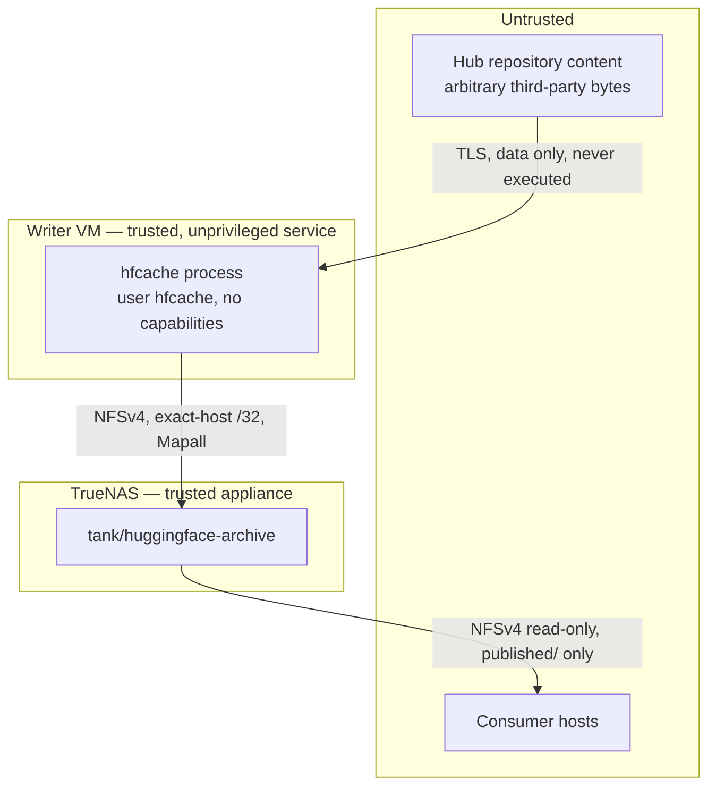

# hfcache Security Model

| Field | Value |
| --- | --- |
| Status | Normative contract for implementation |

This document states what `hfcache` protects, who it protects it from, what it
explicitly does not defend against, and which control enforces each claim. A
control that is not testable is not listed.

## 1. Assets

| Asset | Why it matters | Primary loss mode |
| --- | --- | --- |
| Published revision trees | The archive's reason to exist; often irreplaceable once upstream is gone | Deletion, silent corruption |
| Revision manifests | The evidence that a tree is what it claims to be | Rewriting to match corrupt bytes |
| References (`current.json`, per-SHA) | What consumers act on | Pointing at a partial, unverified, or missing tree |
| Audit records and journals | The ability to explain what happened | Loss of provenance after a failure |
| The writer host's storage authority | Whoever holds it can destroy the archive | Code execution, privilege escalation |
| Hub credentials, when present | Reusable outside this system | Leakage into logs, TOML, or the archive |
| Protected administrator hash record | Offline password-verification authority for the single human account | Disclosure or replacement outside the API's protected source |

Availability of the *upstream* Hub is deliberately not an asset here. The system
is designed to keep working, and keep its data, when upstream is unavailable.

## 2. Trust boundaries



| Boundary | Trusted to | Not trusted to |
| --- | --- | --- |
| Hub content | Be bytes | Be safe to execute, be well-formed, have safe paths, describe itself honestly |
| Hub transport | Be authenticated and confidential under TLS | — |
| Writer service identity | Mutate the archive | Escalate privilege, read operator secrets beyond its credential, write outside its paths |
| Consumer hosts | Read every configured repository in `published/`, including restricted content when enabled | Write anything, reach any other part of the dataset |
| Operator | Configure and initialize | — (an intentionally malicious operator is out of scope, §6) |

## 3. Threats and controls

### T-01 — Malicious repository content executes on the writer

**Capability.** Anyone can publish a public Hub repository containing pickled
weights, `*.py` modules, custom code referenced by `auto_map`, or a model card
crafted to trigger a parser.

**Controls.** The application never executes, imports, unpickles, or instantiates
repository content, never sets `trust_remote_code`, and never constructs
Transformers, Datasets, PEFT, or tokenizer objects (`AD-15`, `NG-09`). Files are
opened for reading bytes and hashing only. Dependency detection parses a fixed
set of known static metadata files — model-card front matter and
`adapter_config.json` — without constructing repository objects; unparseable input is
recorded as a low-confidence observation rather than retried with a looser parser
(`AD-07`).

The independent discovery extractor uses no-follow exact-manifest source access
and [bounded static parsing](discovery.md#static-extraction-and-variants), including
ignored YAML/JSON structure, byte, candidate and retained-output limits. It accepts
a conservative YAML subset without aliases/tags/constructors, never follows URLs
and retains only selected attributed declarations. Its bounds do not retroactively
claim a parser resource bound for the older dependency detector.

Independent README presentation capture uses that same exact-manifest access
and shared budgets. It detects registered/recognized secrets across the original
source before omitting front matter or replacing assets; a match withholds the
whole presentation. Unsupported syntax and unsafe or exhausted input produce
fixed diagnostics without raw source fragments or exception messages. No URL,
code block or document construct grants execution or network authority. See the
[capture subset](web-ui/readme-cards.md#sanitized-presentation).

**Residual risk.** A parser vulnerability in the standard library or in
`huggingface_hub`. Mitigated by keeping the dependency set small and locked, and
by systemd hardening (§5) limiting what a compromised process can reach.

### T-02 — Repository paths escape the publication tree

**Capability.** A repository can name files with `../`, absolute paths, embedded
NUL bytes, unusually long components, or names that collide after Unicode
normalization. A symlink in the cache could point anywhere.

**Controls.** Every repository-relative path is normalized and validated to remain
under the publication root before any link, copy, or write (`FS-09`, `FS-15`).
Every publication source must be a **regular file** contained by the operation's
approved cache root; directories, symlinks, devices, sockets, FIFOs, and dangling
entries are rejected with `HFSYN004`. Two entries in one manifest that resolve to
the same on-disk path — including via case or Unicode-normalization collision —
are rejected rather than silently overwriting one another. The archive dataset is
case-sensitive with no normalization, so the on-disk spelling is the repository's
spelling.

### T-03 — Content is corrupted in transit or at rest, and the corruption is accepted

**Capability.** A faulty network path, a storage defect, or a bug writes bytes
that differ from what upstream published.

**Controls.** Every newly introduced unique object is read and SHA-256 hashed
locally before publication (`AD-18`); a mismatch prevents publication. Upstream
Git OIDs, LFS digests, and Xet identifiers are recorded as comparison values only,
never as substitutes for reading the bytes. Quarterly offline verification
re-reads the retained archive against immutable manifests. A verification failure
never rewrites the expected digest, never auto-prunes, and never re-downloads over
the evidence (`AD-13`); it exits `40` and records findings.

Hardlink staging does not re-read bytes the same ingestion operation just
hashed. It carries that digest only after proving the current source and staged
destination both match the hash pass's `(device, inode, size)` identity; a
replacement or mismatch is `HFSYN005` and is never published. Copy mode lands a
different inode and therefore still hashes and compares the destination.

### T-04 — Corrupt bytes are laundered into the expected value

**Capability.** A naive repair implementation re-downloads a damaged revision and
regenerates the manifest from what it just received. If upstream itself changed,
or the new download is also damaged, the archive now attests to the wrong content.

**Controls.** `repair` verifies the isolated download against the **original**
manifest and stops if any digest differs (`HFRET006`). The replacement manifest
copies the original expected path/size/digest set exactly and preserves the
publication generation; the original manifest is kept byte-for-byte (`FS-06`,
`FS-07`). The implicated cache inode is never reused: repair downloads into a
fresh transaction-scoped cache.

### T-05 — A downstream consumer modifies or deletes archive content

**Capability.** A consumer host is compromised, or simply runs a tool that writes
to its mount.

**Controls.** Read-only is enforced **server-side** by the TrueNAS export, not by
client mount options, and the consumer export exposes only `published/`. Writer
and consumer client selectors are disjoint, with the writer restricted to an exact
`/32`. `.store`, `audit`, and `runs` are mode `0700` and are outside the consumer
export entirely. Hardlink deduplication is never preserved at the cost of
server-side read-only isolation: if the export topology cannot provide both, the
documented fallback is two datasets plus copy mode.

**Residual risk.** `AUTH_SYS` means a host on the consumer network can claim any
uid. This is accepted for a trusted isolated storage VLAN because the export is
read-only regardless of claimed identity. `KRB5I`/`KRB5P` is the documented path
when cryptographic client identity becomes necessary.

### T-06 — The archive is written to the wrong place

**Capability.** The NFS mount fails, is remounted elsewhere, or configuration
points at a stale path — and a multi-terabyte download lands on the writer's root
filesystem, or into an unrelated dataset.

**Controls.** Every mutating command proves, before any download: the root exists,
is a mount point distinct from its parent, is an NFS/NFSv4 filesystem, is
read/write, and carries a sentinel whose UUID matches `storage.archive_id`
(`FS-01`–`FS-03`). Writability is proven by a real create/fsync/rename/delete
probe, because the Mapall export makes `st_uid` comparison meaningless (§the architecture contract).
The bare `/srv/hfcache` mount point is root-owned and not writable by the service
identity, so an unmounted archive fails closed rather than filling the root
filesystem. Failure is exit `20` before the first byte is fetched.

### T-07 — A token leaks

**Capability.** A credential in configuration, a log line, an exception message, a
run report, or a file written to shared NFS storage is readable by anyone with
access to that surface.

**Controls.** No configuration key accepts a token; a literal Hub secret in
archive TOML is `HFCFG010`, reported by key path and never echoed. Hub tokens arrive
only through a systemd credential or an explicit `--token-file`; API tokens use
separate explicit protected files or named systemd credentials. Tokens are never
written to the archive, and never appear in a manifest, run report, journal, or log at any
verbosity. Ambient discovery is disabled: `HF_TOKEN`, `HUGGING_FACE_HUB_TOKEN`,
and cached home-directory tokens are ignored, and Hub calls pass an explicit
`token=False` or an explicit token — never `token=None`, which would re-enable
implicit discovery.

The shared sanitizer removes sensitive keys and recognized Hub/bearer/signed-URL
shapes, plus exact credential values registered by loaders before use. This last
boundary covers opaque API tokens without assuming an `hf_` prefix; no regex can
recognize every unknown arbitrary secret. Keep registration for the process
lifetime, never clear it between requests. Logs capture sanitized fields at
emission and sanitize formatting; `Problem` snapshots and its public rendering,
and application exception string/repr paths, sanitize diagnostics too. Preserve
safe code/shape evidence without exposing raw exceptions, request input or
tracebacks to a caller. server authentication registers resolved API credentials before use;
metadata lifecycle must apply the same boundary to route validation/exception output.
See [decision 111](adr/decision-111.md).

Basic Authorization text is scrubbed unconditionally, independently of the exact
secret registry. The protected administrator record contains a salted hash,
never plaintext; only the API receives it. Failed supplied passwords are neither
registered globally nor retained in logs, traces, diagnostics or operation state.
Provision passwords through protected non-echoing input, never arguments,
environment, files or SPA JavaScript. Browser-managed Basic credentials have no
reliable application logout; see [administrator policy](server.md#basic-administrator).

**Consequence beyond leakage.** Disabling ambient discovery also removes a
correctness hazard: a developer's cached credential cannot silently give a
production run access that the configuration does not describe.

Verification has a separate authority boundary: shared verification never
constructs a Hub client, resolves a credential, or changes process-wide offline
environment settings. The shipped unit supplies `HF_HUB_OFFLINE=1` and
`IPAddressDeny=any`. The dedicated executor initializes the offline flag
once before Hub imports and independently requires the no-IP sandbox; the
startup helper alone is not an egress control. The private executor and its
profile-specific confinement own that boundary; installed acceptance remains
separate from source or transient native probe evidence. A network-enabled ASGI process is never a fallback verifier.

### T-08 — Restricted content crosses the intended authorization boundary

**Capability.** A credential can read private or gated repositories, but a
configuration or consumer export exposes those bytes beyond the people and
systems authorized to receive them.

**Controls.** Restricted scope requires the explicit
`hub.token_mode = "required"` policy and a resolved credential (`AD-21`); a token
found under `optional` remains public-only and private/gated metadata is
`HFHUB006`. Tokens never come from ambient discovery (`T-07`). The operator must
place every consumer of the single `published/` export inside the same content-
authorization boundary as the credential owner; the archive does not claim
per-repository ACLs it cannot enforce. `hub.expected_account` plus `doctor`
proves the installed credential is the intended Hub identity before enabling a
sync. The mode and expected account are included in the configuration
fingerprint, while the secret and its path are not.

**Residual risk.** `hfcache` cannot interpret a repository's license or gate
terms, nor can it learn that an off-host consumer later left the authorization
boundary. Revoked upstream access stops future retrieval but deliberately does
not destroy retained bytes (`AD-06`); the operator is responsible for applying
the explicit purge workflow when continued retention is no longer authorized.

### T-09 — A supply-chain compromise reaches production

**Capability.** A malicious release of a dependency, or a substituted artifact at
install time.

**Controls.** Dependencies are locked in `uv.lock` with hashes and installed with
`uv sync --frozen --no-dev --no-editable` at deployment time — never from a
systemd unit and never during a scheduled run, so a sync can never resolve or
fetch a package. The uv version is pinned, its release artifact verified, and its
self-update behaviour disabled. Release trees and virtual environments are
root-owned and read-only to the service identity. The runtime dependency set is closed except for the explicit maintained
client/server/optional MCP protocol exceptions in FW-03/FW-04.

### T-10 — A local unprivileged user on the writer influences a run

**Capability.** A non-root account reads or modifies application state, or plants
input a run will consume.

**Controls.** `/opt/hfcache`, `/etc/hfcache`, and unit files are root-owned;
configuration is `0640 root:hfcache`. `/var/cache/hfcache` and `/var/lib/hfcache`
are `0750 hfcache:hfcache`. The service account has no interactive login, no
password, no sudo access, and no Linux capabilities. Runtime state is under
systemd-managed `RuntimeDirectory`. SELinux is enforcing throughout.

### T-11 — Resource exhaustion turns into data loss

**Capability.** A repository is far larger than expected, a run fills the dataset,
or the local Xet transfer cache exhausts the writer's root filesystem.

**Controls.** `plan` reports logical size and estimated new bytes before a
repository is enabled. Preflight requires free capacity exceeding the estimate
plus the configured reserve, and fails with `HFMNT011` before downloading. The
Xet transfer cache is pinned to `/var/cache/hfcache/xet` on local disk, its peak
usage is reported in every run report, and exceeding its advisory ceiling warns
`HFWRN009`. A failed or aborted run never deletes a retained revision (`TX-06`).

A continuation-enabled queue is admitted against its aggregate download and
copy-publication requirement before the first transfer, then each transfer
rechecks capacity immediately before it starts. Only one repository transfer is
active, so `sync.max_workers` remains the global Hub worker budget rather than
being multiplied by queue depth. The producer is drained before the archive
lock is released, preventing an unowned background writer.
Cache transfers and retention's whole-cache scan are process-serialized, and
queue-ahead retention waits until every downloaded snapshot has been consumed.
Copy publication rechecks space and holds the same allocation guard through
staging, so a concurrent download cannot consume the headroom the copy proved.

### T-12 — An automated repair destroys good data

**Capability.** Recovery logic encounters an ambiguous state and picks a
resolution.

**Controls.** Recovery is roll-forward oriented and refuses to guess: unknown
journal versions, impossible checkpoint combinations, contradicted evidence, and
genuinely ambiguous state all stop with `state = "needs_operator"` and exit `20`
without mutating (`AD-16`, §`docs/architecture.md` §7.9). Unknown files are
reported and preserved, never deleted (`FS-19`). Where a transaction can fail
leaving more or less data, it leaves more (`TX-06`). Quarantined evidence is
released only by explicit operator action.

Whole-repository deletion is a separate `purge` command, never a consequence of
an upstream error or configuration edit. It requires `--apply` plus explicit
unmanaged selectors or `--all-unmanaged`, refuses every repository still in
configuration, validates that references and manifests explain the complete
shallow layout, and preserves any unknown entry. Each repository has its own
durable transaction: pre-commit recovery restores it completely; post-commit
recovery never silently republishes it and retains byte-for-byte manifests plus
reason records under `audit/pruned/` (`AD-20`).

### T-14 — A management caller gains unintended authority

**Capability.** A caller presents a malformed, leaked or wrong-interface bearer,
or a changed configuration redirects a long-lived server's authority.

**Implemented controls.** Strict separate server configuration keeps
transport/auth settings immutable until restart. Fresh archive-policy snapshots
retain the startup root/UUID and fail a changed authority closed. Required REST
writer and optional reader/MCP sources use only explicit protected files or named
systemd credentials; an unconfigured optional class grants nobody access. Every
active source must load. optional MCP transport ignores the MCP source while disabled; enabled
MCP requires it and the optional package. Descriptor-pinned no-follow reads validate inode
type, owner, mode, group access, single hardlink, bounded content and stable
metadata. Directory traversal uses pinned Linux `O_PATH` handles with no-follow
opens; it needs parent search access without reading or listing directories.
The credential leaf still requires a readable checked descriptor. No directory
permission or SELinux grant follows. The narrow root:root `0440` ACL form grants owner-read and one
effective-UID read entry, no owning-group/other access and a read mask. Its exact
five-entry version-2 value is checked through the pinned descriptor before and
after content reading, with final metadata verification. All other ACL shapes
refuse this alternative; ordinary group-authorized source policy remains.
Authentication changes no ACL or permission. See
[decision152](adr/decision-152.md). The unreleased source implements this
policy with recorded owned native/rootless application acceptance; production
provisioning remains separate. The API token grammar rejects Hub-style `hf_` values. Exact opaque
values are registered for redaction; the registry keeps only fixed-size digests
and constant-time comparisons over three slots. Distinct class values prevent
cross-interface ambiguity. Bearer principals retain a nonsecret class label,
never a token, digest or individual-user claim. Every reader shares AD-21's
whole-archive authorization boundary.

An optional restart-only Basic provider uses one strictly protected schema 1
record with stable ASCII subject, printable UTF-8 username and canonical Argon2id
PHC. Exact version 19/m65536/t3/p1/salt16/hash32 validation precedes any hash work;
encoded Authorization/username/password bounds are 8192/128/1024 bytes. A dedicated
two-worker/eight-waiting executor is independent of operation observation.
Global failures plus active reservations are capped at 30 per sliding 60 seconds;
queued work rechecks the budget. Cancellation retains admission until actual
completion; shutdown/partial startup stop new work, drain accepted jobs and join
the owned workers. Capacity/throttling is HFAPI021/429/exit20, never successful
authentication. Wrong user/password perform equivalent configured hash work.

The optional rootless record stays at
`/etc/hfcache/credentials/ui-administrator.json` in the API's existing read-only
configuration bind. Existing worker/client masks hide that credentials directory;
Caddy never receives the configuration bind. This adds no unconditional Podman
secret or runtime-format migration. Native delivery uses a separately provisioned
optional encrypted named credential. Source packaging alone does not prove those
roles are isolated in an installed environment or activate any service.

Basic remains REST-only and projects the existing `rest-writer` class/read+write
array. Internal stable subject/authentication method and five separate admin
grants never widen public schemas or bearer permissions. Host effects still
require the separate protected helper/policy proof. Preserve TLS/trusted-proxy
and corroborated native Unix boundaries. Configured Basic's cheap work limits and
TLS proof may precede hashing; missing/bearer credentials retain authentication
before those limits. Ordinary Host/Origin, CSRF and route errors follow
successful authentication, before body reception. Every Basic method other than
GET/HEAD requires exact single configured Origin, JSON and exactly
`X-Hfcache-Request:1`, including preflights and unknown paths. Missing/null/foreign/
duplicate Origin, simple forms/encoding and bad intent refuse. No-Origin bearer
compatibility and MCP bearer-only isolation remain. Source enforcement and
[boundary](../tests/unit/test_web_basic_boundary.py),
[provider/pool](../tests/unit/test_web_basic_pool.py) and
[key-identity tests](../tests/unit/test_basic_operation_identity.py) are distinct
from browser, Caddy and installed deployment acceptance; see [decision146](adr/decision-146.md).

REST authentication failures use sanitized `HFAPI001`/401 plus the supplied
scheme's challenge; missing REST credentials with Basic enabled advertise both.
MCP and explicit bearer failures retain only the Bearer challenge;
disabled Basic retains that same legacy challenge.
capability denial is `HFAPI002`/403. Unsafe/malformed/racing credential sources
and duplicate class values fail startup with `HFAPI003`/`HFAPI004`. The reusable
FastAPI bearer adapter calls the application-owned verifier; extraction alone
does not authenticate. metadata lifecycle's outer boundary now authenticates metadata routes,
unknown paths/methods, health, schema and optional docs before routing/body
validation. It rejects malformed Host/duplicate Origin, bounds headers/query/
body/normal and streamed responses, disables slash redirects and raw framework
request logging, and returns sanitized typed problems with no-store/nosniff/frame
headers. Explicit trusted TLS proxy rules and one Unix/TCP lifespan are tested
on disposable sockets. Shared no-follow reader/work budgets cover legacy local
query paths too; unsafe derived catalogs retain unknown confidence and never
grant repair authority. bounded runner and private verifier supplies the execution/protocol boundary; scheduled observation
packages service hardening while installed enforcement remains operator
acceptance. Recorded installed 0.2.1 peer connectivity has narrower scope than outstanding
NAS/domain/other-host acceptance; see [deployment status](deployment-status.md). See
[decision 112](adr/decision-112.md) and [server policy](server.md).

**Control-state boundary.** Local receipts bind admission to a fixed public
credential-class principal and hashed idempotency key before acknowledgement or
execution. Store no raw key, bearer, token digest/path or candidate request body.
The key digest is private comparison state and is omitted from HTTP metadata.
All authenticated REST readers may observe operation metadata/events/results
under the whole-archive boundary; key lookup searches only the caller's namespace.
The separate scheduled observation scheduled observer stores its generated nonsecret key in
private local state for lookup-only recovery, never a bearer or token digest;
that does not add raw keys to server receipts/HTTP metadata.
Bearer digests/rotation preserve their exact legacy class namespace. Basic uses
the independently versioned, NUL-separated and length-framed stable-subject/key
preimage in [the API contract](api.md#admission-idempotency-and-lifecycle), never a
printable surrogate. Subject-preserving username/password rotation keeps the
original handle; another subject or bearer selects a distinct namespace. No
subject/authentication field or private attribution sidecar joins old receipts,
and historical class labels gain no individual-user audit claim. A status/result
fetch never executes work.

Protected no-follow local state, finite record/event/result/byte budgets and
durable atomic receipts contain storage/resource risks. An unexpired terminal
key cannot be evicted for capacity; interrupted/ambiguous/nonterminal history
cannot expire. Unsupported or unexplained state is preserved and fails admission
closed. Restart does not replay queued/running receipts or reconstruct submissions
from archive journals. Missing/expired history remains uncertain. See
[decision 114](adr/decision-114.md), [schema](schemas.md#13-service-private-operation-control-state)
and [recovery guidance](recovery.md#preserve-four-kinds-of-authority).

**Execution boundary.** One bounded lane and one absolute waiting
deadline limit heavy work; command services still own the common flock and
compare fresh installed policy inside it before mutation. Strict bounded
verification-only frames and kernel peer UID checks on a protected Unix socket
replace any in-process verification fallback. The dedicated inherited-socket
bootstrap refuses known credential environment sources and unexpected inherited
descriptors, initializes the library offline flag before shared imports and
never resolves a Hub/API credential. Protocol outcomes retain exact operation/
fingerprint/domain-result identity. Unavailable/unsafe status preserves active
evidence and disables execution across restarts; it cannot erase the barrier by
marking an unreachable worker interrupted. Reader metadata remains available.

Socket-file ownership and the listener's kernel peer UID are separate checks.
With native system-manager activation, the node belongs to the configured
service account, while `SO_PEERCRED` identifies the root manager that created
the listener. Configure `verification.expected_peer_uid = 0` and set
`verification.expected_socket_owner_uid` to that installation's measured service
UID. Accepting inherited FD3 does not change the creator's credentials or make
the manager the actual worker. The worker still validates its own socket
ownership and the connecting API's identity. Omission of the owner setting
preserves the previous rule: owner equals the resolved expected peer UID;
omitting both settings uses the API's effective UID. Rootless worker-created
listeners retain their existing equal owner/peer identity. Both checks remain
mandatory, with no alternate UID or listener fallback. See
[decision 148](adr/decision-148.md) and
[private client settings](server.md#private-verifier-client-settings).

These process/protocol checks do not enforce OS egress restrictions or identify
arbitrary unknown secrets. scheduled observation packages socket activation, service identities,
credential-source masking and `IPAddressDeny=any`; actual cgroup/credential/
SELinux/NFS enforcement remains installed hardening acceptance. Custom development
source paths need explicit masks/probes. Standalone development invocation cannot claim that
sandbox. No request starts a generic subprocess or invokes systemctl/sudo.
See [decision 115](adr/decision-115.md) and
[private verification trust](server.md#verification-wire-and-local-trust).

**Typed command boundary.** Sync and every actual verification require
writers before body reception. Mixed-route capability checks happen after bounded
strict JSON parsing but before DTO validation: candidate presence requires a writer,
and diagnostics permits a reader only for literal `read_only=true`. Missing mode
never silently becomes a probe. All recognized POST bodies have explicit media,
encoding, duplicate-key, Unicode, depth and actual-byte limits; errors do not echo
unknown fields or framework input. Typed services preserve domain refusals and
partial results. Four job routes require a key, including plans/read-only diagnostics;
202 means admission, and disconnect never cancels accepted work.

The only Hub token override is the trusted startup `serve --hub-token-file` source,
under existing installed policy. API bearers are never reused as Hub tokens and
HTTP requests cannot supply credentials, server paths or endpoint overrides.
Installed validation resolves only that source or the installed systemd source,
without a Hub request. Pure bounded candidate assessment compares root/UUID,
endpoint, token mode, credential name and expected account; it never resolves a
candidate credential, reads a candidate-selected path, contacts the Hub or installs
policy. API-backed reader CLI now exposes writer-only candidate content validation/planning,
with fresh installed-authority checks before Hub work. See
[decision 116](adr/decision-116.md), [body/role rules](api.md#command-requests)
and [candidate authority](configuration.md#12-candidate-authority-validation-and-planning).

**Explicit maintenance boundary.** Reader previews and writer-only
apply resources have separate URLs and strict scopes; all are keyed bounded jobs.
No omitted mode authorizes mutation, no caller-supplied plan is executable and
no preview grants a later capability. Under-lock fresh policy/scope/proof checks
refuse queued staleness, newly configured purge targets and changed quarantine
evidence. Unknown content, repair quarantine and ambiguous transactions remain
preserved; original manifests/audits and existing pre/post-commit recovery rules
remain authoritative. Repair uses the installed Hub credential and exact original
expectations, not a request-selected endpoint or replacement digest.

The restart-only maintenance switch is disabled by default and gates initialization
only, before body reception/POST retry handling. Even a previously bound key does
not bypass a disabled gate; authenticated lookup/status/result still observe it.
Enabled initialization additionally requires writer capability, strict confirmation
and the configured root/UUID restated. These fields cannot select another archive.
Initialization's own locked checks refuse existing/unsafe/unknown state and write
the sentinel last. Startup, health, recovery and missing sentinel never initialize.
See [decision 117](adr/decision-117.md), [maintenance resources](api.md#maintenance-requests)
and [server gate](server.md#command-admission-and-policy-authority).

**Reader/client authority.** Separate strict client settings select one
URL/socket endpoint and explicit protected API source; no archive configuration,
Hub token, service UID or mount is required. Explicit endpoint overrides replace
the configured group. Verified TLS/default or explicit CA trust, safe prefix URLs,
no redirects/ambient proxies/netrc and exact same-operation link checks keep the
bearer bound to the intended authority. Local Unix sockets still authenticate.
REST acceptance distinguishes only trusted supported native Unix scope for unprefixed
REST: `client=None` plus `server=(absolute Unix socket pathname, None)`.
Peer absence alone may be a socket error and cannot bypass prefix/proxy-TLS;
missing/malformed local evidence fails closed. TCP keeps configured public
prefix/TLS/proxy/Host/Origin checks. No forwarded
header grants native authority. Request-scoped links/schema copies do not mutate
global public prefix or OpenAPI cache state ([decision 123](adr/decision-123.md)).
Malformed/oversized/truncated/unversioned or identity-inconsistent responses refuse
under finite byte/page/retry/poll budgets without echoing raw bodies/transport errors.

Client keys exist before POST transmission. Lost acknowledgement preserves its
original key/route and an uncertain outcome; no automatic POST/new-key replay,
local archive fallback, daemon startup or cancellation of accepted work follows.
Old operation results retain admitted UUID/fingerprint and exact domain IDs/exit.
The optional installed client file is a declared source, not permission to discover
Hub/API tokens elsewhere. Global CLI options are stored now; operational migration
is completed for reads/candidates by API-backed reader CLI and operational CLI/observation by
CLI operation observation.
See [decision 118](adr/decision-118.md) and
[client setup/troubleshooting](api-client.md).

**Reader/candidate integration.** Migrated reads report writer truth
without client archive TOML/mount/service identity/Hub credentials or local fallback.
Exact server Envelope IDs/times/exit are retained; complete finite page aggregation
and current-publication joins refuse inconsistent evidence. Remote inspection
requires no client path, and optional root restatement cannot select server paths.
Local help/version and explicit local config validation are bootstrap exceptions.
Explicit archive `--config` on other API reads and Hub-token overrides are refused.

Writer candidate validation reads bounded UTF-8 content from the CLI host, never
a pathname on the server, and resolves no credential/Hub/probe. Valid incompatible
policy stays valid with false compatibility and mismatch names; broken installed
policy permits syntax validity with unknown compatibility. Neither result grants
planning/install authority. Candidate planning rechecks root/UUID/endpoint/token
mode/credential name/expected account before installed credential use, including
the credential name excluded from policy fingerprints. Candidate policy controls
preview intent only; installed limits/admitted fingerprint remain authoritative.
Exact candidate text binds a key; absent fields preserve old installed-plan digests
and explicit null refuses. REST cannot install policy/backups or give browsers
bearers. See [decision 119](adr/decision-119.md), [candidate contract](configuration.md#12-candidate-authority-validation-and-planning)
and [CLI migration](api-client.md#cli-dispatch).

**Operational CLI observation.** No operational command imports or
invokes a direct local mutation backend. Pure requests and typed HTTP retain
server-owned credential/preflight/flock/recovery/private-verification authority.
Validated nonsecret keys and accepted operation IDs are safety handles, emitted
even quiet; credentials/raw logs are never progress. Sequenced bounded sanitized
events/status/result reads share one finite deadline. Observer interruption retains
handles and says accepted work may continue, never cancellation/new-key replay.
Retained-key validated 5xx failures carry the same uncertainty warning, and event
rendering escapes nonprintable/control text to preserve one plain stderr line.
JSON exact terminal Envelopes and separately identified detach cannot be confused;
human rendering summarizes classified terminal data.
No-confirm init is inspection/refusal only, not a privileged submission. See
[decision 120](adr/decision-120.md) and [CLI operations](cli.md#operations).

## 4. Controls summary

| # | Control | Enforced by |
| --- | --- | --- |
| 1 | Single authoritative writer host | TrueNAS export restricted to one `/32` |
| 2 | Server-side read-only consumer export | TrueNAS, not client mount options |
| 3 | Dedicated Mapall identities per export | TrueNAS |
| 4 | SELinux enforcing | Writer host, no permissive domains |
| 5 | Unprivileged service user, no capabilities | systemd unit, account posture |
| 6 | systemd hardening (§5 below) | Unit configuration, validated per setting |
| 7 | Strict path normalization and containment | `FS-09`, `FS-15`, `HFSYN004` |
| 8 | No execution, import, or unpickling of repository content | `AD-15` |
| 9 | TLS verification always on for Hub requests | `https://`-only endpoint, `HFCFG014` |
| 10 | Immutable commit SHA for every download | `AD-01` |
| 11 | SHA-256 manifest before publication | `AD-18` |
| 12 | Hub secrets via systemd credentials or `--token-file`; API secrets via distinct protected sources | `docs/configuration.md` §7, `docs/server.md` |
| 13 | Locked dependencies, frozen deployment install | `uv.lock`, `uv sync --frozen` |
| 14 | Restricted scope requires explicit required-token mode and one authorized consumer boundary | `AD-21`, `HFARG008`, `HFHUB006` |
| 15 | Explicit configuration required for any dependency archiving | `AD-07` |
| 16 | Unknown state reported, never deleted or guessed | `AD-16`, `TX-06` |
| 17 | Fail-closed preflight before any download | Exit `20` |
| 19 | Fixed capabilities, restart-only auth and bounded typed command/metadata routes | `T-14`, `docs/server.md`, server registry, metadata boundary and typed command routes |
| 20 | Protected single administrator, bounded independent password work and unsafe-request origin checks | `T-14`, decision146, optional Basic provider and outer application boundary |

## 5. systemd hardening posture

Hardening must be validated against the actual executors and their workloads.
Repository fixtures and property inventories do not prove installed enforcement.
Use the [explicit diagnostic modes](#hardening-diagnostics); they never weaken
settings to make a check pass. A transient native process supplies evidence only
about that process, and cannot certify rootless PID1, cgroup or peer boundaries.

```text
NoNewPrivileges=true          ProtectKernelTunables=true
PrivateTmp=true               ProtectKernelModules=true     RestrictNamespaces=true
PrivateDevices=true           ProtectKernelLogs=true        LockPersonality=true
ProtectSystem=strict          ProtectControlGroups=true     SystemCallArchitectures=native
ProtectHome=true              ProtectClock=true             CapabilityBoundingSet=
ProtectProc=invisible         ProtectHostname=true          AmbientCapabilities=
ProcSubset=pid                RestrictAddressFamilies=AF_UNIX AF_INET AF_INET6
```

Writable paths are limited to the NFS archive and the systemd-managed state,
cache, and runtime directories. `RestrictSUIDSGID=true` is deliberately absent:
it blocks the setgid directory creation that publication requires. The narrower
controls are `nosuid,nodev,noexec` on the archive, `NoNewPrivileges=true`, and
empty capability sets (decision 61). The probe must test `mkdir` followed by
`chmod` and assert the resulting setgid mode (decision 66).

The verification unit additionally runs with `HF_HUB_OFFLINE=1` and
`IPAddressDeny=any` (decision 60). `PrivateNetwork=true` remains an
operator-supervised reconnect evaluation, not an enabled protection.

**documentation maintenance reconciliation (2026-10-17, decision 106).** These statements
reflect the existing deployed-unit decisions 60, 61, and 66. The authorization
statements in §§6–7 also reflect `Hub access` / `AD-21`; no runtime control or
authorization policy changes here.

**scheduled observation role amendment (2026-10-18, [decision 121](adr/decision-121.md)).**
The setgid-compatible archive policy now applies to actual API/private-verifier
executors; AF_UNIX scheduled clients mask archive access and can safely enable
`RestrictSUIDSGID=true`. Worker startup is offline and imports no credentials;
its namespace hides standard credential stores/runtime credentials/daemon token
cache, with custom development paths requiring explicit masks/probes. Executor-
aware probes use installed unit/drop-in properties and refuse wrapper-unit names.
Repository activation/unit/dry-run evidence cannot certify actual cgroup no-IP/
no-credential, SELinux or NFS behavior; those remain deployment holds. No sandbox
is weakened to pass a test.

SELinux remains enforcing throughout development and acceptance testing.
Denials are resolved by fixing ownership, labels, or unit restrictions first, and
only then by a narrowly scoped local policy module with documented source, build,
installation, verification, and removal steps. `setenforce 0`, permissive domains,
and blanket allow rules are not production solutions (the architecture contract).

## 6. Explicitly out of scope

Naming these keeps the model honest — each is a real risk that this system does
not address.

| Out of scope | Why |
| --- | --- |
| Compromise of the TrueNAS appliance | It is the storage root of trust; nothing the writer does can compensate |
| Root compromise of the writer host | Root can rewrite the archive and its evidence; the service identity is the boundary, not root |
| A malicious operator | The operator configures, initializes, and holds sudo by design |
| Physical access to either machine | Site security concern |
| Judging whether archived content is itself safe or lawful to use | The archive stores faithfully; consumers evaluate what they run (`NG-04`, `NG-08`) |
| Upstream publishing backdoored content that hashes consistently | Correctly archived by definition; detecting it is a different product |
| Denial of service against the Hub, or by the Hub against us | Handled as an availability condition (`HFHUB001`, `HFWRN006`), not a security control |
| Confidentiality beyond the configured consumer boundary | Restricted content is supported under `AD-21`; the export has no per-repository ACLs or protection from an authorized consumer redistributing bytes (`T-08`) |

## 7. Verifying these claims

| Claim | Test |
| --- | --- |
| No repository code executes | Unit tests assert no `import`, `exec`, `pickle`, or model-construction path exists in ingestion; live tests archive a repository containing `*.py` and custom code and confirm none is loaded |
| Path escapes are rejected | Property-based tests over adversarial path sets, including traversal, absolute, special-file, case-collision, and normalization-collision cases |
| Restricted scope is explicit | Hub tests reject private/gated metadata under `disabled` and `optional`, accept it only under `required` with a credential, and reject missing required credentials; the operator validates the shared consumer boundary (`T-08`) |
| Secrets never surface | Redaction tests over log lines, run reports, manifests, journals, and error messages at maximum verbosity |
| Fail-closed preflight | Unmounted, read-only, wrong-sentinel, and below-reserve archives each exit `20` with no Hub request issued |
| Consumer cannot write | Server-side create, modify, rename, and delete attempts from a consumer client all fail (operator-run; `storage administration`/`storage administration`) |
| Hardening does not break operation | `systemd-analyze verify` clean, a full sync under enforcing SELinux with no unexplained AVC denial |

## Optional MCP transport boundary

[Decision 124](adr/decision-124.md) adds only an explicitly enabled authenticated
Streamable HTTP mount after committed REST acceptance. Production verification
subclasses the supported FastMCP verifier and delegates to the same protected
opaque-token registry with `interface="mcp"`; only the distinct fixed MCP reader
matches. It is a whole-archive capability under AD-21. REST writer/reader and Hub
credentials cannot cross that boundary, and MCP credentials never grant REST
access. A session ID grants no authority; every supported transport request
requires its bearer. No ambient auth provider or development static verifier is
permitted. Disabled mode imports/resolves neither package nor MCP credential.

Transport checks retain strict Host/Origin/TLS/proxy/public prefix, corroborated
native Unix identity and finite resource limits. MCP startup composes with REST
ownership and fails closed if its package/credential is unavailable. Exactly
fourteen curated metadata tools are exposed; no resource, prompt, arbitrary dispatcher,
OAuth login/discovery or credential issuance is supplied. Pre-provisioned bearer clients must protect
and send their credential over the configured verified transport; compatibility
with OAuth-only clients is not promised. Exact wire/session and streaming
behavior is specified by [the MCP contract](mcp.md).
No host hardening or production installation is inferred from those tests.

The transport uses stateless HTTP, without a retained legacy session/resumption
store. Canonical `/mcp/` is separate from REST's strict slash behavior; only the
specific authenticated `/mcp` spelling may redirect using a safe relative
Location after transport/body/query validation, never caller input reflection.

One path projection determines public/native interface spelling, authentication,
early writer/body checks and effective prefix, including public-prefix collisions
with `/mcp` or `/api`. A public REST route must not acquire MCP authentication by
prefix resemblance. MCP rejects query parameters, requires bounded strict JSON
POSTs/empty other bodies and limits separate in-flight work. Finite JSON replies
are buffered/sanitized and capped before headers, with no truncated-success or
retained SSE/session queue. Registered numeric RPC identities that cannot be
safely reflected must refuse rather than leak or silently change identity.

## Curated MCP read capability

[Decision 125](adr/decision-125.md) and its discovery amendment expose fourteen
typed metadata tools, with
no resources/prompts, automatic OpenAPI conversion, generic command/path/URL
fetcher or hidden writable capability. Tool functions receive a narrow async read
protocol only, not SDK Context/Request/app objects or command, Hub, credential
resolver or writable helpers. Bounded metadata workers call validated shared
readers with fresh pinned installed policy; no tool creates a receipt, hashes
archive payload bytes, probes, recovers/cleans, installs config or rebuilds catalogs.

Read-only/non-destructive/closed-world hints are descriptive, not enforcement.
Archive-derived names, dependency observations, report messages and metadata
remain untrusted data, never instructions or executable content. The fixed
registry/schema and success/failure archive/control-state comparisons must prove
the actual boundary. SDK argument/not-found errors and backend classified errors
use stable codes/fixed safe text without raw rejected values. Explicit artifact
projections never grant complete-manifest authority or promote unknown confidence;
exact SHA/publication requests cannot fall back to newer current content. MCP
readers retain AD-21's whole-archive authorization, without per-repository ACLs.

## Mounted MCP security proof

The [threat/control/test map](mcp.md#read-only-boundary)
connects each acceptance claim to concrete mounted tests. It applies existing
T-01/02/07/08/12 and INV-002/003/007/010/016; it adds no tool, role or command
capability. The [recorded deployment scope](deployment-status.md)
owns actual runs and separates repository proof from deployment assumptions.

| Security boundary | Required proof |
| --- | --- |
| Transport and credential class | Parent lifespan plus actual streaming/session requests, all methods and bearer classes, REST isolation and Host/Origin/prefix/proxy refusal; session replay never substitutes for authentication |
| Closed authority and untrusted input | Exact registry/resources/prompts and closed argument schemas, writer-name/dispatch/path/credential attempts, fixed safe errors and no execution of archive-derived strings |
| Evidence preservation and confidentiality | Before/after full paths/content/modes for every valid/invalid tool, no command/Hub/credential/archive-byte-hashing work, malformed original evidence preserved, no secret in wire/error/log or cursor binding, no false verification confidence |
| Bounded mixed-interface lifetime | Concurrent REST/MCP reads remain responsive with separate correlation and finite budgets; cancellation and drain retain real request/worker ownership without adding MCP artifacts |

No background authority means no retained task/job or operation receipt. The
locked SDK can ignore legacy top-level `params.task` metadata and execute the
same approved finite read; it need not reject every optional protocol field.
Unsupported task RPCs and mutation-shaped tool arguments still refuse.

Archive-byte-hashing refusals do not prohibit intentional sanitized-metadata
cursor hashes or credential authentication digests. Baselines follow normal
startup allocations; per-call reads must not create new
archive/control state. Atime changes are not application writes. Sanitized
operational logging is the sole documented non-archive exception. REST fixture
mutations during mixed-interface tests must remain attributable to that REST
command, not hidden MCP work. Malformed fixture evidence is introduced before the
baseline and must not be repaired or deleted by observation.

The narrow tool capability is an application boundary within the shared API
process, not a separate process sandbox. Whole-archive metadata authority
intentionally includes restricted repositories; it supplies neither per-repository
ACLs nor individual identity. Registered-value
redaction does not promise detection of every arbitrary unknown secret. Finite
budgets limit a request's resources, not every denial-of-service strategy by an
authorized client. Locked dependencies and the unprivileged sandbox reduce but
do not eliminate parser/SDK or host compromise risk. Actual TLS/proxy/socket/
credential delivery and rotation, worker egress/source masking, cgroup/SELinux/
NFS/workload/other-host/browser acceptance remain separately scoped by
[deployment status](deployment-status.md). Local integration results never
authorize production changes or certify unrelated controls.


## Protected MCP client acceptance

The [example/setup](mcp.md#connect) uses a protected
operator-provisioned MCP-reader file, explicit validated HTTP transport, verified
TLS/optional CA and finite response/page/deadline bounds. Token values never
belong in config/argv/URLs/browser storage; no ambient provider, redirect/proxy
fallback, OAuth login or arbitrary executable/string transport is selected.
Summary output grants no complete-manifest or copy-verification authority.
Version/identity/cursor errors fail safely without rejected-input diagnostics.

Rotation takes effect only on normal server restart; clients must reread the
source in a new context. Separate REST sources and whole-archive authorization
remain unchanged. [Disabled/enabled/rotation/packaging tests](../tests/unit/test_mcp_acceptance.py)
cover application behavior and unchanged credential-free/no-IP worker/timer
policy, not actual installed enforcement. Client/socket tests use owned disposable
fixtures. TLS/firewall/socket/source delivery, worker egress/custom masks,
cgroup/SELinux/NFS and real drain/rollback each require applicable installed
evidence; see [deployment status](deployment-status.md).


## Rootless runtime scope

[Decision 127](adr/decision-127.md) changes the selected local deployment, not
whole-archive roles or FS/TX/domain authority. Explicit user-manager rootless
Podman services and a reviewed system target bridge use fixed immutable images
and safe lifecycle argv. No rootful/privileged/host-PID/host-network/label-disable
or Podman control socket shortcut is allowed. Unknown surviving container/cgroup
state blocks replacement, cleanup and release; infinite application drain replaces
default timed killing. Preserve original local lock and both operation stores.

Caddy receives only appropriate protected TLS material; API receives its distinct
Hub/REST/optional MCP sources; clients receive API authority only. Private worker
receives none, with separate socket mounts, Network=none and a Unix-only native
socket allowlist retaining other baseline seccomp restrictions. Its real PID1/FD3/
SO_PEERCRED/secret/SELinux proof must run in actual disposable containers. Secrets
are mounted with UID 981/mode 0400, never literals in images/env/argv/browser/logs
or hash inputs. Root alone prepares necessary local service account/rootless
fixture infrastructure; Caddy never obtains ACME certificates or installs trust
on another host in this scope.

[Decision 126](adr/decision-126.md) continues to forbid NAS content/metadata writes
and other-host changes. Every NAS bind is read-only without chown/relabel/copyup;
rootless runtime fixtures bind no NAS at all. Source masks, read-only roots and local state
are actual proof obligations, not claims that containers alone establish isolation.
The fixed container client launcher retains service-identity/observation boundaries
without a browser bearer, generic executable input or bare-host fallback.

host read-only guard adds fixed root-protected host boot policy independently of current.
Its standard-library notify guard runs UID/GID 981, proves original local-lock
ownership and host NFS-ro from /proc/1/mountinfo before READY, then retains its
flock. This is not continuous monitoring. Strict sandbox self mountinfo cannot
stand in for the host view; retain hardening and host PID/proc visibility for this
control only. Application containers still get no host PID/proc authority.
The bridge requires guard readiness and the user default target cannot start the
app target. No generic paths/commands or app imports are added to the guard.

## Protected manual writer authority

The accepted [writer decision](adr/decision-165.md) narrowly amends the earlier
read-only-only rootless scope for an independently selected manual-writer
profile. Default guarded deployments and installation windows remain read-only.
Writer mode requires matching immutable runtime/index/helper evidence, fresh
archive permission, actual NFS identity/capacity/ownership, original lock and
Enforcing policy. Only API/worker fixed archive binds and a dedicated confined
writer process type `hfcache_archive_writer_t` gain required archive writes;
generic `container_t` and
helper/observer archive/Hub/secret payload neverallows stay unchanged. Source
and local synthetic archives cannot qualify production NFS. No boolean, relabel,
privileged container, schedule activation or weaker systemd confinement substitutes
for actual installed proof. Manual startup is current-boot only until separately
qualified. [Original-intent closure](job-recovery.md) independently requires
actual executor and protected-effect proof and never grants archive authority.

The explicit writer type derives the reviewed distribution container/image and
network attributes, including `container_domain`, `svirt_sandbox_domain`, the
container/sandbox network domains and corenet types. It retains
`mcs_constrained_type`; Podman retains its generated MCS categories. Generated
policy-internal attributes are not cloned. Stable stock container process/system/
log markers are retained; the kernel exception markers are required to make the
container domain's existing proc mount mediation consistent with base-policy
neverallows. They add no capability or helper/observer permission.
Only its fixed API/worker invocation selects the type. Required NFS/owned-archive
directory/file transaction rights include create, rename, unlink and hardlinks.
Archive symlink create/unlink/read/getattr is required solely by the canonical
Hub cache at `.store/hub` (`AD-09`, `snapshot_download`); publication resolves
cache links into ordinary files. The new explicit archive rule adds no symlink setattr/rename. Inherited stock
container/NFS policy may be broader at independently administered boolean values;
the explicit rule is not a bound on those inherited rights.
SELinux permissions are type-wide, not a MAC selector for that cache path.
The common writer type retains API credential/network rights; the worker's
separate secret-free mounts/masks, network-none and AF_UNIX-only seccomp enforce
its narrower role. Type selection alone cannot establish worker isolation.
Actual peer/recovery review binds selected writer command, payload PID/start,
cgroup and SELinux domain; unknown facts refuse closure/effects. Helper and
observer archive/secret payload neverallows remain unchanged.

The owned target-policy drill distinguishes syntax/binary compatibility from
strict neverallow validation and real confinement. Strict expansion also fails
for the retained distribution/helper baseline; unchanged assertions are retained,
not bypassed or weakened to obtain a green result. Compilation with the exact
copied host compiler configuration plus bounded allow-vector comparison at
freshly observed **active** boolean values establishes only that snapshot's
compatibility and type permissions. The observed existing `virt_use_nfs=true`
already permits stock container NFS rights; this change adds no generic
`container_t` grant and cannot claim the writer is the sole systemwide writer
type. MCS/DAC/mount/namespace/seccomp and actual enforcing positive/negative
workloads remain independent installed requirements. Do not change a boolean or
weaken confinement to make those checks pass.

## Confined private listener ownership

[Decision 128](adr/decision-128.md) qualifies the rootless worker-created listener’s
creation context rather than granting a new SELinux permission. Explicit direct
PID1 --container-listener refuses inherited FDs above stderr, activation fields
and known credential environment before resources/shared imports. The worker
owns only a fresh protected private socket under its existing confinement; native
named-FD3 activation remains strict with no bind fallback. The instance/pinned
parent/created inode remain owned through joined work and exact cleanup; any
existing or replacement path is preserved and refuses automatic reuse/deletion.
The new owned IPC path must be lexically disjoint from configured archive root
and proven local via bounded fixed /proc/self/mountinfo before parent traversal
or bind. Unknown/network mounts refuse without realpath or NAS stat; a bad
startup socket path cannot authorize archive/NAS filesystem access.

[Decision 148](adr/decision-148.md) separates the native client's expected
filesystem owner from its expected kernel peer. It changes neither native
listener creation nor rootless listener ownership, permissions or confinement.
An owner/peer mismatch refuses the original connection; it never authorizes
chown, a replacement acceptor or an in-process verifier.

Only worker private-directory access becomes writable; API mounts it read-only.
Network=none, native AF_UNIX-only seccomp, no secrets/source-store masks, read-only
root, empty caps, NNP, UID/cgroup limits and the shared archive lock remain.
Actual worker-proxied READY follows listener/store/runtime initialization, not
process launch. No allow module, label override/disable, `+` execution, host worker
or network-enabled fallback is authorized. Actual API-container peer access requires installed proof; source tests and
host probes alone cannot establish it. Recorded 0.2.1 scope is described below.

## UBI 10 image-input boundary

[Decision 129](adr/decision-129.md) pins every service FROM stage to UBI 10 micro.
Minimal supplies only Red Hat CA PEM, uv only a build executable and Caddy only
its verified static binary; no donor OS libraries/CA/defaults. Portable CPython
is hash-verified and safely extracted. Fresh-inode Caddy install/empty getcap
preserve NNP/cap-drop; TLS trust verification stays enabled. Micro contains shell
and tools: isolation claims rely on actual fixed authority/confinement, not tool
absence. No secret-bearing fetch, runtime package/pull, SELinux allow/label or
executor/drain shortcut is added. Repeat actual UBI proof before clean rollout.

### Installed peer-control acceptance (2026-10-18)

[Recorded deployment scope](deployment-status.md) includes actual
installed API-container framed PROBE under Enforcing before/after drain/restart.
No allow/process-label/seccomp/executor bypass is used;0.2.0 failure stays history.
This accepts listener connectivity and inspected confinement, not live NAS
verification/workload or other-host security acceptance.

## Hub adapter boundary

Hub access uses an injectable narrow adapter over supported public
`huggingface_hub` APIs. Resolve the requested reference to a full immutable
SHA, retrieve tree metadata and logical size, and enforce configured public
or explicitly authenticated scope before download. Optional identity validation
uses `whoami`. Pass explicit repository ID/type, resolved SHA, private Hub
cache path and configured worker count to `snapshot_download`; never use
allow/ignore filters. Follow transfer with a local-only completeness check.
Return typed metadata rather than library response objects to storage code.
Cache inspection and revision deletion also use the adapter; never infer
backing blobs from private cache-directory names.

Anonymous calls pass `token=False`; authenticated calls pass the exact
validated selected credential. Never pass `None` where implicit discovery
could use a cached credential. The Xet transfer cache is disposable, not
durable archive content. Never execute repository code, instantiate models,
tokenizers, PEFT objects or dataset builders, enable `trust_remote_code`, or
invoke Hub/Git/Git-LFS/Git-Xet subprocesses. Stream hashing in bounded chunks;
never load an entire model file into memory.

## Hardening diagnostics

Native installed inventory and workload entrypoints first require positive
[release layout proof](scripts.md): ordinary source/lock/version metadata and
built environment under an exact internal selector. Container markers, mixed,
unknown or incomplete releases refuse before manager/archive/interpreter effects.
A native acknowledgement alone is insufficient. Fixture unit inventory is static;
default/help/dry-run do not inspect an installation.

`scripts/check-hardening.sh` and its Python payload are static by default.
Import, no arguments, `--help` and `--dry-run` make no manager, archive,
credential or network request. Dry-run prints intent only; it does not inspect
installed properties or prove target validity.

Explicit inventory prints selected sandbox property names without values:

```bash
scripts/check-hardening.sh --mode inventory --profile native hfcache-api.service
scripts/check-hardening.sh --mode inventory --profile guarded-readonly hfcache-verification.service
```

Native inventory reads the system manager; rootless and guarded-readonly
inventory read the caller's user manager. Run user-manager inventory as the
service identity. `--unit-directory PATH` is an explicit fixture inventory
alternative; it is not deployment evidence. Only API/private-verifier executor
unit names are accepted, never scheduled client wrappers.

A native disposable workload requires `--mode workload --profile native`,
`--acknowledge-disposable`, `--archive-root`, `--archive-id` and `--lock-file`.
The target and health area, sentinel and local lock must already exist; the
probe never initializes an archive or recreates a lock. Paths must be absolute,
canonical and free of whitespace, quotes, backslashes and systemd specifiers.
`--target-kind local` selects an owned local fixture; `--target-kind nfs`
requires an exact disposable NFS mount. Production `/srv/hfcache`, symlink
aliases, read-only profiles/targets and all NFS workloads on a host carrying
the production mount refuse. The recorded guarded deployment cannot run archive
write probes. No documentation change authorizes provisioning or running one.

Before any write, prove filesystem locality, strict sentinel schema/expected
UUID, directory ownership/modes and a pre-existing regular local lock. Refuse
symlinks and special files without blocking, acquire the lock nonblocking and
revalidate identity, paths and modes. Write only inside an exclusive random
`.store/health` child. Create files with exclusive no-follow opens; read/hash,
fsync, hardlink, rename and mkdir/chmod setgid there. Cleanup checks exact inode
ownership and preserves unknown or replaced evidence.

The native wrapper copies selected sandbox/read-mask properties and excludes
credentials, environment, lifecycle hooks and shared production writable state.
It explicitly overrides the health write path and private temporary storage;
it does not claim to reproduce every installed property. Native extension and
API DNS/TLS/anonymous Hub/download checks remain available. Network checks run
only with `--allow-network`; a small download alone does not prove Xet transfer.
The verifier checks its offline/credential environment and attempts separate
IPv4/IPv6 actions. A `--credential-probe PATH` is a protected file path, never
a token; the probe opens/closes without reading bytes. Absence or DAC denial is
not proof of namespace masking.

Results are `pass`, `fail` or `not_proven`: exit 0 means selected checks passed,
1 means a demonstrated failure, and 2 means refusal or incomplete evidence.
Missing imports, DNS failure, timeout and unrelated I/O never certify isolation.
Permission errno evidence establishes only that the attempted action was denied.
Seccomp status proves a filter is loaded, not specific syscall rules. Mount and
kernel-tunable visibility checks are observations; they never create files in
`/usr`, `/etc`, `/opt` or write a real kernel setting. The former broad
ProtectHome/ProcSubset/ProtectProc/PrivateDevices/PrivateTmp/namespace/AF_PACKET
claims are not inferred from this reduced safe-observation set.

Direct workload output is a schema-1 diagnostic document scoped to the current
probe process. The wrapper requires the complete role/network check set, rejects duplicate
results and noninteger versions, projects known names/states and suppresses raw
manager errors. Dependency stdout/stderr/logging and exception text are discarded;
values and secrets are never relayed. No numeric score substitutes for installed
cgroup, credential mask, SELinux, peer, NFS or container-readiness acceptance.

Catalog matching checks both registered literals and their casefolded
representations before including labels, technical fields or source values in
visible predicates/facets/cursors. This closes normalization of a known mixed-case
bearer into a lowercase label. Ordinary output sanitization retains its exact
literal contract; the catalog's stricter projection never grants read or write
authority and does not recognize unknown arbitrary secrets.

## Browser administration design

Optional Basic authentication and bounded authenticated application assets are
implemented in unreleased source under the boundaries below. Actual installed
conformance remains separately required; source availability does not enable a
running release. Host/configuration and card controls retain their separate
implementation/acceptance requirements. Preserve bearer REST, separate read-only
MCP, helper confinement and recorded deployment limits. Do not enable unsupported
settings or host effects based on design or a Basic grant alone. See decisions
[140](adr/decision-140.md), [141](adr/decision-141.md),
[142](adr/decision-142.md), [143](adr/decision-143.md),
[UI status](web-ui/README.md) and [server bounds](server.md#web-ui-design-and-current-availability).

Application-owned static serving uses the existing Caddy/TLS/Unix upstream.
Assets are a bounded immutable indexed non-archive release root, authenticated
even on direct Unix access. There is no public static exception, arbitrary file
endpoint, second frontend listener, global edge Basic requirement or hidden bearer
translation. Caddy receives no management hash, archive mount or privileged helper.
Configured paths/prefixes and actual transport establish authority; forwarded
headers, browser storage and request-selected URLs do not.

[Decision147](adr/decision-147.md) makes all enabled UI resources Basic-only and
fixes protected capture before operation admission: no-follow descriptor/linked
identity, protected ancestors, bounded rich mount aliases without archive I/O,
strict canonical indexed members and actual installed version/wire identity.
The service serves immutable captured bytes with a separate finite send budget;
it never reopens a checked path for a request. Unknown/network asset filesystems,
unindexed members, unsupported MIME, symlinks and special files refuse startup.
The sole text/plain exception is the fixed notices file, never arbitrary text or
payload serving. Every partial-startup/shutdown path closes exact owned resources.

Strict bootstrap exposes configured archive identity without claiming a sentinel,
health or permission probe. Inert DOM and real bootstrap/compiled-source equality
plus platform cryptographic checks precede trusted browser state. Entry/module
failure retains script-free recovery; release changes require explicit reload
and retain drafts/original handles. No handcrafted browser hash implementation,
synthetic successful bootstrap, external asset or credential-storage fallback is
introduced. All UI HEAD/error responses are bodyless; cache permissions are
selected only from authenticated validated resources, never reflected headers.

Repository navigation recognizes only the validated type/namespace/name path
under `/ui/repositories/`, in addition to the fixed workspaces. Unknown routes,
extra segments, traversal and encoded separators do not receive a shell. Queries
remain refused. The bounded fragment accepts only an optional complete lowercase
SHA/publication pair and a closed detail-tab name; it grants no path, endpoint or
origin selection. Current resolution is separate from pinned publication reads.
Late responses, same-SHA repair and vanished selected publications cannot silently
substitute newer evidence. Supplemental failures leave independently valid
manifest/inventory evidence distinct. Logical sizes, observation completeness,
README source digests and API health are not fresh publication verification.
See [detail procedures](web-ui/repository-details.md).

The independent Basic provider verifies one protected Argon2id record under
finite header/credential/concurrency/failure budgets before domain work. It
produces an internal stable subject and explicit capabilities, with separate
versioned UI context. Existing credential-class receipt/capabilities schemas and
bearer key mappings remain unchanged. Basic has no MCP authority; a generic REST
writer has no privileged host/configuration authority. Passwords stay outside
JavaScript and application-managed saved browser state. The native challenge requires actual browser
proof; browser-managed Basic lifetime has no reliable application logout.

Basic is ambient authentication: unsafe requests require exact configured same
Origin, JSON media and a non-simple application header. Reject absent/null/duplicate
or foreign Origin, form/text/multipart mutations and cross-origin credentialed
preflights. Bearer clients preserve their existing no-Origin contract. Fetch
Metadata may add protection but cannot replace these checks. Cheap size/work
admission precedes expensive hashing; failed-login capacity is independent of
operation observation. No secrets enter diagnostics, traces or original-handle
recovery state.

Browser recovery keeps only validated nonsecret handles and bounded identity/
terminal metadata in session storage:32records/64KiB, with no credentials,
request/result bodies, configuration text, cards or raw logs. Storage is untrusted;
restored prepared and terminal records require authenticated original observation.
Never evict unresolved handles to admit a mutation. Storage failure before POST
blocks transmission; failure after possible transmission keeps in-memory handles
and the block. Only a proven current-session refusal before fetch may durably
remove its own fresh prepared record before releasing that block. Its local
not-submitted summary is not persisted, and missing receipts never authorize
automatic deletion or replay.

Stable Basic subjects and bearer credential classes retain their separate key
namespaces. Imported IDs do not prove the current reader's creator/key ownership;
manually retained legacy keys remain unbound references. Explicit compatible
reconnect obtains fresh authenticated context without rewriting original admitted
authority. Changed scope/authentication or local authentication generation clears
private cached data while preserving unresolved safe handles. Cross-tab notices
are bounded advisory signals, never execution locks, grants or trusted results.
Stopping browser observation aborts reads only.
Query handles survive route remounts only within one authenticated session.
Session replacement/reconnect permanently clears and retires old handles;
controllers recreate them against the current client. A retired handle cannot
invoke an old loader, including when returned scope values are identical.

Structured configuration editing keeps one RAM-only editable projection and
exact-base local intent diff. It never persists drafts, TOML, protected values or
preview bodies in recovery storage. Configuration-read/write capability and
independent policy are checked separately from host-status read. Client-side
readiness requires the unchanged validated draft and its original complete
assessment; server execution remains authoritative. Every edit, stale base or
session change retires that readiness. Cross-tab advice cannot merge edits,
grant Apply or clear another tab's uncertain operation. Supported JSON is the
closed editable projection, not a protected document or path-selection channel.
Protected application outcome reads are explicit and original-key-bound; they
never retransmit Apply or promote an interrupted generic receipt.
Releasing a browser submission precaution requires a fresh verified original-key
lookup, exact application/archive binding, a terminal verified API receipt and
`pending=false` with `confirmed` or `unchanged`. This is RAM-only configuration
knowledge, not an edited receipt or durable recovery flag; reconnect clears it.
Unchanged means known no-install. No unknown/staged/installed-unconfirmed or
pending outcome can use this exception.

The shared32MiB retention budget measures encoded logical evidence, not exact
heap/RSS. An8MiB observation-response limit only lowers existing route limits;
finite concurrency, retries, cycles, time and event retention are specified in
the [recovery guide](web-ui/operations.md#finite-observation). Exhaustion is
visible uncertainty, not an empty/successful result. API interruption never
clears separate unknown or installed-unconfirmed protected configuration effects.

Apply restrictive CSP with same-origin scripts/styles/connect, no inline
executable scripts/eval, framing/plugins or card forms; `base-uri` permits only
the controlled same-origin deployment base. Use `nosniff` and `no-referrer`.
Browser JSON POSTs explicitly use the `same-origin` request referrer policy to
preserve the exact Origin required by Basic CSRF validation. Their controlled
same-origin URL, same-origin fetch mode and refused redirects prevent disclosure
to another origin. GETs and external links retain `no-referrer`; the response
policy stays unchanged. A null Origin remains a refusal, never a CSRF exception.
No CDN fonts/scripts, service workers, offline archive-data cache or automatic
external asset requests are permitted. HTML/bootstrap/API/card output is
`no-store`; hashed static assets use private caching only. Release changes must
retain drafts and uncertain operation handles until explicit reload/reconciliation.

Host effects cross a narrow privileged Unix helper only after explicit internal
capability, actual peer identity and independently provisioned protected host
policy. Fixed enum operations cannot choose paths/commands/units/managers/UIDs or
credentials. Root API, broad writable host mounts and control sockets are
excluded. Preserve original config/archive locks, candidate/predecessor evidence
and no-replay outcome records. Readiness/version/absence of a mask cannot grant
permission. Rootless unproved schedule/observer bindings deny effects; supported
native positive paths require isolated installed proof.

[Decision150](adr/decision-150.md) fixes the protected reader in the
[host administration contract](host-administration.md). Its root foreground
service reads only fixed selected-release/configuration/policy evidence and owns
one API-only Unix parent/socket/binding. It has no archive payload, Hub secret,
credential-store or IP socket access. `CAP_SETUID`/`CAP_SETGID` serve the fixed
read-only observer and the separately authorized original-pidfd SIGTERM child,
both running as the indexed service account; no process attachment,
memory access, initial-USER SYS_PTRACE/DAC_READ_SEARCH, SELinux-authorized DAC_OVERRIDE,
peer signaling, engine socket, broad API mount or generic subprocess is added.
The observer inspects the fixed manager/container and kernel process facts.
Its fixed entry logs only bounded operator failure metadata: the operation,
builtin exception classes, integer errnos and protected-module function/line
frames, including suppressed exception contexts. Exception text, filenames,
argv, PIDs, payloads and local variables remain excluded. Observer stderr may
reach the daemon journal; raw engine CLI stderr remains discarded. The
[host administration contract](host-administration.md) fixes the record bounds.
Managed startup requests only ambient SETUID within the existing SETUID/SETGID
ceiling, then the fixed entry clears every ambient/inheritable bit before
threads or children. Steady root effective/permitted/bounding sets contain
exactly SETUID/SETGID. Delegated branches retain empty ambient/inheritable sets.

Only the separate fixed engine child may enter the verified service account's
existing USER namespace. The original host observer remains in initial USER
and the helper's masked MNT; neither enters MNT, PID or NET. The engine child
pins pause PID/start/liveness, namespace owner and exact protected mappings,
then retains only namespace-local DAC_READ_SEARCH and SYS_ADMIN in effective/
permitted/bounding sets at fixed API-container exec (bits2+21, mask0x200004);
inheritable/ambient are empty. Lock NOROOT false, NO_SETUID_FIXUP true and
NO_CAP_AMBIENT_RAISE true (securebits0xCE). [Decision151](adr/decision-151.md)
replaces only the earlier SYS_ADMIN-only engine rule. The read/search bit
bypasses DAC directory read/search and regular-file read for all reachable
inodes whose mount-transformed UID and GID both map into that USER, not merely
one metadata path. It grants no write or regular-file execute bypass and does
not bypass SELinux. No initial-USER DAC capability, chmod/ACL workaround or
payload/secret label-access expansion is permitted. Its conditional file-handle
and empty-path link consequences are bounded in the
[host contract](host-administration.md#mapped-inode-read-and-search-amendment-2026-10-21).
Mandatory Enforcing SELinux `hfcache_host_helper_t` confinement starts at first
exec and is inherited by all helper children. Separately typed archive/NFS,
Hub and credential/secret objects deny reads even through proc-root aliases.
Direct masks alone proved insufficient in an owned nonsecret pre-entry probe;
no actual credential alias was probed. The source/installed CIL, loaded-module
receipt and fixed label roles are independent protected authority. No unconfined
fallback, domain escape, policy administration or relabelling is allowed. Root
policy/label changes require fresh installation evidence and restart; the receipt
is not a per-exchange hash of the entire kernel policy. See the
[mandatory isolation contract](host-administration.md#mandatory-selinux-isolation).

Rootless fixed manager reads select the independently indexed account's
existing session bus through a closed environment and
`SYSTEMCTL_FORCE_BUS=1`. Explicit DBUS_SESSION_BUS_ADDRESS alone does not
override systemctl's private-manager transport. Keep the fixed read-only
argv and all indexed-manager, live process/container and original API
socket-pidfd checks. Bus data is not independent process authority. No
private socket exposure, broad user_tmp_t socket permission, relabel or
ambient-address fallback is authorized by this transport selection.
The stock `unconfined_dbusd_t` session-broker variant additionally needs only
`unix_stream_socket connectto` and `dbus send_msg` from `hfcache_host_helper_t`.
The broker authorizes its driver/fallback destination before method dispatch.
Both rights are type-wide IPC authority; MAC does not limit them to a socket
path, UID, unit, method or read-only request. The protected indexed UID/address,
closed metadata argv, strict parser and independent manager/process/container/
original socket-pidfd proofs retain the application boundary. No generic
message dispatch, reverse message, service acquisition, file/ioctl, capability
or transition permission is added. Keep archive/Hub/credential payload denials
and require fresh policy-receipt/index/restart evidence plus installed enforcing
acceptance. Broker journal denials may replace `USER_AVC` when its audit channel
is unavailable; absence of audit records alone proves no message authorization.

The fixed manager reads require `init_t:system status` when systemd has no
unit-file access context, and `systemd_unit_file_t:service status` when the unit
fragment carries that file type. These are type-wide metadata authorizations,
not unit-name or property-name restrictions. Systemctl requests
[all unit properties](https://github.com/systemd/systemd/blob/70bae7648f2c18010187c9cf20093155eaa26029/src/shared/bus-map-properties.c#L228-L240)
and applies its
[selected-output filter afterward](https://github.com/systemd/systemd/blob/70bae7648f2c18010187c9cf20093155eaa26029/src/systemctl/systemctl-show.c#L2256-L2265).
The protected fixed argv and strict output parser supply the closed application
surface. [Decision156](adr/decision-156.md) adds only manager reload and
start/stop on the separately labelled immutable sync-timer unit. Generic unit
types retain status-only service rights; no enable/disable, target/API/worker or
verification-timer control is added. Optional native receipt2 and fresh fixed
labels precede those effects. The exact observer stop separately retains the
original process pidfd and grants SIGTERM only to the separately confined
`hfcache_sync_observer_t`, through a same-UID child; no CAP_KILL or name-only
StopUnit is used. Default native units and journal stream metadata do not attest
a live SDK domain; `init_t` is not a signal target. Optional observer activation
measures one exact protected/indexed context
fragment and dedicated SDK-state label; manager context and original process SID
are freshly joined before admission and again before signal. The optional domain
has only SDK interpreter/configuration/delivered-credential/Unix-API/journal access
and writes to its own scheduled state, with no archive, Hub, helper-private state,
IP or capability authority. Missing proof denies observer control independently
of schedule control. No generic context selector, unconfined fallback, automatic
relabel or helper domain transition is permitted.

After the original-stop flow proves exit through its retained original pidfd,
final validation may accept only disappearance of that invocation's previously
captured fixed systemd credential mount. Capture its full raw identity before
signaling: one mount rooted at `/`, filesystem/source `tmpfs`, with
`ro,nosuid,nodev,noexec`. Malformed, duplicate, writable or non-tmpfs targets grant
no exception; optional `noswap`/`nosymfollow` flags are not required.
An unchanged projected table must not hide a replaced credential
mount. All other ordered captured mount observations and protected authority
remain identical. Missing/ambiguous proof, additions, replacements, duplicates,
other changes or unrelated removals refuse. This observes systemd teardown; it
grants no credential payload read, path-prefix exclusion, generic baseline
refresh, mount/unmount, cleanup, capability or namespace permission. Original
pending handles and separate backend/receipt/Stop certainty remain unchanged.

Systemd's
[status access check](https://github.com/systemd/systemd/blob/70bae7648f2c18010187c9cf20093155eaa26029/src/core/selinux-access.c#L224-L265)
uses the unit-file context when known and its own context otherwise. A denied
manager read must be diagnosed from `USER_AVC` as well as kernel `AVC` records;
an unrelated ioctl or certificate lookup denial does not justify a grant.

For helper mask/bind attachment, the trusted system manager separately has only
directory `mounton` on the
custom secret, Hub-state, archive, runtime, configuration-directory and optional
fixed schedule-directory types so it can install the fixed
`InaccessiblePaths` masks and fixed `ReadWritePaths` runtime/configuration/schedule binds before
helper exec. This type-wide manager permission grants the helper no additional
mount or object access. Preserve every mask/bind, denied payload type and
existing helper runtime right; successful policy compilation alone is not proof
that managed startup or installed isolation works.

The same trusted `init_t` manager needs directory `setattr` on the custom
Hub-state type for native `CacheDirectory` mode/ownership setup, and file `read`/`open`
on the custom secret type for credential delivery before application exec. These
are type-wide rights, covering all directories of that Hub-state type and all
files of the secret type, including container-secret files; they are not restricted
to one cache or TLS key. Protected units and root provisioning supply the fixed
paths. The module adds neither further manager directory search/open or file getattr rights nor
file write/create, relabel, service-control or capability permission. Existing
target-policy manager permissions remain separate. Preserve all helper payload
neverallows, typed cache/credential sources, masks and hardening. Original-executor
and credential-child attribution must be established from actual inode and
lineage evidence; unrelated helper ioctl/certificate AVCs justify no grant.
Enforcing native startup and actual helper inode denials remain mandatory.

The fixed existing rootless network-state directory additionally needs only
`ifconfig_var_run_t` directory `getattr` during shared command initialization.
This type-wide metadata permission adds no traversal/enumeration, directory
mutation, file access or network authority; preserve stock path/configuration
proof and all capability, namespace and payload restrictions.

Application configuration files share an application-read-only type with containers;
private helper policy/index/key/receipt labels do not become container-readable.
Mutable Hub home and the entire cache root use a separate helper-denied state
type, with legitimate application state operations. Credential/container-secret
inputs remain read-only. Validated helper opt-in preserves these Hub labels by
omitting `:z` from those two existing API binds; default and other-role arguments
remain unchanged except the separately typed rootless archive-lock bind below.
Fixed persistent contexts and actual original/new
leaf-label proof across operations and restart are required. No generic relabel
or mount selector is introduced.

For enabled rootless helper support, the fixed original archive lock has the
independently provisioned `hfcache_host_helper_archive_lock_t` type. API and
worker validate fixed no-follow ownership/mode/link/context metadata and preserve
that bind without shared relabeling; the worker receives no authority projection.
The rootless mixed-ID guard observer brackets the original inode/FLOCK predicate
with the same metadata proof. Only helper file `getattr` is allowed; open/read/
write/map/lock stay compile-denied. Exact `container_t` receives only existing
lock-use rights, with no creation or mutation-of-identity grant. Generic container
payload access, automatic lock repair and native label requirements remain
excluded. Selected CIL/module/kernel bindings and direct fixed-object validation
preserve the existing receipt/protocol. See [the rationale](adr/decision-159.md).

The stock backend may stat/read image files and enumerate image directories
carrying `container_ro_file_t`; the file grant is exactly `getattr`, `open` and
`read`. Fixed layer metadata reload stats `overlay-layers/layers.json` before
reading its content. This is type-wide metadata/content exposure, with no
image-content or filename confidentiality claim. Helper image-file/directory mutation is
compile-denied. Only the two independently labeled existing64B persistent image/
layer locks, the fixed zero-byte `/run/user/<protected host UID>/libpod/tmp/alive.lck`,
and fixed64B `/run/user/<protected host UID>/containers/overlay-layers/mountpoints.lock`
use the separate engine-lock type with file read/write/lock coordination. No parent creation, replacement, relabeling or generic write
selector follows. Fresh fixed-path inode/label checks bracket rootless reads;
absent or wrong/default-type-recreated locks refuse until root reprovisioning.
The type-only receipt does not detect prior otherwise-valid same-type swaps;
current fixed-path inode/ancestor changes are checked during inspection. Both runtime
locks require fresh independent root provisioning after reboot/recreation. The guard
does not authenticate database `LibpodTmp` or guarantee every override refuses;
root must establish the default runtime/configuration/database epoch, and engine
account/state trust remains explicit. Nondefault temporary state is unsupported.
Native-only use
requires no Podman state. Actual credential/archive/Hub labels and role hygiene
remain mandatory; a secret or image payload mislabeled as an allowed lock is
outside the supported boundary. Lock-record updates are allowed metadata effects.

The stock2048-lock shared-memory segment has a separate `engine_shared_memory`
role/type, with helper and legitimate engine file getattr/open/read/write/map
rights only. The existing ordinary single-link account-owned0600/82488B object
must be independently labeled at its fixed UID-derived `/dev/shm` name; mapping
ordinary lock files remains denied. The sole writable ancestor exception is exact
root:root01777 sticky `/dev/shm`. No generic tmpfs, object creation/replacement,
relabeling, execution or parent mutation follows. Missing, default-type or
recreated segments, including after reboot, need fresh root provisioning after
stock prewarming. Metadata-only O_PATH checks strictly rejoin each capture;
command comparison binds stable inode/label/principal/mode/size/link/ancestor
identity while excluding timestamps changed by legitimate shared mutex writes.
The grant covers whole shared coordination state, with no contents-integrity or
historical-inode claim and no native engine prerequisite. Default database-epoch
and engine-account trust limits remain; denied secret/payload objects must never
carry an allowed coordination type.

The existing keeper's cross-USER metadata check may require SELinux
`cap_userns sys_ptrace` mediation of the kernel's parent-owner authority. This
changes no initial-USER capability bit, and the class permission itself is not
restricted to a pathname or read operation. Fixed source still validates the
keeper/account/maps/PID/start/namespace. A mandatory helper-to-domain
`process ptrace` neverallow prevents a merged policy from granting attachment
permission; enable that compile check and cover actual target task types. New
proc-memory opens require attachment mode. Same-TGID introspection and memory
FDs authorized elsewhere are separate cases: fixed child launches close
unrelated FDs and the protocol refuses descriptor transfer. This does not claim
general daemon-startup FD sanitation; verify the actual managed launch's declared
channels. The initial-USER SYS_PTRACE prohibition, resolved
payload inode denials, masks and capability sets remain unchanged. Actual owned
attachment-class memory-read and archive-inode/FD denial proofs are required;
source classification alone establishes neither.

Read-mode access to `/proc/PID/environ` remains separate: the kernel then reads
target address-space bytes without an attachment-class check. This policy does
not promise universal process-memory secrecy. Supported API, worker, Caddy and
helper processes must deliver authentication/Hub secrets through fixed
credential files and keep secret values out of environments/argv. Require source
and actual private environment-hygiene proof for all four roles, plus an owned
public environment-sentinel observation. Never publish raw environment values;
resolved payload inode labels do not protect a secret copied into proc-visible
memory.

The earlier capless engine proposal failed stock Podman's effective-SYS_ADMIN
setup/storage gates; its SYS_ADMIN-only successor failed traversal of a
mapped-subordinate-ID-owned0700 layer directory. Both reasons remain recorded
in decisions150 and151. Before USER entry, prove with NS_GET_USERNS that the
retained masked MNT belongs to initial USER; recheck its identity and actual MNT
unshare, typed/zero-flag MNT entry and archive/Hub/IP denials. Repeat the applicable
owned nonsecret inode/FD-alias and attachment-class process denials under the
new retained bits; earlier results or kernel permission queries cannot replace
actual proof. Exact two-bit execution observations do not prove lifetime
exactness after arbitrary further USER transitions. No host capability outside the daemon's
SETUID/SETGID ceiling, shipped info selector, effect opcode or unconfined
fallback is introduced. NoNewPrivileges, seccomp, AF_UNIX and all credential/archive masks
remain required; source/prototype success cannot replace installed acceptance.

The original socket peer pidfd and credentials on every data-bearing fragment
bind native MainPID or actual rootless container init TGID, not the Podman
launcher, copied process attributes, an exec child or claimed username. API
startup independently pins the protected address parent through no-follow
`O_PATH` directory handles; directory data and listings are unnecessary. Binding
leaves retain readable opens and all metadata/content checks. Rootless overflow
credentials are accepted only with exact measured read-only parent projection
and launcher attestation. Parent/index/boot drift refuses. Reserve at most eight
unqueued exchanges and retain slots through actual worker exit; timeout cannot
assert a stalled local read drained.

The six-category policy and revision key require independent explicit operator
provisioning. No legacy grant is migrated automatically. Basic action admission
and queue dispatch recheck fresh proof outside application/domain locks; bearer
and MCP behavior and original recovery handles remain unchanged. A failed
observation neither cancels accepted work nor permits another submission. The
implemented fixed helper writes require their guarded original-outcome protocols
and fresh independent grants. Unsupported grammar remains denied. Source tests
do not establish SELinux/namespace/container acceptance.

Cards are untrusted derived presentation, separately bound to exact retained
publication and immutable manifest/source identity. Writer-only bounded source
SHA comparison checks the copied README alone and never raises integrity
confidence. Capture and exact metadata-only reads are implemented in unreleased
source; their inert Markdown is not an HTML response. Browser formatting has
its separate closed policy under [decision155](adr/decision-155.md). Registered/recognized secrets
anywhere in the source withhold the whole presentation; non-present records retain no body or
presentation digest. Safe link text stays inert, Markdown images become fixed
placeholders, and raw HTML/MDX outside supported code is unsupported. Absent README is
normal; unsafe/oversize/failed capture emits bounded `HFWRN011` without undoing
valid publication success or changing old observation counts.

The card read API accepts only exact validated repository/SHA/publication identity
and rechecks retained authority after reading the adjunct. Missing capture is
explicit without a write; vanished identity is404, and unknown/unsafe/corrupt
records refuse. It never opens README/payloads, resolves Hub credentials, contacts
Hub, acquires the writer lock or refreshes. Ordinary read authentication, bounded
pool/lease lifetime and no-store/nosniff apply. Response encoding completes within
the smaller configured bound or2MiB before headers. Present-body validation and
redaction must not emit changed Markdown with an old digest; the typed browser
client verifies the actual UTF-8 digest and exact request binding before exposure.

The renderer must use React allowlists and bounded inert
Markdown, disabling HTML/MDX/SVG/scripts/iframes/forms/handlers/unsafe protocols,
code execution and automatic images/fonts. Safe relative links use pinned
upstream identity; external links use `noopener noreferrer`; heading IDs prevent
DOM clobbering. Any source toggle exposes sanitized presentation only. These
render controls do not become available through card GET. Before synchronous
parsing, input is limited to 64 KiB with finite line, nesting, delimiter, heading,
fence, code and table bounds; the AST walk additionally limits nodes/depth.
Refusal is local and does not truncate into full-content success. Closed custom
components admit no arbitrary source props. Relative/root-relative/fragment links
resolve within the selected immutable upstream repository; dot segments cannot
escape it or navigate the management origin. Absolute management-origin links
also become inert instead of API/application navigation. External navigation adds
`no-referrer` as well as opener isolation. The exact sanitized source remains
escaped text under the existing 1 MiB body ceiling. Capture already omitted front
matter; display does not strip verified leading rules or alter the digest.
No runtime plugin, highlighter or asset request is granted by GFM support.

Conformance requires adversarial unit/integration cases and built-UI tests through
actual Caddy/TLS plus installed isolated native/rootless profiles in Chromium,
Firefox and WebKit. Mocks, skipped required tests or source-only namespace claims
cannot establish the replaced host/authentication boundary. Production deployment,
live archive/guard changes and installed service removal remain separate operator actions.

## Managed configuration confidentiality and concurrency

The configuration administrator receives only the supported editable projection
and fixed protected-field descriptions. Full base/candidate identities use the
independently provisioned domain-separated HMAC key; do not expose raw full-byte
hashes, redaction replacement documents, credential fields or raw TOML. The fixed
private helper reconstructs candidates from fresh captured bytes, preserving all
protected authority. It has no Hub access, browser-selected path or new effect
operation. Candidate text may cross only that protected API/helper connection for
independent validation, never generic receipts/events/public results.

Configuration read and managed validation/preview require explicit internal
administrative grants and fresh independent configuration permission. A managed
request's presence is classified before expensive typed validation; ordinary
writer bearer authority cannot reach preparation, including malformed forms.
Nonempty derived scope additionally requires Hub permission before work. Empty
scope remains an explicit successful no-Hub assessment. Queue waiting does not
freeze permission or full-byte base: both are rechecked before sizing. Full-byte
CAS includes tags/comments even when the operational fingerprint is unchanged.
Read-only reconstruction creates no lock/staging/outcome; guarded installation
retains the original configuration lock and durable no-replay obligations. See
[managed reconstruction](adr/decision-153.md) and the [operator guide](web-ui/configuration-and-tags.md).


### Guarded configuration filesystem effects

The online API has no writable configuration directory or private outcome mount.
The peer-authenticated helper exposes only closed managed edits and opaque
identities, never paths, commands, arbitrary TOML or credentials. It independently
reconstructs protected values/fingerprint and serializes fixed publication under
the original persistent configuration flock. No archive lock or Hub/network work
occurs there. Basic configuration-write plus fresh independent permission and an
exact successful complete original preview are required; possession of a preview
or key grants no authority.

`/etc/hfcache` has its own configuration-directory type, private root0700
`.configuration-applications` directories/new root0600 files use a state type,
and `.configuration.lock`/`.configuration.pending` use a guard type. The helper
may create/write/rename/unlink only owned configuration/state/guard types; generic
`etc_t` writes, relabeling, new capabilities, archive and credential writes remain
denied. `SupplementaryGroups=hfcache` permits root:hfcache0640 creation without
CAP_CHOWN or threaded credential changes. The API still reads configuration through
its read-only mount; private state/guards are container-denied. Preserved original
predecessor/backup inodes retain their exact0640 metadata/SID within private0700.

Private HMAC outcomes bind original request/preview/archive/target and material,
independent of later deployment/policy bytes. Intent/pending durability precedes
effects; exact post-install bytes/fingerprint precede confirmation. Duplicate
operation IDs observe only. Unknown backups, unresolved state, missing/corrupt
history and pending markers refuse new writes. Read-only original-key outcome
observation cannot clear, replay, roll back or clean up evidence. Fixed retention
quotas refuse rather than evict. Generic receipts/events/results contain no raw
configuration, keys or helper diagnostics. See
[decision154](adr/decision-154.md) and [application recovery](web-ui/configuration-and-tags.md#observe-an-interrupted-application).
