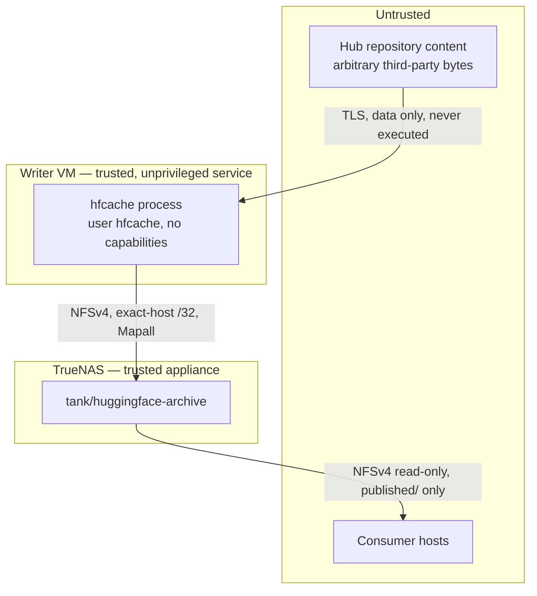

# hfcache Security Model

| Field | Value |
| --- | --- |
| Status | Normative contract for implementation |

This document states what `hfcache` protects, who it protects it from, what it
explicitly does not defend against, and which control enforces each claim. A
control that is not testable is not listed.

## 1. Assets

| Asset | Why it matters | Primary loss mode |
| --- | --- | --- |
| Published revision trees | The archive's reason to exist; often irreplaceable once upstream is gone | Deletion, silent corruption |
| Revision manifests | The evidence that a tree is what it claims to be | Rewriting to match corrupt bytes |
| References (`current.json`, per-SHA) | What consumers act on | Pointing at a partial, unverified, or missing tree |
| Audit records and journals | The ability to explain what happened | Loss of provenance after a failure |
| The writer host's storage authority | Whoever holds it can destroy the archive | Code execution, privilege escalation |
| Hub credentials, when present | Reusable outside this system | Leakage into logs, TOML, or the archive |

Availability of the *upstream* Hub is deliberately not an asset here. The system
is designed to keep working, and keep its data, when upstream is unavailable.

## 2. Trust boundaries



| Boundary | Trusted to | Not trusted to |
| --- | --- | --- |
| Hub content | Be bytes | Be safe to execute, be well-formed, have safe paths, describe itself honestly |
| Hub transport | Be authenticated and confidential under TLS | — |
| Writer service identity | Mutate the archive | Escalate privilege, read operator secrets beyond its credential, write outside its paths |
| Consumer hosts | Read every configured repository in `published/`, including restricted content when enabled | Write anything, reach any other part of the dataset |
| Operator | Configure and initialize | — (an intentionally malicious operator is out of scope, §6) |

## 3. Threats and controls

### T-01 — Malicious repository content executes on the writer

**Capability.** Anyone can publish a public Hub repository containing pickled
weights, `*.py` modules, custom code referenced by `auto_map`, or a model card
crafted to trigger a parser.

**Controls.** The application never executes, imports, unpickles, or instantiates
repository content, never sets `trust_remote_code`, and never constructs
Transformers, Datasets, PEFT, or tokenizer objects (`AD-15`, `NG-09`). Files are
opened for reading bytes and hashing only. Dependency detection parses a fixed
set of known static metadata files — model-card front matter and
`adapter_config.json` — with a bounded JSON/YAML parser, and unparseable input is
recorded as a low-confidence observation rather than retried with a looser parser
(`AD-07`).

**Residual risk.** A parser vulnerability in the standard library or in
`huggingface_hub`. Mitigated by keeping the dependency set small and locked, and
by systemd hardening (§5) limiting what a compromised process can reach.

### T-02 — Repository paths escape the publication tree

**Capability.** A repository can name files with `../`, absolute paths, embedded
NUL bytes, unusually long components, or names that collide after Unicode
normalization. A symlink in the cache could point anywhere.

**Controls.** Every repository-relative path is normalized and validated to remain
under the publication root before any link, copy, or write (`FS-09`, `FS-15`).
Every publication source must be a **regular file** contained by the operation's
approved cache root; directories, symlinks, devices, sockets, FIFOs, and dangling
entries are rejected with `HFSYN004`. Two entries in one manifest that resolve to
the same on-disk path — including via case or Unicode-normalization collision —
are rejected rather than silently overwriting one another. The archive dataset is
case-sensitive with no normalization, so the on-disk spelling is the repository's
spelling.

### T-03 — Content is corrupted in transit or at rest, and the corruption is accepted

**Capability.** A faulty network path, a storage defect, or a bug writes bytes
that differ from what upstream published.

**Controls.** Every newly introduced unique object is read and SHA-256 hashed
locally before publication (`AD-18`); a mismatch prevents publication. Upstream
Git OIDs, LFS digests, and Xet identifiers are recorded as comparison values only,
never as substitutes for reading the bytes. Quarterly offline verification
re-reads the retained archive against immutable manifests. A verification failure
never rewrites the expected digest, never auto-prunes, and never re-downloads over
the evidence (`AD-13`); it exits `40` and records findings.

Hardlink staging does not re-read bytes the same ingestion operation just
hashed. It carries that digest only after proving the current source and staged
destination both match the hash pass's `(device, inode, size)` identity; a
replacement or mismatch is `HFSYN005` and is never published. Copy mode lands a
different inode and therefore still hashes and compares the destination.

### T-04 — Corrupt bytes are laundered into the expected value

**Capability.** A naive repair implementation re-downloads a damaged revision and
regenerates the manifest from what it just received. If upstream itself changed,
or the new download is also damaged, the archive now attests to the wrong content.

**Controls.** `repair` verifies the isolated download against the **original**
manifest and stops if any digest differs (`HFRET006`). The replacement manifest
copies the original expected path/size/digest set exactly and preserves the
publication generation; the original manifest is kept byte-for-byte (`FS-06`,
`FS-07`). The implicated cache inode is never reused: repair downloads into a
fresh transaction-scoped cache.

### T-05 — A downstream consumer modifies or deletes archive content

**Capability.** A consumer host is compromised, or simply runs a tool that writes
to its mount.

**Controls.** Read-only is enforced **server-side** by the TrueNAS export, not by
client mount options, and the consumer export exposes only `published/`. Writer
and consumer client selectors are disjoint, with the writer restricted to an exact
`/32`. `.store`, `audit`, and `runs` are mode `0700` and are outside the consumer
export entirely. Hardlink deduplication is never preserved at the cost of
server-side read-only isolation: if the export topology cannot provide both, the
documented fallback is two datasets plus copy mode.

**Residual risk.** `AUTH_SYS` means a host on the consumer network can claim any
uid. This is accepted for a trusted isolated storage VLAN because the export is
read-only regardless of claimed identity. `KRB5I`/`KRB5P` is the documented path
when cryptographic client identity becomes necessary.

### T-06 — The archive is written to the wrong place

**Capability.** The NFS mount fails, is remounted elsewhere, or configuration
points at a stale path — and a multi-terabyte download lands on the writer's root
filesystem, or into an unrelated dataset.

**Controls.** Every mutating command proves, before any download: the root exists,
is a mount point distinct from its parent, is an NFS/NFSv4 filesystem, is
read/write, and carries a sentinel whose UUID matches `storage.archive_id`
(`FS-01`–`FS-03`). Writability is proven by a real create/fsync/rename/delete
probe, because the Mapall export makes `st_uid` comparison meaningless (§the architecture contract).
The bare `/srv/hfcache` mount point is root-owned and not writable by the service
identity, so an unmounted archive fails closed rather than filling the root
filesystem. Failure is exit `20` before the first byte is fetched.

### T-07 — A token leaks

**Capability.** A credential in configuration, a log line, an exception message, a
run report, or a file written to shared NFS storage is readable by anyone with
access to that surface.

**Controls.** No configuration key accepts a token; a literal Hub secret in
archive TOML is `HFCFG010`, reported by key path and never echoed. Hub tokens arrive
only through a systemd credential or an explicit `--token-file`; API tokens use
separate explicit protected files or named systemd credentials. Tokens are never
written to the archive, and never appear in a manifest, run report, journal, or log at any
verbosity. Ambient discovery is disabled: `HF_TOKEN`, `HUGGING_FACE_HUB_TOKEN`,
and cached home-directory tokens are ignored, and Hub calls pass an explicit
`token=False` or an explicit token — never `token=None`, which would re-enable
implicit discovery.

The shared sanitizer removes sensitive keys and recognized Hub/bearer/signed-URL
shapes, plus exact credential values registered by loaders before use. This last
boundary covers opaque API tokens without assuming an `hf_` prefix; no regex can
recognize every unknown arbitrary secret. Keep registration for the process
lifetime, never clear it between requests. Logs capture sanitized fields at
emission and sanitize formatting; `Problem` snapshots and its public rendering,
and application exception string/repr paths, sanitize diagnostics too. Preserve
safe code/shape evidence without exposing raw exceptions, request input or
tracebacks to a caller. server authentication registers resolved API credentials before use;
metadata lifecycle must apply the same boundary to route validation/exception output.
See [decision 111](adr/decision-111.md).

**Consequence beyond leakage.** Disabling ambient discovery also removes a
correctness hazard: a developer's cached credential cannot silently give a
production run access that the configuration does not describe.

Verification has a separate authority boundary: shared verification never
constructs a Hub client, resolves a credential, or changes process-wide offline
environment settings. The shipped unit supplies `HF_HUB_OFFLINE=1` and
`IPAddressDeny=any`. The dedicated executor initializes the offline flag
once before Hub imports and independently requires the no-IP sandbox; the
startup helper alone is not an egress control. The private executor and its
profile-specific confinement own that boundary; installed acceptance remains
separate from source or transient native probe evidence. A network-enabled ASGI process is never a fallback verifier.

### T-08 — Restricted content crosses the intended authorization boundary

**Capability.** A credential can read private or gated repositories, but a
configuration or consumer export exposes those bytes beyond the people and
systems authorized to receive them.

**Controls.** Restricted scope requires the explicit
`hub.token_mode = "required"` policy and a resolved credential (`AD-21`); a token
found under `optional` remains public-only and private/gated metadata is
`HFHUB006`. Tokens never come from ambient discovery (`T-07`). The operator must
place every consumer of the single `published/` export inside the same content-
authorization boundary as the credential owner; the archive does not claim
per-repository ACLs it cannot enforce. `hub.expected_account` plus `doctor`
proves the installed credential is the intended Hub identity before enabling a
sync. The mode and expected account are included in the configuration
fingerprint, while the secret and its path are not.

**Residual risk.** `hfcache` cannot interpret a repository's license or gate
terms, nor can it learn that an off-host consumer later left the authorization
boundary. Revoked upstream access stops future retrieval but deliberately does
not destroy retained bytes (`AD-06`); the operator is responsible for applying
the explicit purge workflow when continued retention is no longer authorized.

### T-09 — A supply-chain compromise reaches production

**Capability.** A malicious release of a dependency, or a substituted artifact at
install time.

**Controls.** Dependencies are locked in `uv.lock` with hashes and installed with
`uv sync --frozen --no-dev --no-editable` at deployment time — never from a
systemd unit and never during a scheduled run, so a sync can never resolve or
fetch a package. The uv version is pinned, its release artifact verified, and its
self-update behaviour disabled. Release trees and virtual environments are
root-owned and read-only to the service identity. The runtime dependency set is closed except for the explicit maintained
client/server/optional MCP protocol exceptions in FW-03/FW-04.

### T-10 — A local unprivileged user on the writer influences a run

**Capability.** A non-root account reads or modifies application state, or plants
input a run will consume.

**Controls.** `/opt/hfcache`, `/etc/hfcache`, and unit files are root-owned;
configuration is `0640 root:hfcache`. `/var/cache/hfcache` and `/var/lib/hfcache`
are `0750 hfcache:hfcache`. The service account has no interactive login, no
password, no sudo access, and no Linux capabilities. Runtime state is under
systemd-managed `RuntimeDirectory`. SELinux is enforcing throughout.

### T-11 — Resource exhaustion turns into data loss

**Capability.** A repository is far larger than expected, a run fills the dataset,
or the local Xet transfer cache exhausts the writer's root filesystem.

**Controls.** `plan` reports logical size and estimated new bytes before a
repository is enabled. Preflight requires free capacity exceeding the estimate
plus the configured reserve, and fails with `HFMNT011` before downloading. The
Xet transfer cache is pinned to `/var/cache/hfcache/xet` on local disk, its peak
usage is reported in every run report, and exceeding its advisory ceiling warns
`HFWRN009`. A failed or aborted run never deletes a retained revision (`TX-06`).

A continuation-enabled queue is admitted against its aggregate download and
copy-publication requirement before the first transfer, then each transfer
rechecks capacity immediately before it starts. Only one repository transfer is
active, so `sync.max_workers` remains the global Hub worker budget rather than
being multiplied by queue depth. The producer is drained before the archive
lock is released, preventing an unowned background writer.
Cache transfers and retention's whole-cache scan are process-serialized, and
queue-ahead retention waits until every downloaded snapshot has been consumed.
Copy publication rechecks space and holds the same allocation guard through
staging, so a concurrent download cannot consume the headroom the copy proved.

### T-12 — An automated repair destroys good data

**Capability.** Recovery logic encounters an ambiguous state and picks a
resolution.

**Controls.** Recovery is roll-forward oriented and refuses to guess: unknown
journal versions, impossible checkpoint combinations, contradicted evidence, and
genuinely ambiguous state all stop with `state = "needs_operator"` and exit `20`
without mutating (`AD-16`, §`docs/architecture.md` §7.9). Unknown files are
reported and preserved, never deleted (`FS-19`). Where a transaction can fail
leaving more or less data, it leaves more (`TX-06`). Quarantined evidence is
released only by explicit operator action.

Whole-repository deletion is a separate `purge` command, never a consequence of
an upstream error or configuration edit. It requires `--apply` plus explicit
unmanaged selectors or `--all-unmanaged`, refuses every repository still in
configuration, validates that references and manifests explain the complete
shallow layout, and preserves any unknown entry. Each repository has its own
durable transaction: pre-commit recovery restores it completely; post-commit
recovery never silently republishes it and retains byte-for-byte manifests plus
reason records under `audit/pruned/` (`AD-20`).

### T-13 — The management plugin widens the operator surface

**Capability.** The Cockpit plugin (`docs/cockpit.md`) exposes operator
actions — sync control, configuration editing, schedule changes, repair — in
a browser behind cockpit-ws.

**Controls.** Authentication is the host's own (PAM through cockpit-ws), and
every mutating path requires the superuser bridge, which only an
administrative session obtains — the same boundary as a shell, and §6 already
places root and the operator out of scope as adversaries. The plugin is
static files under `/usr/share/cockpit/hfcache` with no listener or daemon;
fixed privileged config/candidate/backup/lock paths are documented separately.
CLI work drops to the service identity in a
transient systemd unit and never runs as root (`CP-03`); it never reads
`$CREDENTIALS_DIRECTORY`, offers token entry, or renders a credential — the
fixed rootless launcher mounts named Podman API-only `hfcache.api` as a
protected file inside the finite client (`CP-08`, upholding T-07). Native systemd
credential delivery remains a separate supported profile; the shipped plugin
has no host ImportCredential path. Hub authority
stays on the daemon; no browser/environment/argument bearer is introduced;
the archive is
reached only through CLI envelopes plus one read-only run-report read as the
service identity (`CP-01`, `CP-09`); and `archive init`, `hfcache.target`,
and `hfcache-verify.timer` are refused structurally in its API layer
(`CP-05`–`CP-07`).

Strict bounded terminal Envelopes govern outcomes. Separately validated bounded
progress/handles support reconnection, never outcome/checkpoint authority. Client
stop/page closure and uncertain HFAPI013/015/019/020 retain handles without
automatic recovery/replay. Config operations compare exact candidate and installed
base under the retained root configuration flock; compatible assessment, required
preview and exact installed fingerprint confirmation precede reported success.
Incompatible/unknown authority blocks plugin installation and requires manual
operator review/install/restart. See [decision 122](adr/decision-122.md).

**Residual risk.** cockpit-ws itself, patched with the distribution like
`sshd`. An administrative browser session is as powerful as an administrative
shell, which is this deployment's existing posture, not a new one.

### T-14 — A management caller gains unintended authority

**Capability.** A caller presents a malformed, leaked or wrong-interface bearer,
or a changed configuration redirects a long-lived server's authority.

**Implemented controls.** Strict separate server configuration keeps
transport/auth settings immutable until restart. Fresh archive-policy snapshots
retain the startup root/UUID and fail a changed authority closed. Required REST
writer and optional reader/MCP sources use only explicit protected files or named
systemd credentials; an unconfigured optional class grants nobody access. Every
active source must load. optional MCP transport ignores the MCP source while disabled; enabled
MCP requires it and the optional package. Descriptor-pinned no-follow reads validate inode
type, owner, mode, group access, single hardlink, bounded content and stable
metadata. The API token grammar rejects Hub-style `hf_` values. Exact opaque
values are registered for redaction; the registry keeps only fixed-size digests
and constant-time comparisons over three slots. Distinct class values prevent
cross-interface ambiguity. The principal contains a nonsecret credential class,
never a token, digest or individual-user claim. Every reader shares AD-21's
whole-archive authorization boundary.

REST authentication failures use sanitized `HFAPI001`/401 plus a Bearer challenge;
capability denial is `HFAPI002`/403. Unsafe/malformed/racing credential sources
and duplicate class values fail startup with `HFAPI003`/`HFAPI004`. The reusable
FastAPI bearer adapter calls the application-owned verifier; extraction alone
does not authenticate. metadata lifecycle's outer boundary now authenticates metadata routes,
unknown paths/methods, health, schema and optional docs before routing/body
validation. It rejects malformed Host/duplicate Origin, bounds headers/query/
body/normal and streamed responses, disables slash redirects and raw framework
request logging, and returns sanitized typed problems with no-store/nosniff/frame
headers. Explicit trusted TLS proxy rules and one Unix/TCP lifespan are tested
on disposable sockets. Shared no-follow reader/work budgets cover legacy local
query paths too; unsafe derived catalogs retain unknown confidence and never
grant repair authority. bounded runner and private verifier supplies the execution/protocol boundary; scheduled observation
packages service hardening while installed enforcement remains operator
acceptance. Recorded installed 0.2.1 peer connectivity has narrower scope than outstanding
NAS/domain/other-host acceptance; see [deployment status](deployment-status.md). See
[decision 112](adr/decision-112.md) and [server policy](server.md).

**Control-state boundary.** Local receipts bind admission to a fixed
credential-class principal and hashed idempotency key before acknowledgement or
execution. Store no raw key, bearer, token digest/path or candidate request body.
The key digest is private comparison state and is omitted from HTTP metadata.
All authenticated REST readers may observe operation metadata/events/results
under the whole-archive boundary; key lookup searches only the caller's namespace.
The separate scheduled observation scheduled observer stores its generated nonsecret key in
private local state for lookup-only recovery, never a bearer or token digest;
that does not add raw keys to server receipts/HTTP metadata.
Rotation preserves that class identity, without creating individual-user audit
claims. A status/result fetch never executes work.

Protected no-follow local state, finite record/event/result/byte budgets and
durable atomic receipts contain storage/resource risks. An unexpired terminal
key cannot be evicted for capacity; interrupted/ambiguous/nonterminal history
cannot expire. Unsupported or unexplained state is preserved and fails admission
closed. Restart does not replay queued/running receipts or reconstruct submissions
from archive journals. Missing/expired history remains uncertain. See
[decision 114](adr/decision-114.md), [schema](schemas.md#13-service-private-operation-control-state)
and [recovery guidance](recovery.md#preserve-four-kinds-of-authority).

**Execution boundary.** One bounded lane and one absolute waiting
deadline limit heavy work; command services still own the common flock and
compare fresh installed policy inside it before mutation. Strict bounded
verification-only frames and kernel peer UID checks on a protected Unix socket
replace any in-process verification fallback. The dedicated inherited-socket
bootstrap refuses known credential environment sources and unexpected inherited
descriptors, initializes the library offline flag before shared imports and
never resolves a Hub/API credential. Protocol outcomes retain exact operation/
fingerprint/domain-result identity. Unavailable/unsafe status preserves active
evidence and disables execution across restarts; it cannot erase the barrier by
marking an unreachable worker interrupted. Reader metadata remains available.

These process/protocol checks do not enforce OS egress restrictions or identify
arbitrary unknown secrets. scheduled observation packages socket activation, service identities,
credential-source masking and `IPAddressDeny=any`; actual cgroup/credential/
SELinux/NFS enforcement remains installed hardening acceptance. Custom development
source paths need explicit masks/probes. Standalone development invocation cannot claim that
sandbox. No request starts a generic subprocess or invokes systemctl/sudo.
See [decision 115](adr/decision-115.md) and
[private verification trust](server.md#verification-wire-and-local-trust).

**Typed command boundary.** Sync and every actual verification require
writers before body reception. Mixed-route capability checks happen after bounded
strict JSON parsing but before DTO validation: candidate presence requires a writer,
and diagnostics permits a reader only for literal `read_only=true`. Missing mode
never silently becomes a probe. All recognized POST bodies have explicit media,
encoding, duplicate-key, Unicode, depth and actual-byte limits; errors do not echo
unknown fields or framework input. Typed services preserve domain refusals and
partial results. Four job routes require a key, including plans/read-only diagnostics;
202 means admission, and disconnect never cancels accepted work.

The only Hub token override is the trusted startup `serve --hub-token-file` source,
under existing installed policy. API bearers are never reused as Hub tokens and
HTTP requests cannot supply credentials, server paths or endpoint overrides.
Installed validation resolves only that source or the installed systemd source,
without a Hub request. Pure bounded candidate assessment compares root/UUID,
endpoint, token mode, credential name and expected account; it never resolves a
candidate credential, reads a candidate-selected path, contacts the Hub or installs
policy. API-backed reader CLI now exposes writer-only candidate content validation/planning,
with fresh installed-authority checks before Hub work. See
[decision 116](adr/decision-116.md), [body/role rules](api.md#command-requests)
and [candidate authority](configuration.md#12-candidate-authority-validation-and-planning).

**Explicit maintenance boundary.** Reader previews and writer-only
apply resources have separate URLs and strict scopes; all are keyed bounded jobs.
No omitted mode authorizes mutation, no caller-supplied plan is executable and
no preview grants a later capability. Under-lock fresh policy/scope/proof checks
refuse queued staleness, newly configured purge targets and changed quarantine
evidence. Unknown content, repair quarantine and ambiguous transactions remain
preserved; original manifests/audits and existing pre/post-commit recovery rules
remain authoritative. Repair uses the installed Hub credential and exact original
expectations, not a request-selected endpoint or replacement digest.

The restart-only maintenance switch is disabled by default and gates initialization
only, before body reception/POST retry handling. Even a previously bound key does
not bypass a disabled gate; authenticated lookup/status/result still observe it.
Enabled initialization additionally requires writer capability, strict confirmation
and the configured root/UUID restated. These fields cannot select another archive.
Initialization's own locked checks refuse existing/unsafe/unknown state and write
the sentinel last. Startup, health, recovery and missing sentinel never initialize.
See [decision 117](adr/decision-117.md), [maintenance resources](api.md#maintenance-requests)
and [server gate](server.md#command-admission-and-policy-authority).

**Reader/client authority.** Separate strict client settings select one
URL/socket endpoint and explicit protected API source; no archive configuration,
Hub token, service UID or mount is required. Explicit endpoint overrides replace
the configured group. Verified TLS/default or explicit CA trust, safe prefix URLs,
no redirects/ambient proxies/netrc and exact same-operation link checks keep the
bearer bound to the intended authority. Local Unix sockets still authenticate.
REST acceptance distinguishes only trusted supported native Unix scope for unprefixed
REST: `client=None` plus `server=(absolute Unix socket pathname, None)`.
Peer absence alone may be a socket error and cannot bypass prefix/proxy-TLS;
missing/malformed local evidence fails closed. TCP keeps configured public
prefix/TLS/proxy/Host/Origin checks. No forwarded
header grants native authority. Request-scoped links/schema copies do not mutate
global public prefix or OpenAPI cache state ([decision 123](adr/decision-123.md)).
Malformed/oversized/truncated/unversioned or identity-inconsistent responses refuse
under finite byte/page/retry/poll budgets without echoing raw bodies/transport errors.

Client keys exist before POST transmission. Lost acknowledgement preserves its
original key/route and an uncertain outcome; no automatic POST/new-key replay,
local archive fallback, daemon startup or cancellation of accepted work follows.
Old operation results retain admitted UUID/fingerprint and exact domain IDs/exit.
The optional installed client file is a declared source, not permission to discover
Hub/API tokens elsewhere. Global CLI options are stored now; operational migration
is completed for reads/candidates by API-backed reader CLI and operational CLI/observation by
CLI operation observation.
See [decision 118](adr/decision-118.md) and
[client setup/troubleshooting](api-client.md).

**Reader/candidate integration.** Migrated reads report writer truth
without client archive TOML/mount/service identity/Hub credentials or local fallback.
Exact server Envelope IDs/times/exit are retained; complete finite page aggregation
and current-publication joins refuse inconsistent evidence. Remote inspection
requires no client path, and optional root restatement cannot select server paths.
Local help/version and explicit local config validation are bootstrap exceptions.
Explicit archive `--config` on other API reads and Hub-token overrides are refused.

Writer candidate validation reads bounded UTF-8 content from the CLI host, never
a pathname on the server, and resolves no credential/Hub/probe. Valid incompatible
policy stays valid with false compatibility and mismatch names; broken installed
policy permits syntax validity with unknown compatibility. Neither result grants
planning/install authority. Candidate planning rechecks root/UUID/endpoint/token
mode/credential name/expected account before installed credential use, including
the credential name excluded from policy fingerprints. Candidate policy controls
preview intent only; installed limits/admitted fingerprint remain authoritative.
Exact candidate text binds a key; absent fields preserve old installed-plan digests
and explicit null refuses. REST cannot install policy/backups or give browsers
bearers. See [decision 119](adr/decision-119.md), [candidate contract](configuration.md#12-candidate-authority-validation-and-planning)
and [CLI migration](api-client.md#cli-dispatch).

**Operational CLI observation.** No operational command imports or
invokes a direct local mutation backend. Pure requests and typed HTTP retain
server-owned credential/preflight/flock/recovery/private-verification authority.
Validated nonsecret keys and accepted operation IDs are safety handles, emitted
even quiet; credentials/raw logs are never progress. Sequenced bounded sanitized
events/status/result reads share one finite deadline. Observer interruption retains
handles and says accepted work may continue, never cancellation/new-key replay.
Retained-key validated 5xx failures carry the same uncertainty warning, and event
rendering escapes nonprintable/control text to preserve one plain stderr line.
JSON exact terminal Envelopes and separately identified detach cannot be confused;
human rendering summarizes classified terminal data.
No-confirm init is inspection/refusal only, not a privileged submission. See
[decision 120](adr/decision-120.md) and [CLI operations](cli.md#operations).

## 4. Controls summary

| # | Control | Enforced by |
| --- | --- | --- |
| 1 | Single authoritative writer host | TrueNAS export restricted to one `/32` |
| 2 | Server-side read-only consumer export | TrueNAS, not client mount options |
| 3 | Dedicated Mapall identities per export | TrueNAS |
| 4 | SELinux enforcing | Writer host, no permissive domains |
| 5 | Unprivileged service user, no capabilities | systemd unit, account posture |
| 6 | systemd hardening (§5 below) | Unit configuration, validated per setting |
| 7 | Strict path normalization and containment | `FS-09`, `FS-15`, `HFSYN004` |
| 8 | No execution, import, or unpickling of repository content | `AD-15` |
| 9 | TLS verification always on for Hub requests | `https://`-only endpoint, `HFCFG014` |
| 10 | Immutable commit SHA for every download | `AD-01` |
| 11 | SHA-256 manifest before publication | `AD-18` |
| 12 | Hub secrets via systemd credentials or `--token-file`; API secrets via distinct protected sources | `docs/configuration.md` §7, `docs/server.md` |
| 13 | Locked dependencies, frozen deployment install | `uv.lock`, `uv sync --frozen` |
| 14 | Restricted scope requires explicit required-token mode and one authorized consumer boundary | `AD-21`, `HFARG008`, `HFHUB006` |
| 15 | Explicit configuration required for any dependency archiving | `AD-07` |
| 16 | Unknown state reported, never deleted or guessed | `AD-16`, `TX-06` |
| 17 | Fail-closed preflight before any download | Exit `20` |
| 18 | Management UI confined to operator surfaces, with the limits structural | `docs/cockpit.md` `CP-01`–`CP-14` |
| 19 | Fixed capabilities, restart-only auth and bounded typed command/metadata routes | `T-14`, `docs/server.md`, server registry, metadata boundary and typed command routes |

## 5. systemd hardening posture

Hardening must be validated against the actual executors and their workloads.
Repository fixtures and property inventories do not prove installed enforcement.
Use the [explicit diagnostic modes](#hardening-diagnostics); they never weaken
settings to make a check pass. A transient native process supplies evidence only
about that process, and cannot certify rootless PID1, cgroup or peer boundaries.

```text
NoNewPrivileges=true          ProtectKernelTunables=true
PrivateTmp=true               ProtectKernelModules=true     RestrictNamespaces=true
PrivateDevices=true           ProtectKernelLogs=true        LockPersonality=true
ProtectSystem=strict          ProtectControlGroups=true     SystemCallArchitectures=native
ProtectHome=true              ProtectClock=true             CapabilityBoundingSet=
ProtectProc=invisible         ProtectHostname=true          AmbientCapabilities=
ProcSubset=pid                RestrictAddressFamilies=AF_UNIX AF_INET AF_INET6
```

Writable paths are limited to the NFS archive and the systemd-managed state,
cache, and runtime directories. `RestrictSUIDSGID=true` is deliberately absent:
it blocks the setgid directory creation that publication requires. The narrower
controls are `nosuid,nodev,noexec` on the archive, `NoNewPrivileges=true`, and
empty capability sets (decision 61). The probe must test `mkdir` followed by
`chmod` and assert the resulting setgid mode (decision 66).

The verification unit additionally runs with `HF_HUB_OFFLINE=1` and
`IPAddressDeny=any` (decision 60). `PrivateNetwork=true` remains an
operator-supervised reconnect evaluation, not an enabled protection.

**documentation maintenance reconciliation (2026-10-17, decision 106).** These statements
reflect the existing deployed-unit decisions 60, 61, and 66. The authorization
statements in §§6–7 also reflect `Hub access` / `AD-21`; no runtime control or
authorization policy changes here.

**scheduled observation role amendment (2026-10-18, [decision 121](adr/decision-121.md)).**
The setgid-compatible archive policy now applies to actual API/private-verifier
executors; AF_UNIX scheduled clients mask archive access and can safely enable
`RestrictSUIDSGID=true`. Worker startup is offline and imports no credentials;
its namespace hides standard credential stores/runtime credentials/daemon token
cache, with custom development paths requiring explicit masks/probes. Executor-
aware probes use installed unit/drop-in properties and refuse wrapper-unit names.
Repository activation/unit/dry-run evidence cannot certify actual cgroup no-IP/
no-credential, SELinux or NFS behavior; those remain deployment holds. No sandbox
is weakened to pass a test.

SELinux remains enforcing throughout development and acceptance testing.
Denials are resolved by fixing ownership, labels, or unit restrictions first, and
only then by a narrowly scoped local policy module with documented source, build,
installation, verification, and removal steps. `setenforce 0`, permissive domains,
and blanket allow rules are not production solutions (the architecture contract).

## 6. Explicitly out of scope

Naming these keeps the model honest — each is a real risk that this system does
not address.

| Out of scope | Why |
| --- | --- |
| Compromise of the TrueNAS appliance | It is the storage root of trust; nothing the writer does can compensate |
| Root compromise of the writer host | Root can rewrite the archive and its evidence; the service identity is the boundary, not root |
| A malicious operator | The operator configures, initializes, and holds sudo by design |
| Physical access to either machine | Site security concern |
| Judging whether archived content is itself safe or lawful to use | The archive stores faithfully; consumers evaluate what they run (`NG-04`, `NG-08`) |
| Upstream publishing backdoored content that hashes consistently | Correctly archived by definition; detecting it is a different product |
| Denial of service against the Hub, or by the Hub against us | Handled as an availability condition (`HFHUB001`, `HFWRN006`), not a security control |
| Confidentiality beyond the configured consumer boundary | Restricted content is supported under `AD-21`; the export has no per-repository ACLs or protection from an authorized consumer redistributing bytes (`T-08`) |

## 7. Verifying these claims

| Claim | Test |
| --- | --- |
| No repository code executes | Unit tests assert no `import`, `exec`, `pickle`, or model-construction path exists in ingestion; live tests archive a repository containing `*.py` and custom code and confirm none is loaded |
| Path escapes are rejected | Property-based tests over adversarial path sets, including traversal, absolute, special-file, case-collision, and normalization-collision cases |
| Restricted scope is explicit | Hub tests reject private/gated metadata under `disabled` and `optional`, accept it only under `required` with a credential, and reject missing required credentials; the operator validates the shared consumer boundary (`T-08`) |
| Secrets never surface | Redaction tests over log lines, run reports, manifests, journals, and error messages at maximum verbosity |
| Fail-closed preflight | Unmounted, read-only, wrong-sentinel, and below-reserve archives each exit `20` with no Hub request issued |
| Consumer cannot write | Server-side create, modify, rename, and delete attempts from a consumer client all fail (operator-run; `storage administration`/`storage administration`) |
| Hardening does not break operation | `systemd-analyze verify` clean, a full sync under enforcing SELinux with no unexplained AVC denial |

## Optional MCP transport boundary

[Decision 124](adr/decision-124.md) adds only an explicitly enabled authenticated
Streamable HTTP mount after committed REST acceptance. Production verification
subclasses the supported FastMCP verifier and delegates to the same protected
opaque-token registry with `interface="mcp"`; only the distinct fixed MCP reader
matches. It is a whole-archive capability under AD-21. REST writer/reader and Hub
credentials cannot cross that boundary, and MCP credentials never grant REST
access. A session ID grants no authority; every supported transport request
requires its bearer. No ambient auth provider or development static verifier is
permitted. Disabled mode imports/resolves neither package nor MCP credential.

Transport checks retain strict Host/Origin/TLS/proxy/public prefix, corroborated
native Unix identity and finite resource limits. MCP startup composes with REST
ownership and fails closed if its package/credential is unavailable. Exactly
nine curated metadata tools are exposed; no resource, prompt, arbitrary dispatcher,
OAuth login/discovery or credential issuance is supplied. Pre-provisioned bearer clients must protect
and send their credential over the configured verified transport; compatibility
with OAuth-only clients is not promised. Exact wire/session and streaming
behavior is specified by [the MCP contract](mcp.md).
No host hardening or production installation is inferred from those tests.

The transport uses stateless HTTP, without a retained legacy session/resumption
store. Canonical `/mcp/` is separate from REST's strict slash behavior; only the
specific authenticated `/mcp` spelling may redirect using a safe relative
Location after transport/body/query validation, never caller input reflection.

One path projection determines public/native interface spelling, authentication,
early writer/body checks and effective prefix, including public-prefix collisions
with `/mcp` or `/api`. A public REST route must not acquire MCP authentication by
prefix resemblance. MCP rejects query parameters, requires bounded strict JSON
POSTs/empty other bodies and limits separate in-flight work. Finite JSON replies
are buffered/sanitized and capped before headers, with no truncated-success or
retained SSE/session queue. Registered numeric RPC identities that cannot be
safely reflected must refuse rather than leak or silently change identity.

## Curated MCP read capability

[Decision 125](adr/decision-125.md) adds exactly nine typed metadata tools, with
no resources/prompts, automatic OpenAPI conversion, generic command/path/URL
fetcher or hidden writable capability. Tool functions receive a narrow async read
protocol only, not SDK Context/Request/app objects or command, Hub, credential
resolver or writable helpers. Bounded metadata workers call validated shared
readers with fresh pinned installed policy; no tool creates a receipt, hashes
archive payload bytes, probes, recovers/cleans, installs config or rebuilds catalogs.

Read-only/non-destructive/closed-world hints are descriptive, not enforcement.
Archive-derived names, dependency observations, report messages and metadata
remain untrusted data, never instructions or executable content. The fixed
registry/schema and success/failure archive/control-state comparisons must prove
the actual boundary. SDK argument/not-found errors and backend classified errors
use stable codes/fixed safe text without raw rejected values. Explicit artifact
projections never grant complete-manifest authority or promote unknown confidence;
exact SHA/publication requests cannot fall back to newer current content. MCP
readers retain AD-21's whole-archive authorization, without per-repository ACLs.

## Mounted MCP security proof

The [threat/control/test map](mcp.md#read-only-boundary)
connects each acceptance claim to concrete mounted tests. It applies existing
T-01/02/07/08/12 and INV-002/003/007/010/016; it adds no tool, role or command
capability. The [recorded deployment scope](deployment-status.md)
owns actual runs and separates repository proof from deployment assumptions.

| Security boundary | Required proof |
| --- | --- |
| Transport and credential class | Parent lifespan plus actual streaming/session requests, all methods and bearer classes, REST isolation and Host/Origin/prefix/proxy refusal; session replay never substitutes for authentication |
| Closed authority and untrusted input | Exact registry/resources/prompts and closed argument schemas, writer-name/dispatch/path/credential attempts, fixed safe errors and no execution of archive-derived strings |
| Evidence preservation and confidentiality | Before/after full paths/content/modes for every valid/invalid tool, no command/Hub/credential/archive-byte-hashing work, malformed original evidence preserved, no secret in wire/error/log or cursor binding, no false verification confidence |
| Bounded mixed-interface lifetime | Concurrent REST/MCP reads remain responsive with separate correlation and finite budgets; cancellation and drain retain real request/worker ownership without adding MCP artifacts |

No background authority means no retained task/job or operation receipt. The
locked SDK can ignore legacy top-level `params.task` metadata and execute the
same approved finite read; it need not reject every optional protocol field.
Unsupported task RPCs and mutation-shaped tool arguments still refuse.

Archive-byte-hashing refusals do not prohibit intentional sanitized-metadata
cursor hashes or credential authentication digests. Baselines follow normal
startup allocations; per-call reads must not create new
archive/control state. Atime changes are not application writes. Sanitized
operational logging is the sole documented non-archive exception. REST fixture
mutations during mixed-interface tests must remain attributable to that REST
command, not hidden MCP work. Malformed fixture evidence is introduced before the
baseline and must not be repaired or deleted by observation.

The narrow tool capability is an application boundary within the shared API
process, not a separate process sandbox. Whole-archive metadata authority
intentionally includes restricted repositories; it supplies neither per-repository
ACLs nor individual identity. Registered-value
redaction does not promise detection of every arbitrary unknown secret. Finite
budgets limit a request's resources, not every denial-of-service strategy by an
authorized client. Locked dependencies and the unprivileged sandbox reduce but
do not eliminate parser/SDK or host compromise risk. Actual TLS/proxy/socket/
credential delivery and rotation, worker egress/source masking, cgroup/SELinux/
NFS/workload/other-host/browser acceptance remain separately scoped by
[deployment status](deployment-status.md). Local integration results never
authorize production changes or certify unrelated controls.


## Protected MCP client acceptance

The [example/setup](mcp.md#connect) uses a protected
operator-provisioned MCP-reader file, explicit validated HTTP transport, verified
TLS/optional CA and finite response/page/deadline bounds. Token values never
belong in config/argv/URLs/browser storage; no ambient provider, redirect/proxy
fallback, OAuth login or arbitrary executable/string transport is selected.
Summary output grants no complete-manifest or copy-verification authority.
Version/identity/cursor errors fail safely without rejected-input diagnostics.

Rotation takes effect only on normal server restart; clients must reread the
source in a new context. Separate REST sources and whole-archive authorization
remain unchanged. [Disabled/enabled/rotation/packaging tests](../tests/unit/test_mcp_acceptance.py)
cover application behavior and unchanged credential-free/no-IP worker/timer
policy, not actual installed enforcement. Client/socket tests use owned disposable
fixtures. TLS/firewall/socket/source delivery, worker egress/custom masks,
cgroup/SELinux/NFS and real drain/rollback each require applicable installed
evidence; see [deployment status](deployment-status.md).


## Rootless runtime scope

[Decision 127](adr/decision-127.md) changes the selected local deployment, not
whole-archive roles or FS/TX/domain authority. Explicit user-manager rootless
Podman services and a reviewed system target bridge use fixed immutable images
and safe lifecycle argv. No rootful/privileged/host-PID/host-network/label-disable
or Podman control socket shortcut is allowed. Unknown surviving container/cgroup
state blocks replacement, cleanup and release; infinite application drain replaces
default timed killing. Preserve original local lock and both operation stores.

Caddy receives only appropriate protected TLS material; API receives its distinct
Hub/REST/optional MCP sources; clients receive API authority only. Private worker
receives none, with separate socket mounts, Network=none and a Unix-only native
socket allowlist retaining other baseline seccomp restrictions. Its real PID1/FD3/
SO_PEERCRED/secret/SELinux proof must run in actual disposable containers. Secrets
are mounted with UID 981/mode 0400, never literals in images/env/argv/browser/logs
or hash inputs. Root alone prepares necessary local service account/rootless
fixture infrastructure; Caddy never obtains ACME certificates or installs trust
on another host in this scope.

[Decision 126](adr/decision-126.md) continues to forbid NAS content/metadata writes
and other-host changes. Every NAS bind is read-only without chown/relabel/copyup;
rootless runtime fixtures bind no NAS at all. Source masks, read-only roots and local state
are actual proof obligations, not claims that containers alone establish isolation.
The fixed Cockpit client launcher retains admin/candidate/observation boundaries
without a browser bearer, generic executable input or bare-host fallback.

host read-only guard adds fixed root-protected host boot policy independently of current.
Its standard-library notify guard runs UID/GID 981, proves original local-lock
ownership and host NFS-ro from /proc/1/mountinfo before READY, then retains its
flock. This is not continuous monitoring. Strict sandbox self mountinfo cannot
stand in for the host view; retain hardening and host PID/proc visibility for this
control only. Application containers still get no host PID/proc authority.
The bridge requires guard readiness and the user default target cannot start the
app target. No generic paths/commands or app imports are added to the guard.

## Confined private listener ownership

[Decision 128](adr/decision-128.md) qualifies the rootless worker-created listener’s
creation context rather than granting a new SELinux permission. Explicit direct
PID1 --container-listener refuses inherited FDs above stderr, activation fields
and known credential environment before resources/shared imports. The worker
owns only a fresh protected private socket under its existing confinement; native
named-FD3 activation remains strict with no bind fallback. The instance/pinned
parent/created inode remain owned through joined work and exact cleanup; any
existing or replacement path is preserved and refuses automatic reuse/deletion.
The new owned IPC path must be lexically disjoint from configured archive root
and proven local via bounded fixed /proc/self/mountinfo before parent traversal
or bind. Unknown/network mounts refuse without realpath or NAS stat; a bad
startup socket path cannot authorize archive/NAS filesystem access.

Only worker private-directory access becomes writable; API mounts it read-only.
Network=none, native AF_UNIX-only seccomp, no secrets/source-store masks, read-only
root, empty caps, NNP, UID/cgroup limits and the shared archive lock remain.
Actual worker-proxied READY follows listener/store/runtime initialization, not
process launch. No allow module, label override/disable, `+` execution, host worker
or network-enabled fallback is authorized. Actual API-container peer access requires installed proof; source tests and
host probes alone cannot establish it. Recorded 0.2.1 scope is described below.

## UBI 10 image-input boundary

[Decision 129](adr/decision-129.md) pins every service FROM stage to UBI 10 micro.
Minimal supplies only Red Hat CA PEM, uv only a build executable and Caddy only
its verified static binary; no donor OS libraries/CA/defaults. Portable CPython
is hash-verified and safely extracted. Fresh-inode Caddy install/empty getcap
preserve NNP/cap-drop; TLS trust verification stays enabled. Micro contains shell
and tools: isolation claims rely on actual fixed authority/confinement, not tool
absence. No secret-bearing fetch, runtime package/pull, SELinux allow/label or
executor/drain shortcut is added. Repeat actual UBI proof before clean rollout.

### Installed peer-control acceptance (2026-10-18)

[Recorded deployment scope](deployment-status.md) includes actual
installed API-container framed PROBE under Enforcing before/after drain/restart.
No allow/process-label/seccomp/executor bypass is used;0.2.0 failure stays history.
This accepts listener connectivity and inspected confinement, not live NAS
verification/workload or other-host security acceptance.

## Hub adapter boundary

Hub access uses an injectable narrow adapter over supported public
`huggingface_hub` APIs. Resolve the requested reference to a full immutable
SHA, retrieve tree metadata and logical size, and enforce configured public
or explicitly authenticated scope before download. Optional identity validation
uses `whoami`. Pass explicit repository ID/type, resolved SHA, private Hub
cache path and configured worker count to `snapshot_download`; never use
allow/ignore filters. Follow transfer with a local-only completeness check.
Return typed metadata rather than library response objects to storage code.
Cache inspection and revision deletion also use the adapter; never infer
backing blobs from private cache-directory names.

Anonymous calls pass `token=False`; authenticated calls pass the exact
validated selected credential. Never pass `None` where implicit discovery
could use a cached credential. The Xet transfer cache is disposable, not
durable archive content. Never execute repository code, instantiate models,
tokenizers, PEFT objects or dataset builders, enable `trust_remote_code`, or
invoke Hub/Git/Git-LFS/Git-Xet subprocesses. Stream hashing in bounded chunks;
never load an entire model file into memory.

## Hardening diagnostics

Native installed inventory and workload entrypoints first require positive
[release layout proof](scripts.md): ordinary source/lock/version metadata and
built environment under an exact internal selector. Container markers, mixed,
unknown or incomplete releases refuse before manager/archive/interpreter effects.
A native acknowledgement alone is insufficient. Fixture unit inventory is static;
default/help/dry-run do not inspect an installation.

`scripts/check-hardening.sh` and its Python payload are static by default.
Import, no arguments, `--help` and `--dry-run` make no manager, archive,
credential or network request. Dry-run prints intent only; it does not inspect
installed properties or prove target validity.

Explicit inventory prints selected sandbox property names without values:

```bash
scripts/check-hardening.sh --mode inventory --profile native hfcache-api.service
scripts/check-hardening.sh --mode inventory --profile guarded-readonly hfcache-verification.service
```

Native inventory reads the system manager; rootless and guarded-readonly
inventory read the caller's user manager. Run user-manager inventory as the
service identity. `--unit-directory PATH` is an explicit fixture inventory
alternative; it is not deployment evidence. Only API/private-verifier executor
unit names are accepted, never scheduled client wrappers.

A native disposable workload requires `--mode workload --profile native`,
`--acknowledge-disposable`, `--archive-root`, `--archive-id` and `--lock-file`.
The target and health area, sentinel and local lock must already exist; the
probe never initializes an archive or recreates a lock. Paths must be absolute,
canonical and free of whitespace, quotes, backslashes and systemd specifiers.
`--target-kind local` selects an owned local fixture; `--target-kind nfs`
requires an exact disposable NFS mount. Production `/srv/hfcache`, symlink
aliases, read-only profiles/targets and all NFS workloads on a host carrying
the production mount refuse. The recorded guarded deployment cannot run archive
write probes. No documentation change authorizes provisioning or running one.

Before any write, prove filesystem locality, strict sentinel schema/expected
UUID, directory ownership/modes and a pre-existing regular local lock. Refuse
symlinks and special files without blocking, acquire the lock nonblocking and
revalidate identity, paths and modes. Write only inside an exclusive random
`.store/health` child. Create files with exclusive no-follow opens; read/hash,
fsync, hardlink, rename and mkdir/chmod setgid there. Cleanup checks exact inode
ownership and preserves unknown or replaced evidence.

The native wrapper copies selected sandbox/read-mask properties and excludes
credentials, environment, lifecycle hooks and shared production writable state.
It explicitly overrides the health write path and private temporary storage;
it does not claim to reproduce every installed property. Native extension and
API DNS/TLS/anonymous Hub/download checks remain available. Network checks run
only with `--allow-network`; a small download alone does not prove Xet transfer.
The verifier checks its offline/credential environment and attempts separate
IPv4/IPv6 actions. A `--credential-probe PATH` is a protected file path, never
a token; the probe opens/closes without reading bytes. Absence or DAC denial is
not proof of namespace masking.

Results are `pass`, `fail` or `not_proven`: exit 0 means selected checks passed,
1 means a demonstrated failure, and 2 means refusal or incomplete evidence.
Missing imports, DNS failure, timeout and unrelated I/O never certify isolation.
Permission errno evidence establishes only that the attempted action was denied.
Seccomp status proves a filter is loaded, not specific syscall rules. Mount and
kernel-tunable visibility checks are observations; they never create files in
`/usr`, `/etc`, `/opt` or write a real kernel setting. The former broad
ProtectHome/ProcSubset/ProtectProc/PrivateDevices/PrivateTmp/namespace/AF_PACKET
claims are not inferred from this reduced safe-observation set.

Direct workload output is a schema-1 diagnostic document scoped to the current
probe process. The wrapper requires the complete role/network check set, rejects duplicate
results and noninteger versions, projects known names/states and suppresses raw
manager errors. Dependency stdout/stderr/logging and exception text are discarded;
values and secrets are never relayed. No numeric score substitutes for installed
cgroup, credential mask, SELinux, peer, NFS or container-readiness acceptance.
