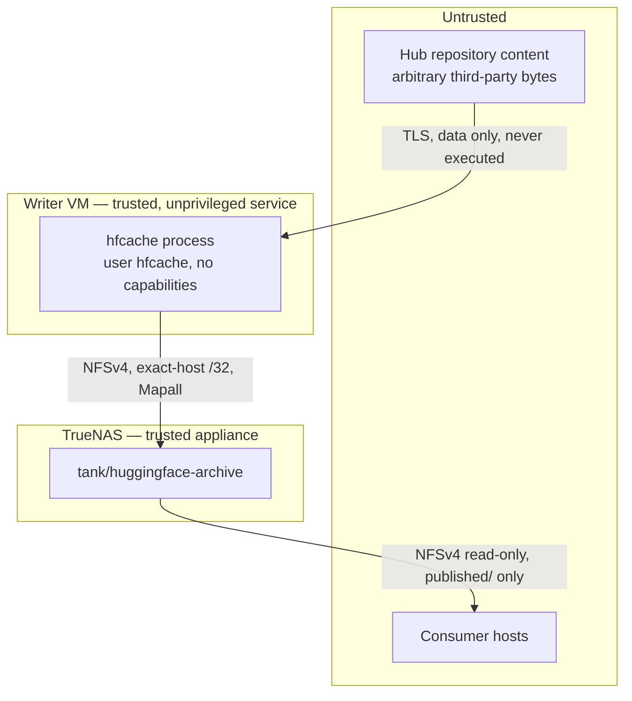

# hfcache Security Model

| Field | Value |
| --- | --- |
| Status | Normative contract for implementation |
| Derived from | `docs/plan.md` §12, §20.2, §21.2, §22.5, §23, §25 |
| Work package | `ARC-007` |

This document states what `hfcache` protects, who it protects it from, what it
explicitly does not defend against, and which control enforces each claim. A
control that is not testable is not listed.

## 1. Assets

| Asset | Why it matters | Primary loss mode |
| --- | --- | --- |
| Published revision trees | The archive's reason to exist; often irreplaceable once upstream is gone | Deletion, silent corruption |
| Revision manifests | The evidence that a tree is what it claims to be | Rewriting to match corrupt bytes |
| References (`current.json`, per-SHA) | What consumers act on | Pointing at a partial, unverified, or missing tree |
| Audit records and journals | The ability to explain what happened | Loss of provenance after a failure |
| The writer host's storage authority | Whoever holds it can destroy the archive | Code execution, privilege escalation |
| Hub credentials, when present | Reusable outside this system | Leakage into logs, TOML, or the archive |

Availability of the *upstream* Hub is deliberately not an asset here. The system
is designed to keep working, and keep its data, when upstream is unavailable.

## 2. Trust boundaries



| Boundary | Trusted to | Not trusted to |
| --- | --- | --- |
| Hub content | Be bytes | Be safe to execute, be well-formed, have safe paths, describe itself honestly |
| Hub transport | Be authenticated and confidential under TLS | — |
| Writer service identity | Mutate the archive | Escalate privilege, read operator secrets beyond its credential, write outside its paths |
| Consumer hosts | Read `published/` | Write anything, reach any other part of the dataset |
| Operator | Configure and initialize | — (an intentionally malicious operator is out of scope, §6) |

## 3. Threats and controls

### T-01 — Malicious repository content executes on the writer

**Capability.** Anyone can publish a public Hub repository containing pickled
weights, `*.py` modules, custom code referenced by `auto_map`, or a model card
crafted to trigger a parser.

**Controls.** The application never executes, imports, unpickles, or instantiates
repository content, never sets `trust_remote_code`, and never constructs
Transformers, Datasets, PEFT, or tokenizer objects (`AD-15`, `NG-09`). Files are
opened for reading bytes and hashing only. Dependency detection parses a fixed
set of known static metadata files — model-card front matter and
`adapter_config.json` — with a bounded JSON/YAML parser, and unparseable input is
recorded as a low-confidence observation rather than retried with a looser parser
(`AD-07`).

**Residual risk.** A parser vulnerability in the standard library or in
`huggingface_hub`. Mitigated by keeping the dependency set small and locked, and
by systemd hardening (§5) limiting what a compromised process can reach.

### T-02 — Repository paths escape the publication tree

**Capability.** A repository can name files with `../`, absolute paths, embedded
NUL bytes, unusually long components, or names that collide after Unicode
normalization. A symlink in the cache could point anywhere.

**Controls.** Every repository-relative path is normalized and validated to remain
under the publication root before any link, copy, or write (`FS-09`, `FS-15`).
Every publication source must be a **regular file** contained by the operation's
approved cache root; directories, symlinks, devices, sockets, FIFOs, and dangling
entries are rejected with `HFSYN004`. Two entries in one manifest that resolve to
the same on-disk path — including via case or Unicode-normalization collision —
are rejected rather than silently overwriting one another. The archive dataset is
case-sensitive with no normalization, so the on-disk spelling is the repository's
spelling.

### T-03 — Content is corrupted in transit or at rest, and the corruption is accepted

**Capability.** A faulty network path, a storage defect, or a bug writes bytes
that differ from what upstream published.

**Controls.** Every newly introduced unique object is read and SHA-256 hashed
locally before publication (`AD-18`); a mismatch prevents publication. Upstream
Git OIDs, LFS digests, and Xet identifiers are recorded as comparison values only,
never as substitutes for reading the bytes. Quarterly offline verification
re-reads the retained archive against immutable manifests. A verification failure
never rewrites the expected digest, never auto-prunes, and never re-downloads over
the evidence (`AD-13`); it exits `40` and records findings.

Hardlink staging does not re-read bytes the same ingestion operation just
hashed. It carries that digest only after proving the current source and staged
destination both match the hash pass's `(device, inode, size)` identity; a
replacement or mismatch is `HFSYN005` and is never published. Copy mode lands a
different inode and therefore still hashes and compares the destination.

### T-04 — Corrupt bytes are laundered into the expected value

**Capability.** A naive repair implementation re-downloads a damaged revision and
regenerates the manifest from what it just received. If upstream itself changed,
or the new download is also damaged, the archive now attests to the wrong content.

**Controls.** `repair` verifies the isolated download against the **original**
manifest and stops if any digest differs (`HFRET006`). The replacement manifest
copies the original expected path/size/digest set exactly and preserves the
publication generation; the original manifest is kept byte-for-byte (`FS-06`,
`FS-07`). The implicated cache inode is never reused: repair downloads into a
fresh transaction-scoped cache.

### T-05 — A downstream consumer modifies or deletes archive content

**Capability.** A consumer host is compromised, or simply runs a tool that writes
to its mount.

**Controls.** Read-only is enforced **server-side** by the TrueNAS export, not by
client mount options, and the consumer export exposes only `published/`. Writer
and consumer client selectors are disjoint, with the writer restricted to an exact
`/32`. `.store`, `audit`, and `runs` are mode `0700` and are outside the consumer
export entirely. Hardlink deduplication is never preserved at the cost of
server-side read-only isolation: if the export topology cannot provide both, the
documented fallback is two datasets plus copy mode.

**Residual risk.** `AUTH_SYS` means a host on the consumer network can claim any
uid. This is accepted for a trusted isolated storage VLAN because the export is
read-only regardless of claimed identity. `KRB5I`/`KRB5P` is the documented path
when cryptographic client identity becomes necessary.

### T-06 — The archive is written to the wrong place

**Capability.** The NFS mount fails, is remounted elsewhere, or configuration
points at a stale path — and a multi-terabyte download lands on the writer's root
filesystem, or into an unrelated dataset.

**Controls.** Every mutating command proves, before any download: the root exists,
is a mount point distinct from its parent, is an NFS/NFSv4 filesystem, is
read/write, and carries a sentinel whose UUID matches `storage.archive_id`
(`FS-01`–`FS-03`). Writability is proven by a real create/fsync/rename/delete
probe, because the Mapall export makes `st_uid` comparison meaningless (§`docs/plan.md` §35.3).
The bare `/srv/hfcache` mount point is root-owned and not writable by the service
identity, so an unmounted archive fails closed rather than filling the root
filesystem. Failure is exit `20` before the first byte is fetched.

### T-07 — A token leaks

**Capability.** A credential in configuration, a log line, an exception message, a
run report, or a file written to shared NFS storage is readable by anyone with
access to that surface.

**Controls.** No configuration key accepts a token; a literal secret in TOML is
`HFCFG010`, reported by key path and never echoed. Tokens arrive only through a
systemd credential or an explicit `--token-file`, are never written to the
archive, and never appear in a manifest, run report, journal, or log at any
verbosity. Ambient discovery is disabled: `HF_TOKEN`, `HUGGING_FACE_HUB_TOKEN`,
and cached home-directory tokens are ignored, and Hub calls pass an explicit
`token=False` or an explicit token — never `token=None`, which would re-enable
implicit discovery.

**Consequence beyond leakage.** Disabling ambient discovery also removes a
correctness hazard: a developer's cached credential cannot silently give a
production run access that the configuration does not describe.

### T-08 — Version 1 archives content it is not authorized to redistribute

**Capability.** A credential that can read private or gated repositories is
present, and the configuration names one.

**Controls.** Version 1 refuses any repository whose Hub metadata marks it private
or gated, regardless of whether the supplied credential could read it
(`HFHUB006`, `NG-06`). A credential in version 1 proves identity and raises rate
limits; it never widens repository scope. `expected_account` is verified with
`whoami` when configured.

### T-09 — A supply-chain compromise reaches production

**Capability.** A malicious release of a dependency, or a substituted artifact at
install time.

**Controls.** Dependencies are locked in `uv.lock` with hashes and installed with
`uv sync --frozen --no-dev --no-editable` at deployment time — never from a
systemd unit and never during a scheduled run, so a sync can never resolve or
fetch a package. The uv version is pinned, its release artifact verified, and its
self-update behaviour disabled. Release trees and virtual environments are
root-owned and read-only to the service identity. The runtime dependency set is
deliberately three packages.

### T-10 — A local unprivileged user on the writer influences a run

**Capability.** A non-root account reads or modifies application state, or plants
input a run will consume.

**Controls.** `/opt/hfcache`, `/etc/hfcache`, and unit files are root-owned;
configuration is `0640 root:hfcache`. `/var/cache/hfcache` and `/var/lib/hfcache`
are `0750 hfcache:hfcache`. The service account has no interactive login, no
password, no sudo access, and no Linux capabilities. Runtime state is under
systemd-managed `RuntimeDirectory`. SELinux is enforcing throughout.

### T-11 — Resource exhaustion turns into data loss

**Capability.** A repository is far larger than expected, a run fills the dataset,
or the local Xet transfer cache exhausts the writer's root filesystem.

**Controls.** `plan` reports logical size and estimated new bytes before a
repository is enabled. Preflight requires free capacity exceeding the estimate
plus the configured reserve, and fails with `HFMNT011` before downloading. The
Xet transfer cache is pinned to `/var/cache/hfcache/xet` on local disk, its peak
usage is reported in every run report, and exceeding its advisory ceiling warns
`HFWRN009`. A failed or aborted run never deletes a retained revision (`TX-06`).

A continuation-enabled queue is admitted against its aggregate download and
copy-publication requirement before the first transfer, then each transfer
rechecks capacity immediately before it starts. Only one repository transfer is
active, so `sync.max_workers` remains the global Hub worker budget rather than
being multiplied by queue depth. The producer is drained before the archive
lock is released, preventing an unowned background writer.
Cache transfers and retention's whole-cache scan are process-serialized, and
queue-ahead retention waits until every downloaded snapshot has been consumed.
Copy publication rechecks space and holds the same allocation guard through
staging, so a concurrent download cannot consume the headroom the copy proved.

### T-12 — An automated repair destroys good data

**Capability.** Recovery logic encounters an ambiguous state and picks a
resolution.

**Controls.** Recovery is roll-forward oriented and refuses to guess: unknown
journal versions, impossible checkpoint combinations, contradicted evidence, and
genuinely ambiguous state all stop with `state = "needs_operator"` and exit `20`
without mutating (`AD-16`, §`docs/architecture.md` §7.9). Unknown files are
reported and preserved, never deleted (`FS-19`). Where a transaction can fail
leaving more or less data, it leaves more (`TX-06`). Quarantined evidence is
released only by explicit operator action.

Whole-repository deletion is a separate `purge` command, never a consequence of
an upstream error or configuration edit. It requires `--apply` plus explicit
unmanaged selectors or `--all-unmanaged`, refuses every repository still in
configuration, validates that references and manifests explain the complete
shallow layout, and preserves any unknown entry. Each repository has its own
durable transaction: pre-commit recovery restores it completely; post-commit
recovery never silently republishes it and retains byte-for-byte manifests plus
reason records under `audit/pruned/` (`AD-20`).

### T-13 — The management plugin widens the operator surface

**Capability.** The Cockpit plugin (`docs/cockpit.md`) exposes operator
actions — sync control, configuration editing, schedule changes, repair — in
a browser behind cockpit-ws.

**Controls.** Authentication is the host's own (PAM through cockpit-ws), and
every mutating path requires the superuser bridge, which only an
administrative session obtains — the same boundary as a shell, and §6 already
places root and the operator out of scope as adversaries. The plugin is
static files under `/usr/share/cockpit/hfcache` with no listener, daemon, or
durable state of its own; CLI work drops to the service identity in a
transient systemd unit and never runs as root (`CP-03`); it never reads
`$CREDENTIALS_DIRECTORY`, offers token entry, or renders a credential — the
deployment's encrypted Hub credential reaches spawned runs only through
systemd's `ImportCredential=`, decrypted by PID 1 (`CP-08`, upholding T-07);
the archive is
reached only through CLI envelopes plus one read-only run-report read as the
service identity (`CP-01`, `CP-09`); and `archive init`, `hfcache.target`,
and `hfcache-verify.timer` are refused structurally in its API layer
(`CP-05`–`CP-07`).

**Residual risk.** cockpit-ws itself, patched with the distribution like
`sshd`. An administrative browser session is as powerful as an administrative
shell, which is this deployment's existing posture, not a new one.

## 4. Controls summary

| # | Control | Enforced by |
| --- | --- | --- |
| 1 | Single authoritative writer host | TrueNAS export restricted to one `/32` |
| 2 | Server-side read-only consumer export | TrueNAS, not client mount options |
| 3 | Dedicated Mapall identities per export | TrueNAS |
| 4 | SELinux enforcing | Writer host, no permissive domains |
| 5 | Unprivileged service user, no capabilities | systemd unit, account posture |
| 6 | systemd hardening (§5 below) | Unit configuration, validated per setting |
| 7 | Strict path normalization and containment | `FS-09`, `FS-15`, `HFSYN004` |
| 8 | No execution, import, or unpickling of repository content | `AD-15` |
| 9 | TLS verification always on for Hub requests | `https://`-only endpoint, `HFCFG014` |
| 10 | Immutable commit SHA for every download | `AD-01` |
| 11 | SHA-256 manifest before publication | `AD-18` |
| 12 | Secrets only via systemd credentials or `--token-file` | `docs/configuration.md` §7 |
| 13 | Locked dependencies, frozen deployment install | `uv.lock`, `uv sync --frozen` |
| 14 | Public-only repository scope in version 1 | `HFHUB006` |
| 15 | Explicit configuration required for any dependency archiving | `AD-07` |
| 16 | Unknown state reported, never deleted or guessed | `AD-16`, `TX-06` |
| 17 | Fail-closed preflight before any download | Exit `20` |
| 18 | Management UI confined to operator surfaces, with the limits structural | `docs/cockpit.md` `CP-01`–`CP-14` |

## 5. systemd hardening posture

Every setting below is applied and then **validated against a real run** — Hub
requests, DNS, TLS, NFS I/O, hashing, and Xet reconstruction all exercised. A
setting that breaks a legitimate operation is not silently dropped: the failing
requirement and the narrower alternative are documented (`docs/plan.md` §22.5).

```text
NoNewPrivileges=true          ProtectKernelTunables=true    RestrictSUIDSGID=true
PrivateTmp=true               ProtectKernelModules=true     RestrictNamespaces=true
PrivateDevices=true           ProtectKernelLogs=true        LockPersonality=true
ProtectSystem=strict          ProtectControlGroups=true     SystemCallArchitectures=native
ProtectHome=true              ProtectClock=true             CapabilityBoundingSet=
ProtectProc=invisible         ProtectHostname=true          AmbientCapabilities=
ProcSubset=pid                RestrictAddressFamilies=AF_UNIX AF_INET AF_INET6
```

Writable paths are limited to the NFS archive and the systemd-managed state,
cache, and runtime directories. The verification unit additionally runs with
`HF_HUB_OFFLINE=1`; `PrivateNetwork=true` is tested against the deployed mount and
enabled only if the already-mounted filesystem stays reliable under reconnect,
with the narrower egress control documented otherwise.

SELinux remains enforcing throughout development and acceptance testing.
Denials are resolved by fixing ownership, labels, or unit restrictions first, and
only then by a narrowly scoped local policy module with documented source, build,
installation, verification, and removal steps. `setenforce 0`, permissive domains,
and blanket allow rules are not production solutions (`docs/plan.md` §23).

## 6. Explicitly out of scope

Naming these keeps the model honest — each is a real risk that this system does
not address.

| Out of scope | Why |
| --- | --- |
| Compromise of the TrueNAS appliance | It is the storage root of trust; nothing the writer does can compensate |
| Root compromise of the writer host | Root can rewrite the archive and its evidence; the service identity is the boundary, not root |
| A malicious operator | The operator configures, initializes, and holds sudo by design |
| Physical access to either machine | Site security concern |
| Judging whether archived content is itself safe or lawful to use | The archive stores faithfully; consumers evaluate what they run (`NG-04`, `NG-08`) |
| Upstream publishing backdoored content that hashes consistently | Correctly archived by definition; detecting it is a different product |
| Denial of service against the Hub, or by the Hub against us | Handled as an availability condition (`HFHUB001`, `HFWRN006`), not a security control |
| Confidentiality of archive content | All version 1 content is public by definition (`NG-06`) |

## 7. Verifying these claims

| Claim | Test |
| --- | --- |
| No repository code executes | Unit tests assert no `import`, `exec`, `pickle`, or model-construction path exists in ingestion; live tests archive a repository containing `*.py` and custom code and confirm none is loaded |
| Path escapes are rejected | Property-based tests over adversarial path sets, including traversal, absolute, special-file, case-collision, and normalization-collision cases |
| Public-only scope holds | A credential able to read gated content does not expand version 1 scope |
| Secrets never surface | Redaction tests over log lines, run reports, manifests, journals, and error messages at maximum verbosity |
| Fail-closed preflight | Unmounted, read-only, wrong-sentinel, and below-reserve archives each exit `20` with no Hub request issued |
| Consumer cannot write | Server-side create, modify, rename, and delete attempts from a consumer client all fail (operator-run; `NAS-004`/`NAS-005`) |
| Hardening does not break operation | `systemd-analyze verify` clean, a full sync under enforcing SELinux with no unexplained AVC denial |
