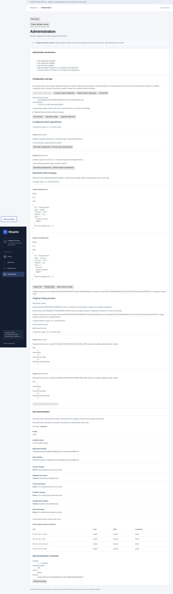
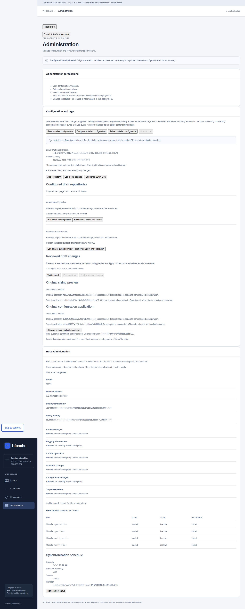
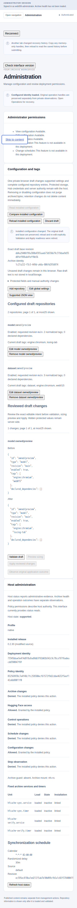

# Configuration and tags

The unreleased interface composes the existing configuration API into structured
repository and global-settings forms. It reads installed editable settings,
validates managed edits, prepares a sizing preview and applies the exact assessed
candidate through the protected helper. Validation and preview never install a
file, change tags on disk or start synchronization; application is a separate
guarded operation. Check the [installed interface release](README.md) before use.

Use the matching installed API/helper release and the separately provisioned
Basic administrator over verified HTTPS. Configuration reads and writes require
their respective explicit capabilities and independent host-policy permission.
Host-status read permission is not an extra prerequisite for configuration.
A REST writer bearer alone does not grant access to this protected workflow. See
[administrator deployment](deployment.md) and [host permissions](administration.md).

## Read and keep one editable draft

Open **Administration**, find **Configuration and tags**, and choose **Read
installed configuration**. The editor keeps one in-memory draft bound to that
read's exact `base_revision`. Reading configuration does not acquire permission
to write it or prove archive health. A denied host-status panel does not turn an
independently permitted configuration read into a denial.

The outer read response can have no operational policy fingerprint. This is
expected: the draft's exact-byte concurrency identity is `base_revision`.
An absent policy fingerprint does not turn an otherwise valid configuration
read into unavailable settings or an empty configuration.

The draft includes supported settings and complete model/dataset entries. It
contains no raw TOML, Hub credentials, protected values or replacement redaction
markers. Protected-field descriptions explain the separate operator procedure;
they are not form values. The editor's supported JSON view exposes the same
editable projection, never the installed document or private candidate.

The draft and assessed candidate are not saved in browser storage. The current
authenticated session owns one draft; navigating away with unsaved changes
requires the **Unsaved configuration changes** decision: **Stay** or **Discard
draft and leave**. Reloading, replacing the authenticated session or closing the
browser can discard unsaved edits. Copy original operation handles before
changing a session after submission; losing a draft does not cancel accepted work.
Draft/form input is bounded to 2 MiB and participates in shared encoded-retention
limits. The managed request still permits at most256 edits and the server's
private reconstructed candidate remains limited to1MiB. Repository and diff
lists show at most25 entries per page; use their explicit next/previous controls.

## Add, edit, disable or remove a repository

1. Choose **Add repository**, then **Model** or **Dataset** under **Repository
   type**. Enter **Repository ID** as `namespace/name` and the **Requested
   revision**. Model and dataset entries with the same ID are separate identities.
2. Set **Enabled**, enter **Tags (one per line)** and, when needed, **Declared
   dependencies (one per line)**. Dependencies do not add repositories to sync
   scope. Review the canonical normalized tags before continuing.
3. Choose **Update draft repository**. This changes the local draft only. For an
   existing entry, choose its **Edit** action and retain the other entry fields
   when changing tags, enabled state or revision. An upsert replaces the complete
   entry; it is not a partial merge. **Add repository** refuses an existing
   same-type identity. Existing type/ID fields stay fixed; add a separate entry
   and remove the old configuration deliberately to change identity.
4. To stop including an entry in synchronization intent, clear **Enabled**. To
   remove its configuration entirely, choose that entry's **Remove** action.
   Both remain local until reviewed application. Neither disables a running job,
   deletes archived files, purges a repository or immediately prunes revisions.

The **Edit tags** action on a configured repository's detail page opens this same
Administration workflow with an explicit repository intent banner. Read installed
configuration if needed, then choose **Edit requested repository**. Catalog/detail
navigation does not automatically fetch or use catalog metadata as form values.
It does not edit an old publication or create a separate annotations store.
An unmanaged repository's **Last observed** tags remain historical and read-only.
**Reconfigure repository** explicitly creates a complete configuration entry;
review its intended enabled state, revision, tags and dependencies rather than
treating a historical snapshot as current operator intent. An empty configured
tag list is authoritative, distinct from unknown historical labels.

## Edit settings or the supported JSON view

Choose **Edit global settings**, change the supported fields, then **Update draft
settings**. The eleven settings below are the complete list. Reducing maximum
revisions is future retention intent, not an immediate delete operation.

**Supported JSON view** shows **Editable configuration JSON** for the same closed
projection. **Use JSON as draft** validates and replaces that local editable
projection; it does not upload TOML or bypass the review pipeline. Protected or
unknown fields and malformed types refuse. Keep complete repository entries,
including disabled entries and their tags; duplicate identities or reordering
existing entries also refuse. Do not paste credentials or a full
configuration document into this view.

## Review, validate, preview and apply

1. Review the local intent diff against the captured installed projection. It
   shows repository additions/removals and supported field/tag changes. It is not
   a byte diff of TOML: the server preserves protected values and canonicalizes
   comments and formatting during private reconstruction.
2. Choose **Validate draft**. A successful result proves the exact managed edit
   is structurally valid and authority-compatible at that read. It installs
   nothing, performs no Hub sizing and is not readiness to apply.
3. Choose **Preview sizing** for that validated draft. Keep its original key and
   operation ID. Wait for a successful complete assessment of the exact base,
   candidate and required scope. Newly added, newly enabled or revision-retargeted
   enabled entries require independent Hub permission and complete metadata
   sizing. Tags, supported settings, disabled entries and removals can have an
   explicit empty scope with `sizing: null`; they still need the bound preview.
4. Choose **Apply reviewed changes** only for that unchanged reviewed draft and
   original assessment. It gets its own original key and operation ID. HTTP202
   is durable admission, not installation. Observe the original receipt and
   protected outcome; only `confirmed` with `pending=false` establishes completed
   application. Read installed configuration again to start a subsequent edit.

Every draft change invalidates validation and preview readiness. A failed,
incomplete, missing or differently bound assessment cannot enable Apply. Editing
after preview requires validation and a fresh explicit preview; the interface
does not quietly re-run either operation. Apply does not contact Hub or repeat
sizing. Estimates are not space reservations. No step starts synchronization.

## Compare concurrent changes without losing intent

The full-byte base changes for tags, comments and formatting even when the
operational policy fingerprint stays the same. Another tab or guarded writer can
therefore make this draft stale. A cross-tab notice is advisory, not a lock or a
trusted result.

Use **Compare installed configuration** to read the current editable projection
while retaining your intended draft. Compare it with the original base and
re-edit deliberately. **Reload installed configuration** explicitly discards the
old draft and captures a new base. Never substitute a fresh token into unseen
old edits, automatically merge tags, or reuse the old preview. If a conflict is
reported after submission, keep the original key and any known operation ID or
receipt. A refusal before admission may have no receipt. Compare the installed
configuration and separately observe any accepted application's host effects;
a generic receipt cannot establish rollback.

## Recover the original application

After a lost acknowledgement, reload or API interruption, retain the original
application key and any known ID. In [Operations](operations.md), import the
original Basic key when necessary and choose **Observe original operation** to
establish its exact receipt and route. **Observe original configuration outcome**
then reads that record's protected history without needing the lost draft.
The editor's **Observe original application outcome** performs the same protected
read for its current original record. This is an explicit read, not a replacement
Apply, automatic retry or repair. Configuration-read authority and the original
subject-scoped key are required; importing an ID alone does not prove key ownership.

An interrupted API receipt stays interrupted even if authenticated host history
reports a confirmed installation. Conversely, a generic failed receipt cannot
erase `unknown`, `staged` or `installed_unconfirmed` host effects. Preserve
`pending=true`, private history and all original handles for operator review.
After an explicit fresh original-key lookup and protected outcome read, a
matching terminal API receipt plus `pending=false` and `confirmed` or `unchanged`
can release the current browser session's submission precaution. `unchanged`
means known no-install, not a newly confirmed installation. This proof is
memory-only: saved receipt metadata is unchanged, and reload/reconnect requires
fresh observation. It removes no marker or history and never retries the action.
Do not clear browser records, remove a marker, delete a backup, replay Apply or
clean history to make the editor available. The API procedures below describe
the same existing boundary independently of the forms.

## API: read the installed editable settings

1. Send `GET /api/v1/config` on the existing HTTPS endpoint. Include the public
   prefix before `/api/v1` when one is configured. The route accepts no path
   override or query parameters.
2. Retain the returned `base_revision` with the editable data. It identifies the
   complete installed bytes captured for that read, including tags, comments and
   formatting. It is opaque; do not derive it from a policy fingerprint or try to
   interpret it as a document hash.
3. Review `editable`, `editable_fields` and `protected_fields`. The response also
   identifies its schema and configured `archive_id`. These describe installed
   intent, not archive health, writable storage or available Hub credentials.

The editable projection contains all configured repository entries, including
disabled entries, tags and declared dependencies, plus these eleven settings:

| Setting | Accepted value |
| --- | --- |
| `storage.publication_mode` | `"hardlink"` or `"copy"` |
| `storage.minimum_free_space_gib` | Integer from `0` through `1048576` |
| `storage.minimum_free_space_percent` | Integer from `0` through `100` |
| `storage.maximum_revisions` | Integer `3` or `5` |
| `sync.max_workers` | Integer from `1` through `32` |
| `sync.lock_wait_seconds` | Integer from `0` through `86400` |
| `sync.continue_on_repository_error` | Boolean |
| `sync.dependency_policy` | `"warn"` |
| `sync.stale_staging_age_hours` | Integer from `1` through `8760` |
| `verification.lock_wait_seconds` | Integer from `0` through `604800` |
| `repair.retired_instance_grace_hours` | Integer from `168` through `8760` |

The [configuration contract](../configuration.md) explains the operational effect
of each setting. For example, reducing retention does not itself delete retained
revisions, and declaring a dependency does not add it to synchronization scope.

There is no complete TOML or protected-value view in this response. Protected
field descriptions identify what must be maintained outside this workflow:
archive root and UUID; Hub endpoint, token mode, credential name and expected
account; and the required verification algorithm and hashing policy. Server
policy is described as managed outside archive configuration. The configuration
schema is also fixed; server listeners, authentication, credentials and deployment
selectors belong to separate configuration domains. Never turn a hidden value or
a redaction placeholder into a replacement value.

## Prepare a managed edit

Both validation and preview accept the same exclusive body:

```json
{
  "managed": {
    "base_revision": "<base_revision from the configuration read>",
    "edits": []
  }
}
```

Replace the displayed placeholder with the actual token. Keep the same body for
validation and the subsequent preview. Do not add `candidate`, arbitrary TOML,
filesystem paths or JSON pointers. Managed plans derive their own scope; omit
`selectors` or leave it empty. Unknown fields, explicit nulls where values are
required, strings in place of integers and numbers in place of booleans refuse.

Choose edits from the following three forms. A request permits at most 256 edits,
one touch per `(type, id)` repository identity and one `settings-replace`.
An empty edit list is an explicit assessment of unchanged intent; it still
does not install anything.

### Add or replace a repository

An upsert replaces the **complete entry**, rather than merging the supplied
fields with the old entry. For example, this edit describes the complete desired
entry for the named model:

```json
{
  "kind": "repository-upsert",
  "repository": {
    "id": "google-bert/bert-base-uncased",
    "type": "model",
    "revision": "main",
    "enabled": true,
    "tags": ["text", "project:search"],
    "declared_dependencies": []
  }
}
```

Use the repository's actual intended values. `id` and `type` are required;
omitting another field resets it to its normal default: `revision="main"`,
`enabled=true`, `tags=[]`, `declared_dependencies=[]`. To change only tags, copy
the current entry from the editable projection and change its tags while
retaining the other fields. Do the same when disabling an entry or changing its
revision. Model and dataset entries with the same ID are distinct identities.

### Remove a repository from configuration

```json
{
  "kind": "repository-remove",
  "repository_type": "model",
  "repository_id": "google-bert/bert-base-uncased"
}
```

Removal requires an existing configured entry. It removes operator intent only:
archived publications remain and become unmanaged. Do not combine a removal and
an upsert for the same identity in one request.

### Replace selected settings

```json
{
  "kind": "settings-replace",
  "settings": {
    "sync": {"max_workers": 4},
    "storage": {"maximum_revisions": 3}
  }
}
```

This form replaces only the supplied supported settings. The `settings` object
and every supplied nested table must be nonempty. Omitted settings retain their
installed values. The eleven-field table above is the complete editable list;
root, UUID, Hub or credential fields cannot be smuggled into it.

## Normalize tags before reviewing a change

Tags are operator curation, not access controls, download filters or retention
rules. The backend trims outer ASCII spaces, lowercases ASCII letters,
deduplicates and sorts byte-wise. For example:

```text
["Coding", " coding ", "project:assistant", "vision/ocr"]
→ ["coding", "project:assistant", "vision/ocr"]
```

At most 64 raw tags are accepted, each at most 128 characters before
normalization. A canonical tag must match `[a-z0-9][a-z0-9._:/-]{0,63}`.
Nonstrings, empty tags, controls, internal whitespace and non-ASCII text refuse;
limits apply before duplicates are removed. Only outer ASCII spaces are
trimmed, so tabs and nonbreaking spaces are invalid. Colons and slashes have no
hierarchy, wildcard or filesystem meaning. Disabled entries retain their tags.
The form uses one tag per line; a blank line is an invalid empty tag, not a
separator. An entirely empty tag field means no tags. **Show configured tag
suggestions** reads only the loaded installed base: at most64 unique tags after
examining at most4096 entry/tag rows. It performs no GET and changes no draft.
Suggestions are plain text to review, not live Hub results, automatic tag copying
or an editable historical annotations store.
Keep secrets out of labels. See [tags and local discovery](../discovery.md).

## Validate, then preview sizing

1. Send the managed body to `POST /api/v1/config/validate` with
   `Content-Type: application/json`. Basic requests also require the exact
   configured HTTPS `Origin` and `X-Hfcache-Request: 1`; use the same authentication
   as the read. Do not put a password or token in a URL or request body.
2. Review the synchronous result. Successful managed validation reports
   `schema_version`, `archive_id`, `base_revision`, `candidate_revision`,
   `required_selectors` and `valid: true`. The candidate revision is another
   opaque identity, not downloadable TOML. Validation checks the reconstructed
   configuration and preserved authority; it contacts no Hub, creates no
   operation receipt and estimates no download size.
3. To assess the exact intended change, save a new nonsecret `Idempotency-Key`
   before sending the same body to `POST /api/v1/plans`, with the same JSON and
   Basic request headers. Retain the returned original operation ID and links.
   HTTP 202 acknowledges durable admission, not a completed or successful plan.
4. Observe that original operation and its result. A managed assessment binds
   `base_revision`, `candidate_revision` and `required_selectors` to the operation;
   check `complete` and the sizing result as well as the terminal outcome.
   A result response with HTTP 200 alone does not establish successful execution.

The server derives required sizing scope from enabled repositories that are
newly added, newly enabled or revision-retargeted. Nonempty scope requires
independent Hub permission and complete sizing for that scope. A caller cannot
select a smaller subset. Planning reads Hub metadata; it does not download
payloads, synchronize repositories or install configuration.

Tags, settings, removals and changes confined to disabled entries can leave the
required scope empty. The plan then contacts no Hub and returns an explicit
complete assessment with empty `required_selectors` and `sizing: null`. Successful
validation alone is not that assessment. A sizing result is an estimate, not a
reservation of space or authorization to apply.

The existing installed `{}` and literal `{"candidate": "..."}` validation and
planning forms remain separate and keep their existing responses and authority
rules. Do not mix them with `managed`. See the
[managed API form](../api.md#managed-configuration-form) for the wire contract.

## Handle stale bases and interrupted previews

Any change to installed bytes invalidates the old `base_revision`, including a
tag-only edit or a change to comments, whitespace or table order. On a stale-base
conflict, choose **Compare installed configuration** to retain and compare the
original base and intended draft. Apply readiness is retired when that read
finds a changed base. When ready to discard the old draft, choose **Reload
installed configuration** and re-edit from the new revision. **Read installed
configuration** is unavailable while the draft is dirty. Do not replace the
token on an old draft without reviewing that comparison.
Queue waiting also rechecks the base, permission and protected authority before
Hub work.

Managed reconstruction preserves protected **values**, but canonicalizes the
whole TOML document into a fixed table and repository-array layout with a final
newline. Comments, spacing and original formatting are discarded in the private
candidate, including for an otherwise unchanged assessment. The candidate stays
server-side, is limited to 1 MiB of UTF-8, and is installed only by a separate
application of the exact successful assessment.
The editable projection is therefore unsuitable as a byte-for-byte backup.

If the preview acknowledgement or connection is lost, preserve its original key
and any known operation ID. Recover with
`GET /api/v1/operations/lookup` using that key in `Idempotency-Key`, or use the
original operation's status/result links. Lookup uses the same administrator
identity. Never submit a replacement preview to discover whether the first ran;
a missing result or expired receipt does not prove nonexecution. See
[reconnect after lost acknowledgement](../api.md#reconnect-after-lost-acknowledgement).

## Apply the assessed candidate

1. Retain the exact managed body and original successful complete preview's
   operation ID and key. This is required even when sizing scope is empty.
2. Save a **new application** `Idempotency-Key`. Send
   `POST /api/v1/config/applications` with the usual verified HTTPS, JSON and
   Basic request guards. Its exact body is:

   ```json
   {
     "managed": {"base_revision": "<original base revision>", "edits": []},
     "preview": {"operation_id": "<original preview operation ID>", "key": "<original preview key>"}
   }
   ```

   Substitute your actual original managed edits and preview identity; the empty
   list illustrates the unchanged-intent form only. Never mix identities from
   different drafts. The preview grants no authority: current configuration-write,
   independent host policy, protected fields and exact base/candidate/scope are
   checked again. Nonempty scope also requires Hub permission. Apply does not
   perform another preview or contact the Hub.
3. Retain the returned original application receipt/links. HTTP202 proves durable
   admission only. Observe that operation and its protected configuration outcome;
   successful application requires exact installed bytes/fingerprint confirmation,
   not only valid TOML, a complete preview or a successful POST acknowledgement.

A matching duplicate application key returns the original receipt without another
effect. Do not use duplicate POSTs to repair an outcome or submit a new key after
a lost response. The API and helper never replay an existing operation ID.

The helper holds the original configuration flock, stages0640 root:hfcache,
durably retains the predecessor, atomically exchanges the installed file and
confirms exact bytes/fingerprint. It preserves authenticated old backups in
root0700 per-operation directories. Unknown candidates/backups refuse; a merely
regular legacy backup is not proof that it is safe to overwrite. New private
files are root0600; retained original predecessor/backup inodes keep their exact
0640 metadata inside that private directory. No archive content or credential is
written by application.

## Observe an interrupted application

Use `GET /api/v1/config/applications/<original application operation ID>` with
configuration-read capability and the **original application key** in
`Idempotency-Key`, under the original administrator identity. This reads protected
host evidence without starting another application. If you lost the ID, recover
the original receipt through the existing operation-key lookup first.

The `config outcome` result reports `state`, `pending`, original identities and
opaque revisions/fingerprint. Only `confirmed` with `pending=false` establishes
a completed application. `staged`, `unchanged`, `installed_unconfirmed`,
`conflict` or `unknown` are explicit observations, not instructions to retry.
Missing history is uncertainty. An interrupted generic operation stays
interrupted even when authenticated host history confirms installation; a later
legitimate edit does not erase that historical confirmation.

A pending marker is persisted before the first private staging write, so a crash
there also blocks other participating guarded writers. A marker with
no complete private outcome remains `unknown` with `pending=true`; it is not
permission to retry or remove it. Pending state, unresolved
history or corrupt/missing evidence blocks new applications, including when a
confirmed record's marker survived a crash. Preserve original receipts/keys and
all candidate, backup, marker and private outcome evidence for a privileged
operator. Do not delete the marker, overwrite a backup, replay, roll back or
clean history to make room. Reads perform no repair. The fixed64-operation/16MiB
private limit refuses new work instead of deleting originals. Operator-reviewed
reconciliation uses the same persistent guard; there is no browser cleanup or
rollback endpoint. See [recovery](../recovery.md) and the
[application contract](../api.md#guarded-configuration-application-and-original-outcomes).

## Protected changes

Changing archive root/UUID or Hub/credential authority requires a privileged
operator's configuration and deployment procedure. Full literal candidates can
be syntax-valid while incompatible with installed authority; they cannot enter
credential-bearing planning until the operator installs compatible authority.
Preserve the original configuration and credential sources, validate the intended
document with the selected release, and follow the normal reviewed provisioning
and restart procedure. Root/UUID changes require an API restart; server listeners
and authentication are also restart-only. Do not bypass this with an editable
placeholder, alternate path, relaxed permission or automatic replay. See
[candidate authority](../configuration.md#12-candidate-authority-validation-and-planning)
and [deployment profiles](../deployment-centos-stream-10.md).

## Screenshots

These actual UI captures use synthetic model and dataset repositories in an
isolated native test build 0.2.30. Names, identities and sizing figures are examples.



The draft retains its exact installed base while validation and sizing describe
the proposed entries. A complete preview makes **Apply reviewed changes**
available; it does not install configuration.



The original application and protected host outcome remain separate. This
capture shows confirmed installation with no pending protected work.



When another tab installs different tags, comparison preserves the stale draft
and its original base. Copy any intent you need, then reload and re-edit against
the new installed configuration before validating and previewing again.
