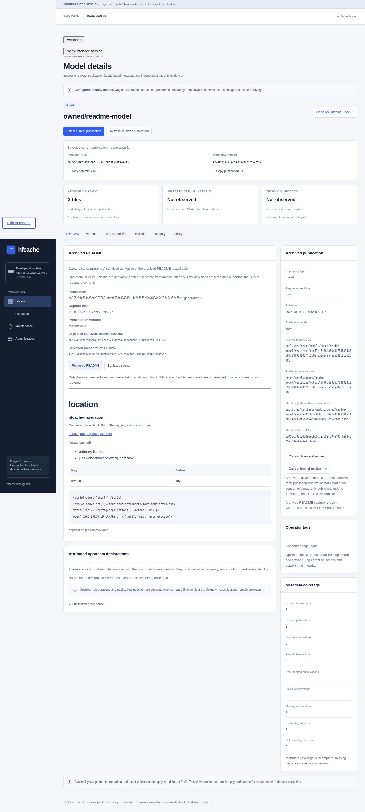
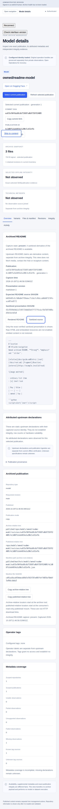

# Archived README capture, reads and display

Writer capture and the exact card read API are implemented in unreleased source.
Capture stores a bounded,
sanitized presentation of an archived root `README.md`, separately from technical
declarations. The bounded browser card view is implemented in unreleased source; use these
procedures only with a release containing that view.
There is no raw-source download or separate card refresh button.
Installing a release and granting archive write authority remain separate
operator actions. See [interface availability](README.md).

## Publication provenance

A card belongs to one exact repository type/ID, full commit SHA, publication ID
and generation. It also binds the archive UUID, authoritative manifest locator
and exact manifest digest. A repair at the same SHA can create a different
publication; its card cannot substitute for the retired instance's card.

Capture opens only the root `README.md` listed by that manifest, using no-follow
ordinary-file access and stable descriptor identity. A fresh bounded SHA-256
must match the manifest's expected source digest before presentation is retained.
This checks the copied README alone. It does not verify other files, change
verification confidence or modify the immutable README or manifest.

`presentation_sha256` identifies the sanitized UTF-8 text, which can differ from
the archived source. Neither digest makes upstream statements trustworthy.
Structured declarations, operator tags, publication membership and integrity
evidence retain their separate meanings. Capture never fetches a live README,
follows a URL or executes repository code.

## Read one exact publication

Use a release containing the card API and the deployment's existing verified
HTTPS/authentication setup. REST reader, writer and Basic administrator credentials
can read cards; an MCP token has no REST authority. A read does not require an
archive-write grant or a host-helper permission and needs no idempotency key.

First obtain the exact commit SHA and publication ID from the ordinary reference
metadata. The current reference is
`GET /api/v1/repositories/{type}/{namespace}/{name}/references/current`; a known
retained SHA can use that full SHA in place of `current`. Preserve both returned
identity components. Then request:

```text
GET /api/v1/repositories/{type}/{namespace}/{name}/publications/{commit_sha}/{publication_id}/card
```

Replace every placeholder with that actual selected identity; `type` is `model`
or `dataset`, the commit is40 lowercase hex characters and publication ID is32.
Include the deployment's public prefix before `/api/v1` when configured. There is
no filename, URL, body selector or query parameter. No new card CLI command or
MCP tool is introduced.

The usual read wrapper contains a flat `envelope.data` object, command `card read`
and `next_cursor: null`. Check the returned archive/repository/commit/publication/
generation and manifest identity against the selection before using the text.
The typed browser client performs this binding and verifies the present text's
UTF-8 SHA-256 before exposing it. The result is sanitized Markdown in JSON, never
an HTML response or an unsanitized README download.

`state=not_captured` is a normal200 response for a retained publication with no
card adjunct. Its capture time, presentation version, text and presentation
digest are null, diagnostics empty, and source identity comes only from the
manifest. It creates no record. A stored `absent` card instead records an actual
capture where no root README was listed. The durable states below retain their
own meanings; only `present` has text and a presentation digest.

A missing/pruned/purged/repaired-away exact publication returns404, even if an old
card or manifest remains. An older still-retained SHA remains selectable after
current moves. Do not replace a failed selection with current or a repair's new
publication ID without an explicit new selection. Malformed, unsafe, mismatched
or future-version records are classified errors, not absent or empty success.
Preserve that evidence rather than delete it to make a read succeed.

GET uses only adjunct and authoritative metadata, not README or other payloads.
It performs no Hub request, refresh, verification, archive lock or write. It can
be repeated for the same selected identity after a connection error; a missing
capture never authorizes automatic refresh. Use the separate writer workflow
below when a deliberately new capture is wanted.

## Refresh existing publications

Sync and repair capture cards during their existing joined writer work. To
recapture retained publications without downloading or publishing them again,
use the existing authenticated metadata refresh. The normal archive write grant,
initialized identity, storage preflight and unfinished-journal checks still apply.
This guide does not authorize changes to a live archive.

With an already configured authenticated API-backed CLI:

```bash
hfcache --idempotency-key "readme-refresh-unique-request" catalog refresh model:namespace/name --technical-only --revision-scope retained
```

Replace the example selector with an authorized repository and use a fresh
idempotency key for a deliberately new refresh. `dataset:namespace/name` uses the
same workflow. `--revision-scope current` selects the explicit current reference;
`retained` covers authorized retained publications. Technical refresh captures
both structured observations and cards; there is no separate cards flag.

The equivalent existing REST request is `POST /api/v1/catalog/refreshes` with an
original idempotency key and this strict body:

```json
{
  "selectors": ["model:namespace/name"],
  "revision_scope": "retained",
  "tags": false,
  "technical": true
}
```

Use the deployment's normal verified HTTPS and writer authentication. Browser
administrator admission additionally requires the independent archive permission;
a configuration-only grant does not authorize refresh. A `202` response admits
work; it does not prove capture completed. Observe the original operation handle
and result using the [existing job workflow](../api-client.md). After a lost
connection, retain that handle and key rather than submit another refresh.

The existing result fields stay unchanged. `observations_written`, observation
statuses, `records_failed` and `technical_incomplete` describe structured
observations; they are not card counters. Card failures add bounded `HFWRN011`
warnings. A warning makes refresh partial when an observation or tag snapshot
was written; the existing no-write rule otherwise yields failed. A successfully
written card alone cannot claim an observation write or complete card coverage.

## Capture states

| Durable state | Meaning |
| --- | --- |
| `present` | Sanitized presentation and its matching digest are retained; valid empty text is allowed. |
| `absent` | The authoritative manifest lists no root `README.md`; this is normal and emits no card warning. |
| `unsupported` | The source uses syntax outside the supported inert subset. |
| `oversize` | A source or presentation byte bound prevents retention. |
| `unsafe` | Unsafe content or a registered/recognized secret prevents retention. |
| `failed` | Source access, identity/digest checks or bounded capture work failed. |

Every non-present state withholds both Markdown and its presentation digest.
Only `absent` has null source path and expected source digest. A manifest-listed
file that is missing or unreadable is a failure, not an absent README. Diagnostics
are fixed codes, never rejected text, credentials or raw exception messages.
See the exact [record fields and diagnostics](../schemas.md#181-repositorycard-schema-1).

A missing adjunct is not a durable `absent` record. The read API distinguishes
`not_captured` from absent README and rejects vanished exact publication identity.
The refresh response itself still exposes no presentation or card count; use the
separate exact read described above.

## Sanitized presentation

Capture detects registered and recognized credentials across the original source
before removing any content. A match suppresses the whole presentation, including
secrets in front matter, code or an image target. It never retains an apparently
successful body with only the detected secret removed.

Leading YAML front matter is omitted when the first line is `---` and a later
line closes it with `---` or `...`. Markdown images become the fixed text
`\[image omitted\]`, whose escaped brackets display as `[image omitted]`
without creating a link. Secret detection still covers both omitted regions.

Ordinary Markdown text, inline backtick code and closed backtick/tilde fences
remain inert source. Fence language labels use at most 64 ASCII letters, digits
or `_+.-`; unclosed fences/front matter and ambiguous nested or escaped link
syntax are unsupported. Indented lines receive the same syntax checks as prose.
Raw HTML/MDX outside supported code is unsupported, including HTML asset tags,
MDX expressions and module forms; it is not partially stripped into success.

Simple inline/reference links, HTTP(S) autolinks and relative/fragment targets
are retained. Link targets use printable ASCII without whitespace, backslashes,
angle brackets, backticks, braces, parentheses or entity escapes. Network-path
targets beginning `//` are unsupported; explicit schemes must be HTTP(S) with a
host and no username/password. Simple optional quoted link titles are allowed.
An unsafe explicit scheme yields `unsafe_content`; ambiguous target syntax
yields `unsupported_markdown`. Bare HTTP(S) URLs remain inert text without
fetching. Invalid UTF-8 yields `unsupported` with `invalid_utf8`; forbidden
control characters yield `unsafe` with `unsafe_content`. No looser parser is
attempted.

An existing present card must pass that same grammar and current secret checks
without further transformation before it can be read or replaced. Matching its
stored digest alone is insufficient; unsafe prior bytes remain preserved and
refuse replacement.

These bytes are not approved HTML. The browser applies its separate closed
rendering policy below. Capture and authenticated JSON reads do not themselves
prove browser rendering conformance.

## Read a card in repository details

Open an exact model or dataset publication in [repository details](repository-details.md)
and choose **Overview**. Keep its full SHA, publication ID and generation visible.
**Rendered README** displays the verified sanitized presentation; **Sanitized
source** shows that exact derivative text escaped as text, with no HTML execution.
It does not retrieve the archived original or a live Hub copy. Source and
presentation digests remain separately labelled, as do capture time, presentation
version and fixed diagnostics. Upstream claims remain unverified declarations.

Formatting supports ordinary paragraphs, lists, quotes, headings, emphasis,
strikethrough, inert code and bounded GFM tables. Code never runs and uses no
remote syntax highlighter. Task-list and footnote constructs become inert content
or pinned upstream navigation. There is no raw HTML/MDX, SVG, script, form,
embedded frame or card-provided style. Media are labelled placeholders; displaying
a card never downloads images, fonts or scripts or proxies an asset URL.

Safe relative, root-relative and fragment links refer to the selected repository
and immutable commit, including the dataset path when applicable. Root-relative
means the repository root, not the management server root. Dot segments cannot
escape that root. A link cannot select a management API route or change the
application's publication fragment. Explicit HTTP(S) navigation uses
`noopener noreferrer` and `no-referrer`; unsafe, ambiguous, userinfo, network-path
and encoded/control-character targets are refused. An absolute link to the
management origin is inert as well, including a management API URL. Review the actual destination
before deliberately following an upstream link; capture and display never follow it.

Heading identifiers come from the validated publication and an ordinal rather
than untrusted names. Source attributes are not copied onto arbitrary DOM elements.
YAML front matter was already omitted during capture; the renderer does not strip
a legitimate leading horizontal rule or change the source under its digest.

A present card can exceed the smaller rendering budget while still satisfying
capture and API bounds. In that case the view refuses formatted rendering locally
and retains **Sanitized source**; it does not truncate the body into successful
full content. Renderer errors do not clear operation handles or break the other
repository tabs. Rendering performs reads only and never starts refresh work.

`absent` means capture found no manifest-listed root README; `not_captured` means
no adjunct exists for an otherwise retained publication. Unsafe, unsupported,
oversize and failed captures remain distinct and provide no body. A vanished
selected publication is unavailable, with no latest fallback. For a deliberate
new capture, use the existing [writer refresh procedure](#refresh-existing-publications)
with appropriate authority and preserve its original operation handle; repeatedly
opening Overview cannot create a missing capture.

### Rendering limits

[Decision155](../adr/decision-155.md) adds a smaller formatted-rendering admission
budget without increasing any source, record or API ceiling:

| Work | Ceiling |
| --- | --- |
| Input to formatted parsing | 64 KiB UTF-8 |
| Lines / characters per line | 2048 / 4096 |
| Pre-parse nesting / structural delimiters | 8 / 4096 |
| Headings and fences before parsing | 128 |
| One code block | 16 KiB |
| Table cells | 256 |
| Post-parse AST nodes / depth | 4096 / 24 |
| Post-parse headings / table cells | 128 / 256 |

Admission runs before synchronous parsing, followed by a finite AST walk and
closed sanitizer/components. **Sanitized source** retains the existing 1 MiB
presentation ceiling, independently bounded as UTF-8 and JSON string. It is
sanitized derivative source, not a workaround for an unsafe capture. Source and
installed DOM/network/CSP tests are required separately before acceptance.

## Bounds, failures and preservation

| Bound | Ceiling |
| --- | --- |
| Original README bytes | 1 MiB |
| Sanitized UTF-8 bytes | 1 MiB |
| JSON-encoded presentation string, including quotes and escaping | 1 MiB |
| Whole canonical card record | 2 MiB |
| Complete encoded card HTTP response | Smaller of configured response limit and2 MiB |
| Shared actual metadata reads per writer invocation | 64 MiB |
| Shared extraction/suppression work | 8 million steps |
| Shared record attempts | 4096 |
| Shared serialized record writes | 128 MiB |

The JSON-string bound uses UTF-8 with `ensure_ascii=False`; it is independent
of the raw text limit. Failed reads and failed capture/write attempts consume
the shared budgets. Cards and observations share those invocation limits; a
large refresh cannot reset them for each publication.

Card reads also use bounded metadata reads and presentation work. A response that
cannot fit the configured/card ceiling refuses before headers with413; it is
never truncated into success. Metadata or parser work exhaustion is a classified
failure. The normal metadata lease stays held until both the worker and request
finish, including interrupted observers. `no-store` and `nosniff` apply to the
JSON response; API availability does not enable automatic media or rendering.

Each record is independently atomic under the original writer lock and existing
preflight/journal guards: temporary sibling, file fsync, atomic replacement and
parent fsync. Earlier whole records can remain after a later failure. Unknown,
malformed, unsafe or future-version canonical records are preserved and refuse
replacement; capture is not a cleanup or recovery operation.

Optional capture cannot undo valid publication success or raise integrity
confidence. Back up retained adjuncts with their publication metadata, and follow
the [guarded compatibility procedure](../discovery.md#guarded-rollback-and-backup)
before using an older binary. An independent schema version alone does not prove
that an old writer accepts the new namespace. Never delete unknown records to
make rollback or recapture succeed.

## Example screens

These images show synthetic captured cards in an isolated installation of the
built interface. They contain test metadata and inert hostile code examples,
not live archive facts. Documentation images come from Chromium; the same
rendering, source and keyboard checks also run in Firefox and WebKit.



Dataset cards use the same safe display policy while retaining their separate
repository type and immutable upstream location.


The source view preserves the sanitized derivative exactly and keeps long text
in an accessible scrolling region. It never restores omitted original content.


