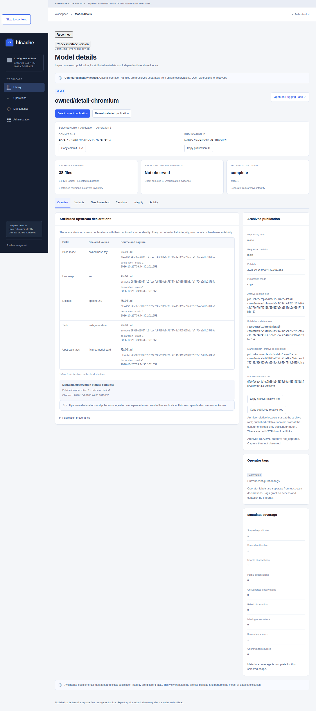
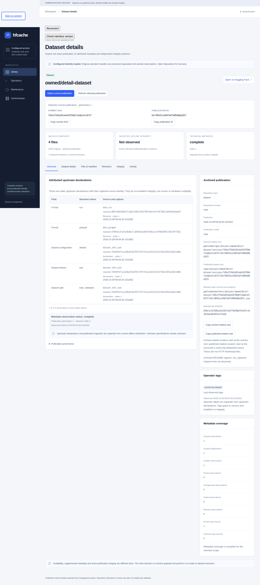
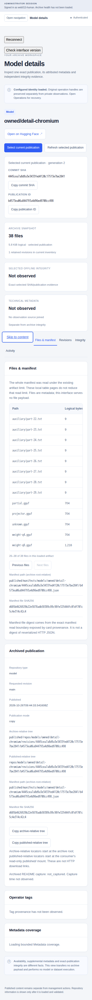

# Inspect an exact model or dataset publication

Repository details combine the existing local metadata APIs through the
authenticated HTTPS interface. Check [interface availability](README.md) before
using an installed release. These reads do not contact the Hub, refresh metadata,
transfer payload files or submit a job. The bounded [README view](readme-cards.md)
is implemented in unreleased source. Use [Configuration and tags](configuration-and-tags.md)
for deliberate managed edits and [Operations](operations.md#choose-a-job-and-its-effects)
for job forms; opening repository details submits neither.

## Open a repository and pin its publication

Follow a repository detail link from the [Library](library.md). Model and dataset
identities remain distinct even when their repository IDs match. The stable route
is `/ui/repositories/model/namespace/name` or its `dataset` equivalent, with the
installation's public prefix when present.

Opening without an exact selection reads the current reference separately, then
pins publication panels to its full commit SHA and publication ID. The address
retains that pair in a bounded fragment, for example this synthetic bookmark:

```text
https://archive.example/ui/repositories/model/owned/example#commit_sha=aaaaaaaaaaaaaaaaaaaaaaaaaaaaaaaaaaaaaaaa&publication_id=bbbbbbbbbbbbbbbbbbbbbbbbbbbbbbbb&tab=overview
```

The identifiers illustrate syntax, not an existing publication. Both identity
fields must be present or both omitted. The optional tab is `overview`, `details`,
`files`, `revisions`, `integrity` or `activity`. Fragments fit8192UTF-8 bytes;
unknown or repeated fields, malformed identifiers and a half-specified pair
refuse visibly. Shell query strings are not supported. The address cannot select
a server, arbitrary file or API endpoint.

Use **Revisions** to select an exact retained publication. The selected full SHA,
publication ID and generation identify the evidence shown by publication panels.
A selected retained pair must still agree with its full-SHA reference. An older
manifest/tree can remain preserved after repair; its existence alone does not
restore retained membership or authorize a new selected-publication view.
A repair can create a new publication at the same SHA. A newer current reference
does not change an existing selection; ordinary refresh stays pinned. Select current explicitly when that is
your intent with **Select current publication**. **Copy commit SHA** and
**Copy publication ID** retain the full identifiers. Reloading or revisiting an exact bookmark keeps that publication
instead of substituting whatever is current now.

Leaving details stops its local reads and releases the displayed evidence.
The bookmark still identifies the selected pair and tab. Returning reads that
selection afresh and rechecks retained membership before showing publication
data; a preserved manifest alone does not prove that publication is still retained.
Original operation handles and accepted jobs remain independent of this view.

An unpublished configured repository has no current publication. Its Library
configuration and tag facts do not manufacture one. An explicitly selected pruned, purged or
repaired-away publication is unavailable. Keep its original identifiers when
investigating; do not replace them with latest merely to make the page load.

## Read each tab as a different evidence class

| Tab | Evidence and limits |
| --- | --- |
| Overview | Repository/configuration facts, current or last-observed operator tags, attributed technical declarations, selected publication identity and available card/manifest provenance. The [README view](readme-cards.md#read-a-card-in-repository-details) distinguishes Rendered README, Sanitized source and non-present capture states. |
| Variants, for models | Exposed format/encoding, role, method/scheme/bits/group size, member paths and logical bytes, completeness, evidence and diagnostics. A detail listing is broader than the Library's positive primary-variant match. |
| Dataset details, for datasets | Static observed configs, splits, features and formats. These are declarations, without dataset loading, inferred row counts or model/GPU fields. |
| Files & manifest | Bounded file metadata, declared size/SHA256/provenance, exact manifest identity and labelled consumer locators. It is not an HTTP payload browser. |
| Revisions | Bounded authoritative retained-publication inventory. Current and selected publications are separate; loaded rows need not exhaust retained history. |
| Integrity | Existing verification evidence for the exact selected publication, separate from ingestion checks, technical observations and API readiness. |
| Activity | Explicitly loaded archive history and selected reports, with their extent and identity. It is not a complete repository audit or proof that unlisted work never happened. |

Changing tabs or publication invalidates superseded requests. A response for the
previous selection cannot supply a new selection's variants, card metadata,
manifest, sizes or integrity. Independently read panels are not one atomic global
snapshot; changed or contradictory identity remains explicit.

Use **Load more variants**, **Load more revisions** or **Load more runs** only
when you want the next bounded collection page. **Inspect report** reads the
selected original report from the currently loaded run IDs. Collection pages
contain at most25 rows and replace the previous page; each walk has at most32
positions. A stale cursor resets once, then remains an explicit refusal if it
drifts again. Loaded extent stays visible; these controls do not silently fetch
all history or submit work.

## Keep provenance and unknown values visible

Task, language, license, base-model and upstream-tag values are attributed
declarations. Their source path/digest, extraction version and observation time
describe how the metadata was obtained; they do not establish a fresh Hub state
or legal interpretation. Operator tags have their own current, last-observed or
unknown source. Known empty current tags override historical snapshots.

Open **Publication provenance** for the stored upstream endpoint, observation,
download and ingestion-check timestamps, and publishing application/Python/Hub
client versions. Those are publication-time facts, separate from the technical
extractor's observation and current offline verification.

**Dataset details** lists **Observed dataset formats** explicitly as well as
source-attributed configuration, split and feature declarations. A missing format
observation stays **Not observed**; it is not inferred from unrelated model data.

Model role and completeness are substantive. Adapters, projectors, auxiliary and
incomplete or unknown variants do not become positive complete-primary matches.
Names and filenames cannot establish parameter count, context length, loadability,
memory requirements or GPU suitability. Dataset fields remain static declarations;
a filename or split label does not establish a row count or executable loader.

Missing observations, unsupported extraction, failed reads and corrupt metadata
are different states. Zero declared bytes or files is not interchangeable with
unknown. Incomplete coverage stays visible, including zero known matches. A
supplemental panel can be unavailable while authoritative manifest or revision
inventory remains useful; do not rebuild or refresh automatically to hide that
distinction.

The **Metadata coverage** panel reports the selected scope's publication and
usable/partial/unsupported/failed/missing observation counts, plus known and
unknown tag sources. Its complete/incomplete statement qualifies metadata only;
it does not certify archived payloads. If the supplemental read fails, coverage
is unavailable rather than replaced with zero counts.

## Inspect files within the read budget

The manifest is a complete bounded artifact. The browser presents its accepted
file metadata locally; a smaller rendered window does not reduce the server's
underlying manifest scan or the browser's artifact read. Existing REST manifest
URLs do not accept file-table `limit` or `cursor` parameters.

Up to100 files use local25-row pages with **Next files** and **Previous files**.
Larger manifests use a scrollable virtualized table: only a finite window is
mounted, with the actual file count and row positions preserved. Focus the table
and use Arrow Up/Down, Page Up/Down, Home or End, or enter **File number** and choose
**Go to file**. The next/previous buttons move the window without another read.
Scrolling retains a focused row rather than silently removing its control.

Choose **Inspect metadata** to focus one file's complete path and metadata below
the table. Open **Hashes and provenance** for its exact evidence; **Return to
selected file** restores the table control. Long paths are shortened visually
only in the table and remain complete in selected metadata. Choosing another
publication resets this window and selection. No scrolling, jump or inspection
fetches a file payload or changes archive data.

Preserve the displayed total and loaded extent. An oversized artifact,
unsafe integer or exhausted read/parse budget refuses explicitly instead of
rounding a size, silently truncating a manifest or showing an empty success.
The shared session retains bounded encoded evidence; a panel can refuse even
when the backend can produce a larger artifact.
The response envelope and JSON escaping count toward the browser's byte limit;
a durable manifest file's size alone does not establish that its response fits.

File and variant counts and sizes are logical metadata, not physical disk usage,
deduplication savings, transfer requirements or hardware memory. Read file paths
as text. There is no raw weight/data download link or arbitrary path endpoint.

## Copy a locator with its labelled base

Before copying, confirm the selected type, ID, full SHA and publication ID.
Keep the generation and exact manifest evidence alongside the locator.
Use **Copy archive-relative tree** or **Copy published-relative tree** according
to the base you need; the labels are part of the locator's meaning.

- Reference `tree` and `manifest` locators are relative to the consumer's
  `published/` mount.
- The durable manifest `tree` and card `manifest_path` are relative to the archive
  root. They are not relative to the manifest's parent or an HTTP URL.
- The browser does not know your local consumer mount point. A copied locator
  is metadata, not a filesystem path guaranteed to exist on your workstation.

The manifest-file digest is displayed only from available exact card-read
provenance, including `not_captured`. It is not a hash of the HTTP response or
browser-reformatted JSON. If that read refuses, the digest remains unavailable;
an independently valid manifest need not disappear with it.

Follow [copy and verify](../consumers.md#2-the-contract-in-one-paragraph) for actual
payload consumption. The copy helper reads its own reference once per copy
attempt and verifies the complete copied path set, sizes and SHA256 digests.
Copying a browser locator neither transfers files nor replaces that verification.

## Interpret integrity and history conservatively

Current configured tags can be changed with **Edit tags**, which opens the shared
[Configuration and tags](configuration-and-tags.md) draft in Administration.
Read installed configuration explicitly if needed, then choose **Edit requested
repository** for that intent. Following the link does not automatically fetch or
prefill configuration from a catalog row.
This edits current operator intent even when an older publication is selected;
it changes no immutable manifest or selected tree. Unmanaged **Last observed**
tags are read-only. **Reconfigure repository** explicitly proposes a complete
entry, with its intended revision, enabled state, tags and dependencies. Neither
action directly mutates disk; both use the reviewed validation/preview/application
pipeline. Removing or disabling that entry preserves archived publications.

Ingestion verification in an immutable manifest describes its publication-time
checks. Offline verification state comes from existing exact-publication
verification evidence. A newer current publication's state cannot establish the
selected older publication's integrity. Missing or corrupt derived verification
confidence remains unverified or unavailable; inventory does not authorize
rebuilding it.

Technical completeness, an available README, its source-copy digest and a healthy
API do not mean a publication has just been verified. Reports can describe older
policy and archive state. A finding without an exact publication identity remains
repository/reference evidence rather than a finding about the selected tree.

Activity loads bounded archive history and reports explicitly. Report absence,
unreadable history or a partially loaded page is not proof of nonexecution.
Observing history submits no job and cannot cancel accepted work. Use
[original-operation recovery](operations.md) for an existing key or operation ID,
or [Jobs](operations.md#choose-a-job-and-its-effects) for a deliberately new operation.
Within a selected report, qualified repository entries match the selected type,
ID, SHA, publication ID and generation. Their local pages and report diagnostics
remain bounded; a newer publication cannot inherit a predecessor's report entry.

For a vanished publication, refused artifact, unavailable supplemental panel or
changed session, see [detail troubleshooting](troubleshooting.md#repository-details).

## Example screens

These screens show synthetic model and dataset metadata from an isolated test
installation of native test build 0.2.22. Their identifiers, tags, sizes and
observations are examples, not live archive facts.



The dataset overview keeps static declarations and historical operator tags
distinct from current configuration and payload integrity.



On a narrow screen, file metadata uses a bounded local page and a horizontally
scrollable table. Copy the locator whose labelled base matches your mount.
This capture shows loaded Files, while the separate coverage panel still shows
Loading; it does not establish supplemental metadata coverage.


